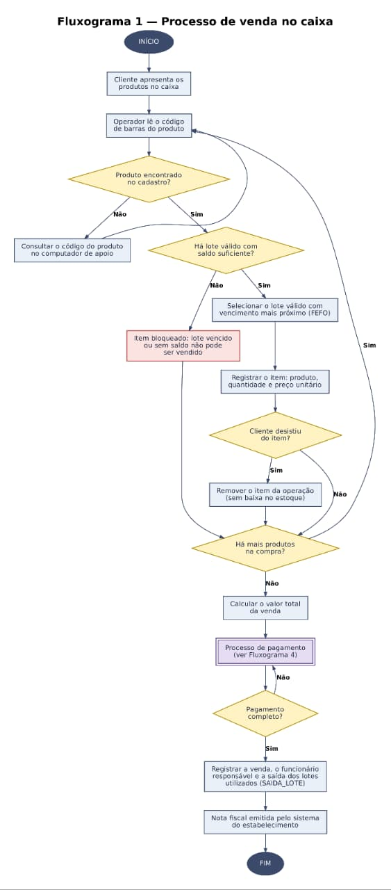
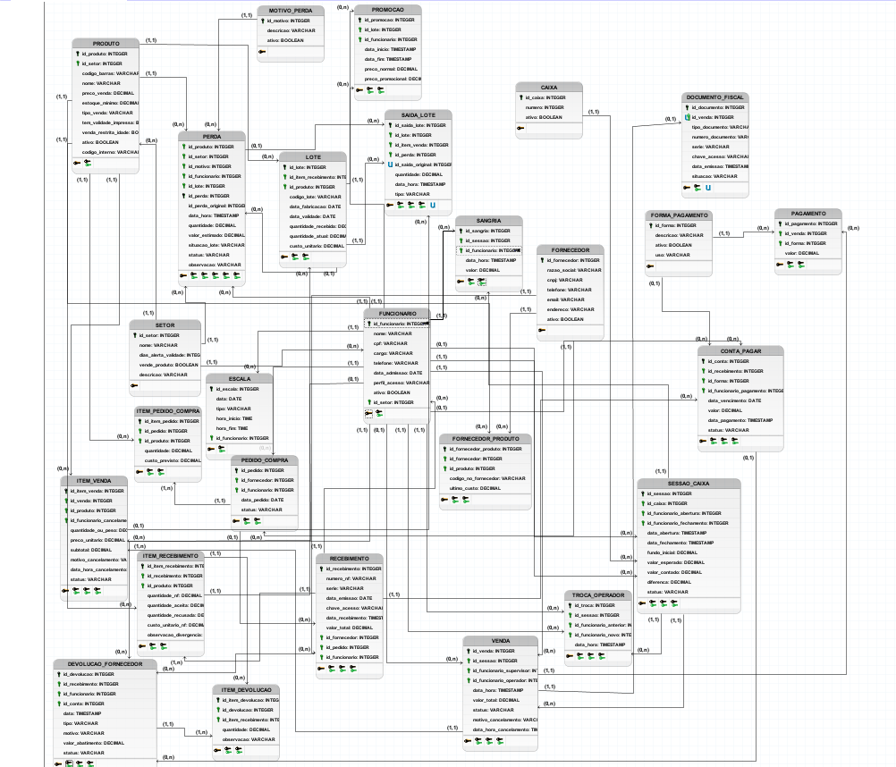

# Entrega 2 — Modelo Lógico, Implementação SQL e Apresentação Final

### Modelagem de um sistema de gestão de informações — Hortifruti União (Tatuapé)

## 1. Relatório Técnico Final

### Integrantes

| Nome completo do aluno | RGM | Usuário do GitHub |
| :---- | :---- | :---- |
| Gabriela Porfírio da Silva | 48017698 | porfiriogabis |
| Guilherme Damasceno dos Santos | 48491683 | damascenogs |
| Henrique Moura de Oliveira | 47610972 | HenriMoura666 |
| Lucas Praxedes da Silva | 47832550 | lucaspraxedes08sil-gif |
| Victor Hugo dos Santos Maciel | 48037630 | vhugo-sm |
| Tarcisio Santos de Oliveira | 47913061 | TarcisioT |


### 1.1 Revisão do Modelo Conceitual

#### Caracterização da organização

- **Nome e natureza da organização:** O Hortifruti União é um mercado localizado no bairro do Tatuapé, em São Paulo. É uma empresa privada que atua no varejo alimentício, tendo como principal atividade a venda de frutas, legumes e verduras. Além disso, o estabelecimento também conta com setores de padaria, frios, laticínios, alimentos embalados e produtos secos. É a mesma organização real que usamos na Entrega 1, e seguimos com ela nesta etapa.

  A organização foi escolhida pelo grupo para a realização do trabalho, sendo possível obter informações sobre seu funcionamento por meio de uma entrevista com um dos responsáveis pelo mercado.

- **Contexto e porte:** Para contextualizar o trabalho, tratamos o Hortifruti União como um mercado de médio porte considerando os números aproximados informados pelo responsável, como cerca de 110 funcionários e faturamento mensal estimado em R$ 5 milhões. Essa descrição é apenas contextual e não usa uma classificação legal específica. O mercado funciona todos os dias da semana, incluindo domingos e feriados.

  Durante a entrevista, o responsável compartilhou algumas informações sobre o tamanho e o funcionamento do estabelecimento. Como não tinha relatórios disponíveis no momento, os números foram informados de memória e devem ser considerados aproximados.

  - Cerca de 110 funcionários;
  - 7 caixas;
  - Cerca de 1.800 vendas por dia;
  - Aproximadamente 340 fornecedores;
  - Faturamento mensal estimado em R$ 5 milhões;
  - Cerca de 6 mil itens diferentes vendidos por mês.

  Para organizar os funcionários no modelo, o grupo também criou os setores internos Caixa e Retaguarda. Eles não representam setores de venda e não recebem produtos ou perdas, totalizando oito setores cadastrados no banco.

  Esses números ajudam a entender o tamanho da operação e a quantidade de informações que o mercado precisa controlar diariamente, principalmente em relação aos produtos, estoque, validade e perdas.

- **Problemas e necessidades identificados:**

  **P1 – Falta de controle sobre a perda de produtos**

  Esse foi o primeiro problema mencionado pelo responsável durante a entrevista. Como o mercado trabalha com muitos produtos frescos, parte deles acaba estragando quando não é vendida a tempo. Ele citou exemplos como frutas muito maduras, verduras murchas, tomates amassados e bananas que começam a escurecer.

  Essas perdas também acontecem em outros setores, como padaria, frios e laticínios. Além disso, existem situações em que os produtos são danificados pelos próprios clientes, como quando algum pote de vidro ou garrafa cai e quebra nos corredores. Há ainda os produtos que já chegam do fornecedor fora do padrão, como tomates moles ou alface murcha. Nesses casos, o mercado chama o fornecedor, que troca a mercadoria ou dá um abatimento na próxima nota.

  O principal problema identificado é a falta de um registro organizado dessas perdas. Atualmente, o mercado não consegue acompanhar com precisão quais produtos foram descartados, em que quantidade e por qual motivo. Sem essas informações, fica difícil identificar os setores com mais perdas e entender quanto isso representa de prejuízo.

  Por isso, uma das necessidades do mercado é ter um controle que permita registrar os produtos perdidos, suas quantidades, os motivos do descarte e os setores envolvidos. Dessa forma, seria possível consultar essas informações e acompanhar melhor as perdas do estabelecimento.

  **P2 – Falta de controle de validade dos produtos**

  Outro problema relatado pelo responsável foi a dificuldade em acompanhar as datas de validade dos produtos. Como o mercado comercializa cerca de 6 mil itens diferentes por mês, controlar todos os vencimentos acaba sendo uma tarefa complicada para a equipe.

  Segundo ele, alguns produtos acabam vencendo nas prateleiras ou no estoque, e muitas vezes os funcionários só percebem quando encontram algum item vencido durante a rotina de trabalho.

  O problema está na falta de um controle que permita consultar quais produtos estão próximos do vencimento. Sem essas informações organizadas, o mercado acaba perdendo a oportunidade de tomar alguma medida antes que os produtos vençam.

  Dessa forma, o estabelecimento precisa de um controle que permita registrar e consultar as datas de validade dos produtos, facilitando a identificação daqueles que estão próximos de vencer. Com essas informações, a equipe poderia se organizar melhor para realizar promoções, reorganizar os produtos nas prateleiras ou retirá-los da exposição quando necessário.

- **Escopo do sistema:** O banco de dados do Hortifruti União será desenvolvido para organizar as informações do mercado como um todo, e não apenas dos problemas de perda e validade dos produtos. Ele deverá incluir dados sobre funcionários e a escala de trabalho, fornecedores, produtos e setores, além de registros de compras, devoluções e trocas com fornecedores, vendas, estoque e pagamentos. Também será possível registrar as perdas e acompanhar as datas de validade dos produtos. Com essas informações reunidas em um só lugar, o mercado poderá ter um controle melhor das suas atividades e consultar os dados com mais facilidade.

  Vale lembrar que o VR Software, o sistema que o mercado já usa, tem recursos para registrar lote, validade e perdas, mas, segundo o responsável, eles não são usados no dia a dia. Por isso, o problema não é a falta de um sistema, e sim a falta de um registro organizado e fácil de consultar desses dados.

  Na prática, o grupo entrega uma **implementação acadêmica, independente do VR Software e com dados fictícios**, que representa os processos do mercado (compras, estoque, vendas, caixa, perdas e validade). Como não existe integração, uma venda feita no VR Software não aparece sozinha no nosso banco, e o banco não acompanha a operação real do mercado nem substitui o sistema que ele usa hoje.

- **Justificativa da escolha:** Escolhemos o Hortifruti União porque é um mercado de verdade, que lida todo dia com compras, recebimento de mercadorias, estoque e vendas. O Tarcisio, do nosso grupo, já trabalhou lá e conhece um dos proprietários, e foi isso que facilitou o contato com o mercado. Deixamos esse vínculo claro aqui, mas ele não substitui a comprovação da entrevista com o responsável, que apresentamos no relato abaixo. Também achamos que o mercado era um bom caso para o trabalho, porque os problemas de perdas, lotes e validade dos produtos podem ser organizados em um banco de dados relacional.

- **Evidências da organização:**

  - **Localização no Google Maps:** [Ver localização do Hortifruti União](https://www.google.com/maps/search/?api=1&query=Rua+Filipe+Camar%C3%A3o%2C+67%2C+Tatuap%C3%A9%2C+S%C3%A3o+Paulo)
  - **Perfil comercial no Google:** [Consultar perfil do Hortifruti União no Google](https://share.google/LWFseN2UxnhQwKsNh)
  - **Endereço:** Rua Filipe Camarão, nº 67, Tatuapé, São Paulo, CEP 03065-000
  - **Contato da organização:** (11) 91856-3865
  - **Responsável entrevistado:** Guilherme Takemoto
  - **Função:** um dos proprietários do Hortifruti União – Tatuapé
  - **Telefone de contato autorizado:** (11) 99317-0906


#### Relato da entrevista

- **Quem:** Guilherme Takemoto, um dos proprietários do Hortifruti União – Tatuapé. A entrevista e a visita foram feitas pelo Tarcisio, que já trabalhou no mercado. Os outros integrantes do grupo não participaram.

- **Quando e onde:** A entrevista inicial foi realizada em **22/09/2026**, por videochamada no WhatsApp. Depois, em **30/09/2026**, o Tarcisio foi até o mercado, na Rua Filipe Camarão, 67, no Tatuapé, para observar o funcionamento do local, tirar fotos e conversar presencialmente com o responsável.
  
- **O que foi levantado:** Conversamos sobre como o mercado funciona, quantos funcionários e fornecedores tem, o que vende e quais são os principais problemas. Também falamos sobre o VR Software, o controle de estoque, a validade, as perdas, as compras, as vendas e os pagamentos. Depois, em 26/10/2026, confirmamos com o responsável, por WhatsApp, alguns detalhes sobre pedidos, notas fiscais, formas de pagamento, fechamento de caixa, cadastro de clientes, fidelidade, vendas online, entregas, devoluções a fornecedores, escala dos funcionários, cancelamento de vendas, venda restrita por idade, validade dos produtos por setor e venda fiado.

- **O que o responsável contou:**
  - O mercado perde produtos frescos e de outros setores (padaria, frios e laticínios) por vencimento, por maturação excessiva ou por danos causados por clientes. Essas perdas não são registradas de forma organizada (P1).
  - Acompanhar a validade de cerca de 6 mil itens por mês é difícil, e os funcionários costumam perceber que um produto venceu só quando o encontram na rotina (P2).
  - O VR Software é o sistema da loja e cuida de venda e nota. Ele é usado para cadastrar produtos, dar entrada nas mercadorias, fazer pedidos de compra, operar o caixa, controlar o fiscal e o financeiro e fechar o dia. O sistema tem tela para registrar lote, validade e perdas, mas, segundo o responsável, isso só funciona se alguém cadastrar e baixar tudo todos os dias, o que é difícil com tantos itens. Na prática, esse controle não é feito.
  - Frutas, legumes e verduras geralmente não têm validade impressa e são avaliados visualmente pelos funcionários. Os produtos que têm validade impressa são os embalados e industrializados.
  - O prazo para considerar um produto próximo do vencimento varia conforme o setor.
  - O cancelamento de uma venda no caixa precisa da autorização de um supervisor.
  - Alguns produtos têm venda restrita por idade, e o operador precisa ficar atento a isso no atendimento.
  - O mercado não vende fiado. Todas as vendas são pagas no caixa.

- **O que observamos na visita (30/09/2026):**
  - A validade é conferida a olho nu pelos funcionários, sem etiqueta de controle, lista ou qualquer registro das datas (P2).
  - Os produtos perto de vencer recebem uma placa de promoção, sem consulta a uma lista de vencimentos (P2).
  - Os produtos descartados são apenas jogados fora, sem anotação de produto, quantidade, motivo ou setor (P1).
  - O estoque é organizado por setor.
  - Vimos os caixas funcionando, mas não vimos ninguém registrando validade ou perdas no sistema.

- **Comparação entre entrevista e observação:** a visita confirmou o que o responsável contou: a validade é conferida no olho, as perdas não são anotadas e o estoque é separado por setor. Isso também combina com o que ele disse sobre o VR Software: o sistema tem lugar para registrar validade e perdas, mas, na prática, nada disso é registrado. Não percebemos nenhuma divergência.

- **O que mudou em relação à Entrega 1:** na Entrega 1, o único problema levantado era o controle de validade dos produtos. Com a entrevista e a visita desta etapa, encontramos um problema novo: a falta de controle sobre as perdas (P1). Os números do mercado continuam os mesmos. Mudaram também duas coisas: a lista de formas de pagamento, em que o Pix não aparecia e agora entrou porque o responsável confirmou que o mercado aceita Pix, e a composição do grupo, já que Victor Hugo dos Santos Maciel, Guilherme Damasceno dos Santos e Lucas Praxedes da Silva entraram, e Henrico e Nicole saíram.

- **Comprovação:** As fotos tiradas na visita e os registros da entrevista e das confirmações ficam na pasta `imagens/evidencias/`. A entrevista de 22/09 foi realizada por videochamada no WhatsApp e é comprovada pelo [registro da videochamada](imagens/evidencias/entrevista_videochamada.jpeg). Como ela não aconteceu no ambiente do mercado, não temos uma foto da entrevista em si. A visita presencial de 30/09 está comprovada pelas fotos do local. Também incluímos os dois prints das confirmações feitas por WhatsApp em 26/10/2026: [primeiro print da confirmação](imagens/evidencias/resposta_proprietário1.jpeg) e [segundo print da confirmação](imagens/evidencias/resposta_proprietário2.jpeg).
  
- **Resumo do levantamento:** Pelo que o responsável explicou, a rotina do mercado funciona assim:
  - **De manhã (retaguarda):** cadastro dos produtos (código de barras, preço, setor, venda por quilo ou por unidade), conferência da nota do fornecedor e entrada no estoque quando a carga chega, e pedidos de compra feitos olhando o giro e os dias de estoque. O fiscal e o financeiro (notas e contas a pagar) também passam pelo sistema. Quando chega algum item fora do padrão, ele pode ser devolvido ou trocado pelo fornecedor, ou então gerar um abatimento na próxima nota.
  - **No caixa:** o operador abre o caixa com o fundo e passa os itens (os de peso vão pela balança). Existem consulta de preço, cancelamento e troca de operador. Cada venda baixa o estoque, na hora se o estoque online estiver ligado, ou depois que o escritório fecha a conferência do dia.
  - **Durante o dia:** repositores e gerência olham o que zerou ou está com pouco giro. Perdas poderiam ser baixadas no sistema, mas não são.
  - **No fim do dia:** fechamento do caixa, sangria e conferência. Depois o sistema junta as vendas do dia e alimenta o estoque, os relatórios e o fiscal.

- **Levantamento completo:** os processos e regras com mais detalhe estão em [levantamento/levantamento.md](levantamento/levantamento.md).

#### Processos de negócio

Com base na entrevista com o responsável, na visita ao Hortifruti União e nas confirmações feitas por WhatsApp em 26/10/2026, identificamos os principais processos que fazem parte da rotina do mercado. Como o estabelecimento trabalha com vários setores e uma grande quantidade de produtos, existem diferentes atividades que precisam ser organizadas e controladas diariamente. Os detalhes de cada processo estão no [levantamento completo](levantamento/levantamento.md).

Para ter certeza de que não esquecemos nenhum processo, comparamos a nossa lista com o que costuma existir em mercados e hortifrutis, usando o ChatGPT e pesquisas. Como usamos IA nessa conferência, o registro está na seção 6.

Os principais processos identificados foram:

1. **Cadastro de produtos:** O mercado utiliza o VR Software para cadastrar os produtos, registrando informações como código de barras, preço, setor e forma de venda, que pode ser por quilo ou unidade.

2. **Controle de fornecedores:** O mercado trabalha com aproximadamente 340 fornecedores, que abastecem os diferentes setores do estabelecimento. As informações desses fornecedores fazem parte dos dados que precisam ser organizados pelo sistema.

3. **Pedidos de compra:** Os pedidos são realizados conforme a necessidade de reposição, considerando o giro dos produtos e a quantidade de dias de estoque disponível.

4. **Recebimento de mercadorias:** Quando os produtos chegam ao mercado, é feita a conferência da nota fiscal do fornecedor e a entrada das mercadorias no estoque pelo sistema. Se algum item chega fora do padrão, ele pode ser devolvido ou trocado, como explicado no próximo item.

5. **Devolução e troca de mercadorias com fornecedores:** Quando chega mercadoria fora do padrão, como caixa de tomate mole, banana verde demais, alface murcha ou embalado amassado, o mercado chama o fornecedor. Normalmente ele troca o produto ou dá um abatimento na próxima nota. Segundo o responsável, isso acontece quase toda semana. Esse processo tem a ver com o controle de perdas, porque parte do que chega estragado não vira prejuízo para o mercado quando o fornecedor troca ou compensa a mercadoria.

6. **Controle de estoque:** Os produtos são organizados por setor, e os funcionários acompanham quais itens precisam ser repostos. As vendas também atualizam as quantidades em estoque, de forma imediata quando o controle online está ativado ou após a conferência do dia.

7. **Vendas e operação de caixa:** O mercado possui 7 caixas e realiza aproximadamente 1.800 vendas por dia. Os operadores abrem o caixa com o fundo, registram os produtos vendidos, usam a balança para os itens vendidos por peso, recebem o pagamento dos clientes e podem fazer consultas de preço, cancelamentos de venda e troca de operador. O mercado aceita pagamento em dinheiro, débito, crédito, Pix e vale-alimentação (VA), e as vendas são feitas de forma anônima, sem identificação do cliente.

8. **Controle financeiro e fiscal:** O VR Software também é utilizado para controlar notas fiscais, contas a pagar e pagamentos. No final do dia, são realizados o fechamento dos caixas, as sangrias e a conferência das vendas.

9. **Controle de validade e lote:** Os funcionários verificam as datas de validade diretamente nos produtos. Apesar de o sistema possuir recursos para registrar lote e validade, esse controle não é utilizado na prática, dificultando a identificação dos itens próximos do vencimento.

10. **Controle de perdas:** O mercado descarta produtos que estragam, vencem ou sofrem danos. Porém, essas perdas não são registradas de forma organizada, o que dificulta saber quais produtos foram perdidos, suas quantidades e os motivos.

11. **Promoções de produtos próximos do vencimento:** Quando os funcionários encontram produtos próximos da validade, eles podem receber uma placa de promoção para incentivar a venda antes do vencimento. Esse processo é feito por meio da observação dos produtos, sem uma lista de vencimentos.

12. **Gestão de funcionários e setores:** O mercado tem cerca de 110 funcionários e vários setores (hortifruti, padaria, frios, laticínios, alimentos embalados e produtos secos). O banco de dados vai guardar as informações sobre funcionários e setores, conforme o escopo definido para o sistema.

13. **Escala de trabalho dos funcionários:** Como o mercado abre todos os dias, inclusive domingos e feriados, existe uma escala para organizar o trabalho dos cerca de 110 funcionários. Hoje essa escala é feita em planilha, fora do VR Software. Mesmo sem ligação direta com os problemas de perdas e validade, ela é um processo real do mercado, e por isso entrou no nosso modelo.

##### Processos comuns que não foram incluídos no modelo

Em mercados e hortifrutis costumam existir outros processos além dos listados acima. Nas confirmações feitas com o responsável, verificamos que alguns deles não fazem parte da rotina do Hortifruti União e, por isso, não foram incluídos no modelo:

| Processo comum | Situação no Hortifruti União | Motivo de não entrar no modelo |
| :---- | :---- | :---- |
| Cadastro de clientes | Não realiza | As vendas são feitas de forma anônima no caixa, sem identificação do cliente. |
| Programa de fidelidade | Não possui | Não há cadastro de clientes nem desconto para clientes identificados. |
| Vendas pela internet ou aplicativo | Não realiza | O mercado vende apenas de forma presencial. |
| Entregas em domicílio | Não realiza | O mercado não faz entregas, nem com equipe própria nem com terceiros. |
| Venda fiado e crediário | Não realiza | Todas as vendas são pagas no caixa. |

##### Fluxogramas

**Fluxograma do processo de venda:**




O fluxograma acima mostra como uma venda acontece no caixa. As rotinas de compra, recebimento e fechamento de caixa estão descritas no resumo do levantamento e na lista de processos.

#### Requisitos do sistema

Os requisitos abaixo foram definidos a partir da entrevista de 22/09/2026, da visita de 30/09/2026 e das confirmações por WhatsApp de 26/10/2026. O que foi informado pelo responsável ou observado na visita é tratado como **levantamento**. Já os campos, validações e controles definidos pelo grupo para organizar o banco são tratados como **proposta**.

O banco será desenvolvido em MySQL como uma implementação acadêmica, independente do VR Software, com dados fictícios. Não há integração nem carga automática de dados do sistema atual, então o banco representa os processos do mercado, mas não acompanha a operação real.

##### Requisitos funcionais

###### Cadastros

| Código | Requisito | Dados envolvidos |
| :---- | :---- | :---- |
| RF01 | Cadastrar e atualizar setores. | Nome, descrição, dias de antecedência do alerta de validade e se o setor vende produto. |
| RF02 | Cadastrar, atualizar e inativar produtos. | Código interno (PLU), código de barras quando existir, nome, setor, unidade de venda, preço, estoque mínimo, situação, indicador de validade impressa e restrição de venda por idade. |
| RF03 | Cadastrar, atualizar e inativar fornecedores. | Razão social, CNPJ, telefone, e-mail, endereço e situação. |
| RF04 | Relacionar produtos aos fornecedores. | Fornecedor, produto, código do produto no fornecedor e último custo. |
| RF05 | Cadastrar formas de pagamento. | Descrição, uso (venda, fornecedor ou ambos) e situação. |
| RF06 | Cadastrar e inativar caixas. | Número e situação. |
| RF07 | Cadastrar motivos de perda. | Descrição e situação. |

###### Funcionários e escala

| Código | Requisito | Dados envolvidos |
| :---- | :---- | :---- |
| RF08 | Cadastrar, atualizar e inativar funcionários. | Nome, CPF, cargo, telefone, data de admissão, setor, perfil de acesso e situação. |
| RF09 | Registrar a escala de trabalho. | Funcionário, data, tipo (trabalho ou folga) e horários, quando for dia de trabalho. |
| RF10 | Consultar a escala por data, funcionário ou setor. | Funcionário, setor, data e horários. |

###### Compras e recebimento

| Código | Requisito | Dados envolvidos |
| :---- | :---- | :---- |
| RF11 | Registrar pedidos de compra e seus itens. | Fornecedor, funcionário, data, situação, produto, quantidade e custo previsto. |
| RF12 | Atualizar a situação do pedido, inclusive cancelá-lo, sem apagar o histórico. | Pedido, situação e data. |
| RF13 | Registrar o recebimento de mercadorias, com ou sem pedido anterior. | Fornecedor, pedido quando houver, funcionário, nota fiscal, datas e valor total. |
| RF14 | Registrar a conferência dos itens recebidos. | Produto, quantidade da nota, quantidade aceita, quantidade recusada, custo e observação. |
| RF15 | Registrar um ou mais lotes para os produtos aceitos no recebimento. | Produto, item recebido, código do lote quando houver, fabricação, validade quando houver, quantidade, saldo e custo. |
| RF16 | Registrar devolução, troca ou abatimento negociado com o fornecedor. | Fornecedor, recebimento, itens, quantidades, tipo, motivo, valor do abatimento, situação, funcionário e data. |
| RF17 | Consultar pedidos, recebimentos e divergências por fornecedor e período. | Quantidades pedidas, aceitas e recusadas. |

###### Estoque

| Código | Requisito | Dados envolvidos |
| :---- | :---- | :---- |
| RF18 | Consultar o saldo dos produtos a partir dos lotes. | Produto, setor, saldo total, saldo por lote e perdas ainda com lote a confirmar. |
| RF19 | Registrar saídas de lote e seus estornos. | Lote, quantidade, venda ou perda de origem, data e hora. |
| RF20 | Consultar produtos com estoque baixo ou pouco giro. | Produto, setor, saldo, estoque mínimo e quantidade vendida no período. |

###### Vendas e caixa

| Código | Requisito | Dados envolvidos |
| :---- | :---- | :---- |
| RF21 | Abrir a sessão de um caixa. | Caixa, operador, data, hora e fundo inicial. |
| RF22 | Registrar vendas e seus itens, sem identificar o cliente. | Sessão, data, situação, produto, quantidade ou peso, preço praticado, subtotal e total. |
| RF23 | Consultar o preço de um produto durante o atendimento. | PLU, código de barras ou nome, preço e unidade de venda. Como a promoção depende do lote, a consulta mostra o preço normal e avisa quando existe lote do produto em promoção vigente. O preço final de cada linha é fechado na conclusão da venda. |
| RF24 | Registrar o pagamento da venda em uma ou mais formas. | Venda, forma de pagamento e valor. |
| RF25 | Cancelar uma venda com autorização de supervisor, mantendo seu histórico e estornando, na mesma operação, as baixas de estoque dos itens da venda. | Venda, motivo, operador, supervisor, data e hora. |
| RF26 | Cancelar um ou mais itens enquanto a venda estiver em andamento, mantendo-os registrados como cancelados. | Venda, itens, motivo, operador, data e hora. |
| RF27 | Avisar o operador quando o produto tiver venda restrita por idade. | Produto e indicador de restrição. |
| RF28 | Registrar troca de operador no caixa. | Caixa, operador anterior, novo operador e horários. |
| RF29 | Registrar sangrias. | Sessão, valor, data, hora e funcionário. |
| RF30 | Fechar a sessão do caixa com a conferência dos valores. | Data, hora, funcionário que fechou, valor contado, valor esperado e diferença. |
| RF31 | Registrar os dados do documento fiscal relacionado à venda. | Venda, tipo, número, série, chave de acesso, data e situação. |
| RF32 | Consultar vendas por período, caixa, operador e forma de pagamento. | Totais de vendas concluídas e canceladas. |

###### Financeiro

| Código | Requisito | Dados envolvidos |
| :---- | :---- | :---- |
| RF33 | Registrar contas a pagar relacionadas às notas de recebimento. | Recebimento, vencimento, valor e situação. |
| RF34 | Registrar o pagamento de uma conta. | Conta, data, forma de pagamento, funcionário que registrou o pagamento e situação. |
| RF35 | Vincular abatimento do fornecedor à conta em que será descontado. | Devolução de origem, conta e valor abatido. |
| RF36 | Consultar contas por vencimento, situação e fornecedor. | Fornecedor, vencimento, valor e situação. |

###### Perdas (P1)

| Código | Requisito | Dados envolvidos |
| :---- | :---- | :---- |
| RF37 | Registrar perdas de produtos. | Data, produto, lote ou situação "lote a confirmar", quantidade, motivo, setor, funcionário, valor quando possível e observação. |
| RF38 | Consultar perdas por setor, motivo, produto e período. | Quantidades, valores e perdas com lote ainda a confirmar. |
| RF39 | Comparar perdas com mercadorias devolvidas, trocadas ou compensadas pelo fornecedor. | Período, fornecedor, setor, perdas e devoluções. |

###### Validade e promoções (P2)

| Código | Requisito | Dados envolvidos |
| :---- | :---- | :---- |
| RF40 | Consultar lotes próximos do vencimento conforme o prazo definido para o setor. | Produto, setor, lote, validade, dias restantes e saldo. |
| RF41 | Consultar lotes vencidos que ainda tenham saldo. | Produto, setor, lote, validade e saldo. |
| RF42 | Registrar promoções de lotes próximos do vencimento. | Lote, preço normal, preço promocional, início, fim e funcionário. |
| RF43 | Consultar promoções vigentes e encerradas. | Produto, lote, período e preços. |

##### Requisitos não funcionais

| Código | Característica | Requisito |
| :---- | :---- | :---- |
| RNF01 | Segurança | Cada usuário deve acessar somente as funções permitidas pelo seu perfil. |
| RNF02 | Rastreabilidade | Operações importantes devem registrar o funcionário e a data. Nas operações de caixa, venda, baixa de estoque e perda, registram também a hora. |
| RNF03 | Integridade | O banco deve utilizar chaves, campos obrigatórios, unicidade e restrições para evitar dados inválidos. |
| RNF04 | Confiabilidade | Operações que envolvem vários registros devem ser concluídas por inteiro ou não ser gravadas. |
| RNF05 | Histórico | Registros com movimentação não devem ser apagados, mas inativados ou cancelados. |
| RNF06 | Auditoria | Cancelamentos devem permitir identificar quem realizou e, quando necessário, quem autorizou a operação. |
| RNF07 | Proteção de dados | Dados pessoais de funcionários devem ter acesso restrito e a massa de testes deve utilizar dados fictícios. |
| RNF08 | Recuperação | O banco deve permitir cópia de segurança, restauração e recriação por meio do script SQL. |
| RNF09 | Desempenho | As consultas mais utilizadas devem possuir índices nas colunas mais usadas em filtros e relacionamentos, considerando o volume aproximado de 1.800 vendas por dia informado pelo responsável. A consulta de vendas por data foi testada com volume equivalente a 1.800 vendas por dia, acumulado por 30 dias, mas esse teste não representa o desempenho completo do sistema. |
| RNF10 | Disponibilidade | Em uma situação real de uso, o banco precisaria ficar disponível durante o horário de funcionamento do mercado, inclusive aos domingos e feriados. Como este projeto é acadêmico, essa disponibilidade contínua não foi testada. |
| RNF11 | Usabilidade | O registro de perdas deve ser simples e exigir somente as informações necessárias. |
| RNF12 | Compatibilidade | O banco será desenvolvido em MySQL, utilizando InnoDB e `utf8mb4`. |

##### Requisitos comuns não incluídos

Cadastro de clientes, programa de fidelidade, vendas online, entregas e venda fiado não viraram requisitos porque o responsável confirmou que o mercado não realiza esses processos.

---

#### Regras de negócio

**[Confirmada]** indica uma prática informada pelo responsável ou observada na visita.  
**[Proposta]** indica uma regra definida pelo grupo para organizar o banco.

- A numeração segue a ordem em que as regras foram criadas, e não a ordem de leitura. Por isso RN08A, RN52 a RN57 aparecem dentro dos grupos por assunto.

##### Cadastros

- **RN01 [Confirmada + Proposta]** O mercado cadastra produtos com código de barras, preço, setor e forma de venda. No banco, todo produto também terá um código interno único e nome.
- **RN02 [Confirmada + Proposta]** Produtos pesados podem utilizar etiqueta de código de barras e produtos a granel podem ser informados pelo código interno (PLU). O código interno será único.
- **RN03 [Proposta]** Cada produto terá um setor principal, e esse setor precisa ser um setor que vende produto. Caixa e Retaguarda existem só para organizar os funcionários e não recebem produto nem perda.
- **RN04 [Proposta]** O preço deve ser maior que zero e o estoque mínimo não pode ser negativo. O estoque mínimo também mostra quais produtos precisam de reposição: quando a quantidade disponível fica abaixo dele, o produto aparece na consulta de estoque baixo (RF20), que também informa se já existe pedido de compra em aberto.
- **RN05 [Proposta]** Produtos, fornecedores, funcionários e caixas com histórico não serão excluídos, apenas inativados.
- **RN06 [Proposta]** O CNPJ do fornecedor não poderá se repetir.
- **RN07 [Proposta]** O CPF do funcionário não poderá se repetir.
- **RN08 [Confirmada]** O mercado aceita pagamento em dinheiro, débito, crédito, Pix e vale-alimentação (VA). Essas formas serão registradas no cadastro de formas de pagamento do banco.
- **RN08A [Proposta]** Cada forma de pagamento tem um uso: venda, fornecedor ou ambos. A venda só aceita formas de uso "venda" ou "ambos", e a conta a pagar só aceita "fornecedor" ou "ambos". Por exemplo, boleto e transferência ficam só para fornecedor, e o Pix vale para os dois lados. Depois que a forma já foi usada em algum pagamento ou conta, o uso não pode mais ser mudado. Se precisar mudar, a forma antiga é desativada e uma nova é cadastrada, assim o histórico continua certo.

##### Compras e recebimento

- **RN09 [Confirmada + Proposta]** Os pedidos são definidos considerando giro e dias de estoque. Todo pedido terá fornecedor, data e ao menos um item. No banco, o pedido pode ter os status `aberto`, `parcial`, `recebido` ou `cancelado`.
- **RN10 [Confirmada + Proposta]** A nota do fornecedor é conferida no recebimento e não poderá ser cadastrada duas vezes.
- **RN11 [Confirmada + Proposta]** Pode haver recebimento sem pedido, e um pedido pode ter mais de um recebimento.
- **RN12 [Proposta]** Somente a quantidade aceita no recebimento entra no estoque.
- **RN13 [Confirmada + Proposta]** Mercadorias que chegam fora do padrão podem ser trocadas ou gerar abatimento e não são registradas como perda do mercado.

##### Lotes e estoque

- **RN14 [Proposta]** Todo lote estará relacionado a um produto recebido e terá quantidade positiva.
- **RN15 [Confirmada + Proposta]** Frutas, legumes e verduras geralmente não possuem validade impressa e são avaliados visualmente. Produtos que possuem validade impressa terão essa informação registrada no lote. Os demais serão acompanhados pelo controle de estoque e perdas.
- **RN16 [Proposta]** O saldo do produto será a soma dos saldos dos seus lotes. O saldo disponível para venda é esse saldo menos as perdas que ainda estão com lote a confirmar (RN42).
- **RN17 [Proposta]** Nenhuma saída poderá ultrapassar o saldo disponível do lote. Cancelamentos geram estorno, e não exclusão.
- **RN18 [Proposta]** Nas vendas, o sistema prioriza o lote que vence primeiro, seguindo a lógica FEFO (*First Expire, First Out*). Quando o produto não tiver validade registrada, prioriza o lote mais antigo.
- **RN19 [Proposta]** Neste banco, a baixa de estoque será registrada quando a venda for concluída. No mercado, a baixa pode ser imediata ou após a conferência do dia, conforme o controle online esteja ativado ou não.
- **RN53 [Proposta]** Ao concluir a venda, a quantidade de cada produto não pode passar do que existe no lote escolhido nem do saldo disponível do produto (RN16). Para evitar que duas operações mexam no mesmo estoque ao mesmo tempo, o banco trava o produto e os lotes enquanto confere o saldo. O mesmo cuidado vale para perdas e outras movimentações de estoque. Fizemos um teste com duas conexões: uma deixou o produto travado e a outra esperou a liberação para registrar uma perda. O teste deu certo nesse caso, mas não cobre todas as combinações possíveis de operações ao mesmo tempo.
- **RN57 [Proposta]** Enquanto a venda está em andamento, cada item é registrado com o produto, a quantidade ou o peso e o preço normal do cadastro, ainda sem lote. O lote só é escolhido quando a venda é concluída, pela procedure concluir_venda (RN18). Se o item sai de um lote só, a linha continua como está. Se precisa de mais de um lote, a linha é dividida em várias, uma para cada lote. O preço de cada linha é o promocional quando o lote tem promoção em vigor (RN47 e RN48) e o normal quando não tem. O lote de cada linha fica registrado na baixa de estoque (SAIDA_LOTE), que aponta para o item de venda. Os itens cancelados durante a venda (RN26) saem antes dessa etapa e não entram na escolha de lote. O produto do item e o produto do lote precisam ser o mesmo.

##### Vendas e pagamentos

- **RN20 [Proposta]** Toda venda estará ligada a uma sessão de caixa aberta e a um operador. O operador da venda precisa ser o operador da sessão naquele momento: quem abriu o caixa ou, se houve troca, o novo operador da última troca (RN29). O banco confere isso sozinho na hora de registrar a venda.
- **RN21 [Confirmada]** As vendas são anônimas, sem cadastro de clientes.
- **RN22 [Confirmada + Proposta]** Produtos vendidos por quilo aceitam quantidade decimal e produtos por unidade utilizam quantidade inteira. O banco guarda o peso informado na venda.
- **RN23 [Proposta]** O total da venda será a soma dos itens que não estiverem cancelados. O total fica definitivo na conclusão da venda.
- **RN24 [Confirmada]** O mercado não vende fiado e as vendas são pagas no caixa, podendo utilizar uma ou mais formas de pagamento na mesma venda.

##### Cancelamentos e vendas restritas

- **RN25 [Confirmada + Proposta]** O cancelamento de uma venda exige autorização de supervisor, e o funcionário que autoriza precisa ter perfil de supervisor ou gerência, conforme a validação da procedure. A venda cancelada permanece registrada e não entra nos totais.
- **RN26 [Proposta]** Um ou mais itens podem ser cancelados enquanto a venda estiver em andamento. O item permanece registrado, mas deixa de fazer parte do total.
- **RN27 [Confirmada + Proposta]** Produtos com venda restrita por idade serão identificados no cadastro e o sistema mostrará um aviso ao operador. O banco não armazenará documento do cliente.
- **RN28 [Proposta]** Cancelamento, perda e devolução ao fornecedor são situações diferentes. Uma mercadoria de venda cancelada não será registrada como perda.
- **RN54 [Proposta]** Quando uma venda já concluída é cancelada, todas as baixas de estoque dos itens ativos dela são estornadas na mesma transação, e cada baixa só pode ser estornada uma vez (RN17). Se algum passo falhar, nada é gravado (RNF04).
- **RN55 [Proposta]** Os pagamentos de uma venda cancelada continuam no histórico, mas a venda não entra no faturamento nem no valor esperado do caixa (RN25). O banco não registra a devolução do dinheiro ao cliente: cancelar é desfazer a venda inteira. Por isso o valor esperado do caixa considera que o dinheiro dessa venda voltou ao cliente ou nunca ficou lá. Como essa saída de dinheiro não fica registrada, uma diferença no fechamento causada por ela apareceria no banco sem explicação. Se um dia for preciso separar o que foi recebido do que foi devolvido, o pagamento vai precisar de um campo de situação. Isso ficou fora do nosso trabalho.

##### Caixa e fiscal

- **RN29 [Confirmada + Proposta]** Existe troca de operador e cada caixa terá somente uma sessão aberta por vez.
- **RN30 [Confirmada + Proposta]** O caixa é aberto com um fundo inicial, que não poderá ser negativo.
- **RN31 [Confirmada + Proposta]** Sangrias só poderão ser registradas em sessões abertas e com valor positivo.
- **RN32 [Confirmada + Proposta]** No fechamento, a diferença será calculada pelo valor contado menos o valor esperado.
- **RN33 [Confirmada + Proposta]** O processo fiscal continua sendo feito no sistema atual. O banco apenas armazenará os dados dos documentos relacionados às vendas.

##### Financeiro

- **RN34 [Confirmada + Proposta]** Contas a pagar relacionadas às compras terão vencimento, valor e recebimento de origem.
- **RN35 [Proposta]** Uma conta poderá estar aberta, paga ou cancelada. O modelo não registra pagamento parcial: a conta é paga de uma vez, pelo saldo a pagar.
- **RN36 [Proposta]** A conta a pagar mantém o valor original da nota. Os abatimentos do fornecedor ficam registrados em DEVOLUCAO_FORNECEDOR e são ligados à conta. O saldo a pagar é o valor da conta menos a soma dos abatimentos ligados a ela. Os abatimentos de uma conta não podem somar mais do que o valor dela, e só dá para ligar abatimento a uma conta que ainda está aberta.

##### Devoluções e abatimentos

- **RN37 [Confirmada + Proposta]** O responsável confirmou por WhatsApp que o mercado trabalha com devolução, troca e abatimento junto ao fornecedor quando há problema na mercadoria. No banco, a devolução fica ligada ao recebimento e não pode passar da quantidade recusada. Quando o fornecedor troca o produto, o que chega no lugar entra como um novo recebimento, sem pedido (RN11), e a devolução é registrada como troca (RF16). Quando há abatimento, aplica-se a RN38. O abatimento não muda o custo do lote, para que o custo da mercadoria continue igual ao da nota de origem.
- **RN38 [Confirmada + Proposta]** O abatimento concedido pelo fornecedor será relacionado a uma conta do mesmo fornecedor.
- **RN39 [Proposta]** Uma mercadoria devolvida, trocada ou compensada pelo fornecedor não será registrada também como perda.

##### Perdas

- **RN40 [Confirmada + Proposta]** O levantamento identificou perdas por vencimento, maturação excessiva e danos causados por clientes. Esses casos formam a base inicial de motivos, além da opção "Outros". Para dar variedade à massa fictícia, o grupo também incluiu quatro motivos adicionais de teste: quebra de embalagem, problema de armazenamento, qualidade inadequada e avaria no manuseio.
- **RN41 [Proposta]** Toda perda terá produto, quantidade, motivo, setor, funcionário, data e situação do lote.
- **RN42 [Proposta]** Quando o lote da perda for conhecido, a quantidade perdida será baixada desse lote. Se o lote não for conhecido, a perda ficará como "lote a confirmar" até que essa informação seja conferida. Enquanto estiver pendente, a quantidade é descontada do saldo disponível do produto (RN16), e uma perda pendente não pode ser maior que esse saldo disponível.
- **RN43 [Proposta]** Uma perda registrada não é apagada. Para corrigir uma perda (por exemplo, 15 kg registrados que eram 12 kg) ou dividi-la entre lotes (RN52), o registro original passa para a situação substituida, deixa de entrar nos totais e nas pendências, e a perda nova (ou as novas) fica ligada a ele. Se o original já tinha baixa em lote, essa baixa é estornada (RN17) e a perda nova faz a sua própria baixa. Só as perdas com situação valida entram nos indicadores.
- **RN44 [Proposta]** O valor da perda será calculado com base na quantidade e no custo do lote. Perdas sem lote confirmado ficarão sem valor até a identificação.
- **RN52 [Proposta]** Quando o lote de uma perda pendente é confirmado, o banco faz tudo de uma vez, na mesma transação: baixa a quantidade no lote (saída do tipo perda), marca a perda como confirmada e calcula o valor. A partir daí ela deixa de ser descontada como pendente, então a quantidade sai uma única vez do saldo disponível. A quantidade não pode passar do saldo do lote. Uma perda confirmada pertence a um lote só. Se a mercadoria perdida veio de mais de um lote do mesmo produto, a pendência original passa a `substituida` (RN43) e é trocada por uma perda para cada lote, todas ligadas a ela, e a soma das partes tem que dar a quantidade original. Como só as perdas válidas entram nos totais, nada é contado duas vezes.
##### Validade e promoções

- **RN45 [Confirmada + Proposta]** O prazo de alerta de validade varia conforme o setor. Cada setor que trabalha com validade impressa tem um número de dias definido. Os setores com dias_alerta_validade vazio (hortifruti, Caixa e Retaguarda) não geram alerta pelo setor. Se um produto desses setores tiver validade impressa (RN15), o lote dele usa um prazo padrão de 7 dias, definido pelo grupo. Esse prazo não é coluna do banco: ele aparece como constante na consulta G03, e para mudar o prazo basta editar o valor lá.
- **RN46 [Proposta]** Lote vencido na data da venda não pode ser vendido nem entrar em promoção. A conferência usa a data da operação e não a data de hoje.
- **RN47 [Confirmada + Proposta]** Produtos próximos do vencimento podem entrar em promoção, com preço inferior ao preço normal.
- **RN48 [Proposta]** A promoção terminará na data definida ou no vencimento do lote, o que acontecer primeiro.

##### Funcionários, escala e rastreabilidade

- **RN49 [Confirmada + Proposta]** O mercado funciona todos os dias e organiza a escala em planilha. No banco, dias de trabalho terão horário de início e fim; folgas terão apenas a data.
- **RN50 [Proposta]** Funcionários inativos não poderão realizar novas operações, mas seu histórico será mantido.
- **RN51 [Proposta]** Dados pessoais dos funcionários, e os contatos de fornecedor que for pessoa física ou MEI, serão acessíveis somente a usuários autorizados, por causa da LGPD.
- **RN56 [Proposta]** Todo fechamento de sessão de caixa e todo pagamento de conta a pagar guardam o funcionário que fez a operação, além da data e da hora (por isso `data_pagamento` e `data_fechamento` são `DATETIME`). Esse funcionário precisa estar ativo (RN50).

##### Regras comuns não incluídas

Não criamos regras para cadastro de clientes, fidelidade, entrega e venda a prazo, porque o responsável confirmou que esses processos não fazem parte da rotina do mercado.

- **Aferição da balança (Inmetro):** o banco só guarda o peso informado na venda (RN22), e o grupo não confirmou com o responsável como a aferição é feita.

##### Rastreabilidade dos problemas P1 e P2

| Problema | Requisitos funcionais | Regras de negócio | Como contribuem |
| :---- | :---- | :---- | :---- |
| **P1 – Falta de controle sobre a perda de produtos** | RF07, RF14, RF16, RF19, RF37 a RF39 | RN12, RN13, RN17, RN28, RN37 a RN44 e RN52 | Permitem registrar e consultar as perdas por produto, quantidade, motivo e setor, além de separar perdas de devoluções e compensações de fornecedores. |
| **P2 – Falta de controle de validade dos produtos** | RF01, RF02, RF15, RF18 e RF40 a RF43 | RN14 a RN16, RN18, RN45 a RN48 e RN57 | Permitem registrar a validade dos lotes, identificar produtos próximos do vencimento ou vencidos e acompanhar promoções antes do vencimento. |

A relação entre os problemas, as tabelas do banco e as consultas SQL será detalhada posteriormente na seção 1.6.

---

#### DER conceitual revisado

O DER conceitual foi revisado com base na entrevista, na visita ao Hortifruti União, nas confirmações feitas com o responsável e nos apontamentos recebidos na Entrega 1.

O diagrama foi desenvolvido no **brModelo 3.2.0**, utilizando a notação conceitual solicitada: entidades, atributos, relacionamentos e cardinalidades mínimas e máximas. As chaves estrangeiras não aparecem no DER, pois são tratadas somente no modelo lógico.

**Arquivo do diagrama:** [Visualizar DER Conceitual](diagramas/der.conceitual.png)


O modelo representa os principais processos levantados no mercado, incluindo produtos, fornecedores, compras, recebimentos, lotes, estoque, perdas, vendas, pagamentos, caixa, funcionários e escala.

O DER possui **22 entidades** e cinco associações com atributos. Entre elas estão os itens de pedido, recebimento, devolução e venda, além da relação entre fornecedor e produto. No modelo lógico, essas associações são convertidas em tabelas próprias.

A modelagem mantém **PERDA** separada de **DEVOLUCAO_FORNECEDOR**, porque uma representa prejuízo do mercado e a outra representa mercadoria devolvida, trocada ou compensada pelo fornecedor. A validade é registrada no **LOTE**, permitindo que diferentes recebimentos do mesmo produto tenham datas de validade diferentes.

Os detalhes da conversão das entidades, atributos, relacionamentos e cardinalidades para tabelas e chaves estão apresentados nas seções **1.2 e 1.3**.

##### Revisão em relação à Entrega 1

Revisamos o modelo com base nos apontamentos da Entrega 1 e nas informações novas do mercado. A principal mudança foi sair de um modelo focado em produtos, estoque e vendas para um que cobre também os outros processos da organização.

**Apontamentos da correção da Entrega 1**

| Apontamento da correção da E1 | O que mudou no trabalho | Por quê |
| :--- | :--- | :--- |
| DER anexado no editor do GitHub | Virou uma imagem referenciada no README | O professor exige o arquivo no repositório. |
| Cardinalidades só com o máximo | Passaram a ter mínimo e máximo | Mostra o que é obrigatório e o que é opcional. |
| Chaves estrangeiras no conceitual | Foram retiradas | Pertencem ao modelo lógico. |
| Venda e produto incompletos | Criamos a entidade associativa VENDA–PRODUTO, com quantidade, preço e situação de cada item (vira a tabela ITEM_VENDA no lógico) | Precisamos da quantidade e do preço de cada produto vendido. |
| Sem entidade de lotes | Criamos LOTE | O controle de validade depende de cada lote. |
| Sem PEDIDO e ciclo de compra incompleto | Incluímos pedidos, recebimentos, contas a pagar e os itens de pedido e de recebimento (associações com atributos) | Fazem parte da rotina do mercado. |
| Entidade CLIENTE | Foi retirada | As vendas não têm cadastro de cliente. |
| Faltava a operação dos caixas | Incluímos caixa, sessão, pagamento, sangria e troca de operador | O banco precisa mostrar o que acontece no atendimento. |
| Entidade CATEGORIA | Trocada por SETOR | O mercado organiza por setor, e o prazo de alerta de validade varia conforme o setor. A validade de cada produto fica registrada no lote. |
| Perdas não representadas | Criamos PERDA, MOTIVO_PERDA e as ligações | Foi um dos principais problemas do levantamento. |
| Sem funcionários e escalas | Incluímos FUNCIONARIO e ESCALA | São cerca de 110 funcionários e a escala é feita em planilha. |
| Justificativas pouco detalhadas | Passamos a explicar as alternativas e os motivos | Mostra por que cada coisa faz sentido para o mercado. |
| Processos: faltava o fluxo do ciclo de compra e do fechamento de caixa | Mantivemos o fluxograma de vendas. O ciclo de compra, o recebimento e o fechamento de caixa estão explicados em texto, na seção de processos | A venda é o processo principal do caixa, e as outras duas rotinas estão descritas no levantamento. |
| Regras: Inmetro, LGPD, estoque mínimo e permissões | LGPD, estoque mínimo e permissões passaram a constar explicitamente nas regras e requisitos do projeto (RN04, RN25, RN51, RNF01 e RNF07). A aferição da balança pelo Inmetro ficou fora do banco e foi justificada no texto de regras comuns não incluídas. | Os três primeiros pontos foram incorporados ao projeto. O Inmetro não foi modelado porque o banco apenas recebe o peso informado pela venda e o grupo não confirmou com o responsável como é feita a aferição da balança. |
| Entrevista e evidências | Nova entrevista (22/09), visita (30/09) e confirmações por WhatsApp (26/10), com fotos e prints no repositório | A comprovação ficou mais completa e os registros ficaram reunidos no repositório. |
| Dicionário de dados | Ficou em um arquivo Markdown separado, `docs/Dicionario_Dados.md` | A turma é GTI. |
| Anexos no GitHub | DER, modelo lógico, script, fotos, prints e levantamento ficam em pastas do repositório e têm link no README | O professor corrige pelo repositório. |
| Forma de pagamento Pix | Entrou no cadastro de formas de pagamento | O responsável confirmou que o mercado aceita Pix. |
| Integrantes | Victor Hugo, Guilherme e Lucas entraram, Henrico e Nicole saíram | Mudança do grupo desde a Entrega 1. |
| Fornecedor–produto modelado como 1:N | Revisamos para N:N e criamos a associação FORNECEDOR_PRODUTO, que no modelo lógico virou uma tabela própria | Um fornecedor pode fornecer vários produtos e o mesmo produto pode estar relacionado a mais de um fornecedor. A associação também guarda o código do produto no fornecedor e o último custo. |
| Dicionário: CPF, CNPJ, telefone e código de barras tratados como número | Esses campos passaram a utilizar `VARCHAR` no modelo lógico e no dicionário | São identificadores ou textos de contato, não valores usados em cálculos, e podem possuir zeros à esquerda. |
| Dicionário: faltavam versão/data e índices | O dicionário foi atualizado com a versão do MySQL utilizada, data de revisão e os índices definidos no banco | Essas informações passaram a documentar com mais precisão a implementação entregue. |
| Dicionário: log de acesso | O grupo não criou um log genérico de acesso. A rastreabilidade das operações foi feita por FKs para FUNCIONARIO nas operações relevantes, e o controle de acesso foi representado por roles e permissões do MySQL | Mantivemos essa decisão porque o usuário técnico que executa um comando no banco não identifica necessariamente o funcionário responsável pela operação. |
| Dicionário e DER: cardinalidades incompletas ou incorretas | As cardinalidades foram revisadas e passaram a mostrar mínimo e máximo nos dois lados dos relacionamentos | A revisão deixa explícito o que é obrigatório, opcional, único ou múltiplo em cada relacionamento. |

Além dos apontamentos, incluímos por conta própria o estorno em SAIDA_LOTE, ligado à baixa original, para corrigir baixas sem apagar o histórico, e as ligações que dizem quem fechou o caixa e quem pagou a conta (relacionamentos 46 e 47) e a que liga uma perda corrigida à original (48).

### 1.2 Conversão do Modelo Conceitual para o Modelo Lógico

Convertemos o DER conceitual feito no brModelo para o modelo lógico utilizado na implementação em MySQL.

**Entidades e associações → tabelas.** As 22 entidades do DER viraram 22 tabelas. As cinco associações com atributos — fornecedor/produto e os itens de pedido, recebimento, devolução e venda — também viraram tabelas próprias: `FORNECEDOR_PRODUTO`, `ITEM_PEDIDO_COMPRA`, `ITEM_RECEBIMENTO`, `ITEM_DEVOLUCAO` e `ITEM_VENDA`. Com isso, o modelo lógico possui **27 tabelas**.

**Atributos → colunas.** Os atributos do DER foram convertidos em colunas das tabelas. Os identificadores passaram a ser chaves primárias numéricas com `AUTO_INCREMENT`. Textos e identificadores como CPF, CNPJ, telefone e código de barras utilizam `VARCHAR`; valores monetários utilizam `DECIMAL`; quantidades e pesos permitem casas decimais; datas e horários utilizam `DATE`, `DATETIME` ou `TIME`, conforme o caso.

**Relacionamentos → chaves estrangeiras.** Os relacionamentos do DER foram convertidos em chaves estrangeiras. As cinco tabelas criadas a partir das associações possuem duas FKs principais, uma para cada lado da associação. Os demais relacionamentos foram representados por FKs nas tabelas correspondentes. O modelo lógico possui **53 chaves estrangeiras**.

**Cardinalidades.** As cardinalidades mínimas e máximas do DER orientaram a obrigatoriedade das chaves estrangeiras. Quando a participação é obrigatória, a FK utiliza `NOT NULL`; quando o relacionamento é opcional, a FK pode aceitar `NULL`. Relacionamentos N:N foram convertidos em tabelas associativas.

Alguns relacionamentos possuem tratamento específico no modelo lógico, como o autorrelacionamento de `SAIDA_LOTE` para registrar estornos, o autorrelacionamento de `PERDA` para manter o histórico de correções e as diferentes ligações de `FUNCIONARIO` com operações como venda, troca de operador, fechamento de caixa e pagamento de conta.

**Generalização/especialização.** O DER não possui generalização ou especialização, portanto não foi necessário aplicar uma estratégia específica de conversão.

### 1.3 Definição de Chaves Primárias e Estrangeiras

Todas as 27 tabelas têm chave primária própria, com o prefixo `id_`. As chaves estrangeiras seguem os relacionamentos explicados na seção 1.2 e somam 53: 43 vindas dos relacionamentos simples e 10 das cinco tabelas de associação (duas em cada).

| Tabela | Chave primária (PK) | Chaves estrangeiras (FK) |
| :--- | :--- | :--- |
| `SETOR` | `id_setor` | Não possui |
| `PRODUTO` | `id_produto` | `id_setor` |
| `FORNECEDOR` | `id_fornecedor` | Não possui |
| `FORNECEDOR_PRODUTO` | `id_fornecedor_produto` | `id_fornecedor`, `id_produto` |
| `FUNCIONARIO` | `id_funcionario` | `id_setor` |
| `ESCALA` | `id_escala` | `id_funcionario` |
| `FORMA_PAGAMENTO` | `id_forma` | Não possui |
| `CAIXA` | `id_caixa` | Não possui |
| `PEDIDO_COMPRA` | `id_pedido` | `id_fornecedor`, `id_funcionario` |
| `ITEM_PEDIDO_COMPRA` | `id_item_pedido` | `id_pedido`, `id_produto` |
| `RECEBIMENTO` | `id_recebimento` | `id_fornecedor`, `id_pedido`, `id_funcionario` |
| `ITEM_RECEBIMENTO` | `id_item_recebimento` | `id_recebimento`, `id_produto` |
| `DEVOLUCAO_FORNECEDOR` | `id_devolucao` | `id_recebimento`, `id_funcionario`, `id_conta` |
| `ITEM_DEVOLUCAO` | `id_item_devolucao` | `id_devolucao`, `id_item_recebimento` |
| `CONTA_PAGAR` | `id_conta` | `id_recebimento`, `id_forma`, `id_funcionario_pagamento` |
| `LOTE` | `id_lote` | `id_item_recebimento`, `id_produto` |
| `SAIDA_LOTE` | `id_saida_lote` | `id_lote`, `id_item_venda`, `id_perda`, `id_saida_original` |
| `MOTIVO_PERDA` | `id_motivo` | Não possui |
| `PERDA` | `id_perda` | `id_produto`, `id_setor`, `id_motivo`, `id_funcionario`, `id_lote`, `id_perda_original` |
| `PROMOCAO` | `id_promocao` | `id_lote`, `id_funcionario` |
| `SESSAO_CAIXA` | `id_sessao` | `id_caixa`, `id_funcionario_abertura`, `id_funcionario_fechamento` |
| `TROCA_OPERADOR` | `id_troca` | `id_sessao`, `id_funcionario_anterior`, `id_funcionario_novo` |
| `SANGRIA` | `id_sangria` | `id_sessao`, `id_funcionario` |
| `VENDA` | `id_venda` | `id_sessao`, `id_funcionario_operador`, `id_funcionario_supervisor` |
| `ITEM_VENDA` | `id_item_venda` | `id_venda`, `id_produto`, `id_funcionario_cancelamento` |
| `PAGAMENTO` | `id_pagamento` | `id_venda`, `id_forma` |
| `DOCUMENTO_FISCAL` | `id_documento` | `id_venda` |

### 1.4 Processo de Normalização (1FN, 2FN e 3FN)

A normalização foi aplicada para evitar repetição desnecessária de informações e manter os dados organizados entre os diferentes processos do mercado.

#### Primeira Forma Normal (1FN)

Na 1FN, cada campo deve armazenar apenas um valor e não deve existir uma lista de informações dentro da mesma coluna.

Por isso, itens de venda, itens de pedido, itens de recebimento, itens de devolução e pagamentos foram separados em registros próprios. Uma venda com vários produtos, por exemplo, possui uma linha em `ITEM_VENDA` para cada item, e uma venda com mais de uma forma de pagamento possui vários registros em `PAGAMENTO`.

Essa separação permite consultar, calcular e alterar cada item individualmente.

#### Segunda Forma Normal (2FN)

Na 2FN, os atributos devem depender da chave que identifica o registro inteiro.

As tabelas do projeto utilizam chaves primárias simples, como `id_item_venda` e `id_item_pedido`. Nas tabelas que representam relações entre registros, mantivemos somente as informações que pertencem àquela relação.

Por exemplo, em `FORNECEDOR_PRODUTO`, o código usado pelo fornecedor e o último custo pertencem à relação entre aquele fornecedor e aquele produto. Os dados cadastrais do fornecedor permanecem em `FORNECEDOR` e os dados do produto permanecem em `PRODUTO`.

Isso evita repetir informações de cadastro em várias linhas.

#### Terceira Forma Normal (3FN)

Na 3FN, evitamos que uma informação dependa de outro atributo que não seja a chave do registro.

Por isso, nomes de setores ficam em `SETOR`, motivos de perda ficam em `MOTIVO_PERDA` e formas de pagamento ficam em `FORMA_PAGAMENTO`, em vez de repetir esses textos em vendas, perdas e outros registros.

Alguns valores são mantidos propositalmente para preservar o histórico. O preço registrado em um item de venda, por exemplo, representa o valor praticado naquele momento e não deve mudar caso o preço atual do produto seja alterado.

Também existem campos derivados, como `ITEM_VENDA.subtotal` e `SESSAO_CAIXA.diferenca`, calculados pelo próprio banco. O `VENDA.valor_total` é definido no momento da conclusão da venda após a conferência dos itens e pagamentos.

Com a normalização, os dados ficam mais consistentes, reduzem-se repetições desnecessárias e alterações em um cadastro não precisam ser feitas em várias tabelas.

### 1.5 Justificativas Técnicas das Decisões

Nesta seção explicamos as principais escolhas feitas no banco e como elas ajudam a manter os dados corretos.

#### Chaves primárias e estrangeiras

Todas as tabelas possuem uma chave primária numérica própria. Escolhemos esse padrão porque dados como nome, CPF, CNPJ ou código de barras podem precisar de correção, enquanto o identificador interno do registro não muda.

As chaves estrangeiras seguem os relacionamentos definidos no DER e no modelo lógico. Elas garantem, por exemplo, que um produto esteja ligado a um setor existente, que um item de venda pertença a uma venda e que um lote esteja relacionado a um produto recebido.

Também usamos `ON DELETE RESTRICT` nos relacionamentos com histórico. Assim, um cadastro que já foi usado em alguma operação não pode simplesmente ser apagado (RN05).

#### Restrições de integridade

As principais regras do projeto foram aplicadas com `NOT NULL`, `UNIQUE`, `CHECK`, chaves estrangeiras, triggers e procedures.

| Regra aplicada | Como foi tratada no banco | Regra relacionada |
| :--- | :--- | :--- |
| Código interno, CPF e CNPJ não podem se repetir | `UNIQUE` | RN02, RN06 e RN07 |
| Produto deve estar ligado a um setor | FK obrigatória em `PRODUTO` | RN03 |
| Preço deve ser positivo e estoque mínimo não pode ser negativo | `CHECK` | RN04 |
| Registros com histórico não devem ser apagados | Campo de situação e `ON DELETE RESTRICT` | RN05 |
| Nota fiscal do fornecedor não pode ser cadastrada duas vezes | `UNIQUE` | RN10 |
| Quantidade aceita e recusada deve bater com a quantidade recebida | `CHECK` e validações do SQL | RN12 e RN14 |
| Estoque não pode ficar negativo | `CHECK`, triggers e procedures | RN16 e RN17 |
| Venda deve estar ligada a uma sessão de caixa válida | FK e validações do SQL | RN20 e RN29 |
| Venda concluída deve ter itens e pagamento completo | Procedure de conclusão da venda | RN23 e RN24 |
| Cancelamento precisa manter o histórico | Situação da venda e estorno das baixas | RN25 e RN54 |
| Perdas precisam guardar produto, motivo, setor e responsável | Campos obrigatórios e FKs | RN40 e RN41 |
| Lote vencido não pode ser vendido | Validação no SQL | RN46 |
| Promoção deve ter preço menor que o normal | `CHECK` e validação do lote | RN47 e RN48 |
| Funcionário inativo não deve realizar novas operações | Validação nas operações do banco | RN50 |
| Fechamento de caixa e pagamento de conta guardam o responsável | FKs para `FUNCIONARIO` | RN56 |

Algumas regras não conseguem ser garantidas apenas com uma chave ou um `CHECK`, porque dependem de informações de várias tabelas. Nesses casos usamos triggers ou procedures.

As triggers cuidam principalmente de validações feitas no momento em que um registro é inserido ou alterado. As procedures são usadas nos processos que envolvem várias etapas, como concluir ou cancelar uma venda, registrar recebimentos, confirmar perdas e fechar uma sessão de caixa.

As consultas de auditoria A01 a A12 complementam essas validações e ajudam a localizar possíveis inconsistências nos dados.

#### Decisões gerais do modelo

Algumas escolhas foram importantes para manter o banco mais organizado.

O estoque não recebeu uma tabela separada. O saldo é controlado pelos lotes e pelas movimentações, evitando manter a mesma informação em dois lugares.

A validade também ficou no lote, e não no produto, porque o mesmo produto pode chegar em datas diferentes e ter vencimentos diferentes.

As perdas ficaram separadas das devoluções ao fornecedor. Uma perda representa um prejuízo do mercado, enquanto uma devolução, troca ou abatimento pode ser compensada pelo fornecedor.

As formas de pagamento ficaram em um único cadastro, que informa se cada forma pode ser usada em vendas, pagamentos a fornecedores ou nos dois casos.

Também registramos o funcionário responsável pelas principais operações. Isso permite saber quem abriu ou fechou um caixa, registrou uma perda, realizou uma venda ou efetuou um pagamento, atendendo à necessidade de rastreabilidade do projeto.

#### Tecnologia utilizada

O banco foi desenvolvido em **MySQL 8.0**, utilizando tabelas InnoDB e `utf8mb4`.

Também foram criados índices nas colunas mais utilizadas em filtros e relacionamentos, principalmente nas consultas de vendas, perdas, lotes e contas a pagar, para ajudar no desempenho considerando o volume informado pelo responsável (RNF09).

O banco é uma implementação acadêmica e independente do VR Software utilizado pelo mercado. Não existe integração automática entre os dois sistemas.

### 1.6 Proposta de Arquitetura Analítica para BI e IA

Os dados do banco podem ajudar a gestão do mercado a acompanhar melhor perdas, validade, estoque, vendas, fornecedores e contas a pagar.

#### Informações estratégicas

Com os dados registrados, seria possível responder perguntas como:

- quais setores e produtos têm mais perdas;
- quais motivos de perda aparecem com mais frequência;
- quais lotes estão próximos do vencimento;
- quais fornecedores entregam mais produtos fora do padrão;
- quais produtos estão abaixo do estoque mínimo;
- como estão o faturamento e o ticket médio;
- quantas vendas são canceladas;
- quais contas estão vencidas ou próximas do vencimento.

Essas informações podem ser usadas em relatórios e painéis para ajudar nas decisões do dia a dia.

#### Indicadores gerenciais

Os indicadores abaixo foram escolhidos porque podem ser calculados com os dados existentes no banco.

| Código | Indicador | Período | Consulta SQL |
| :--- | :--- | :--- | :--- |
| KPI01 | Custo das perdas em relação às vendas do setor | Mensal | G01 |
| KPI02 | Ocorrências de perda por motivo | Mensal | G02 |
| KPI03 | Lotes próximos do vencimento | Diário | G03 |
| KPI04 | Lotes vencidos com saldo | Diário | G04 |
| KPI05 | Faturamento das vendas concluídas | Diário | G05 |
| KPI06 | Ticket médio das vendas concluídas | Diário | G06 |
| KPI07 | Produtos abaixo do estoque mínimo | Diário | G07 |
| KPI08 | Taxa de cancelamento de vendas | Mensal | G08 |
| KPI09 | Quantidade recusada por fornecedor | Por período | G09 |
| KPI10 | Contas abertas e vencidas | Por vencimento | G10 |
| KPI11 | Perdas com lote ainda não confirmado | Mensal | G11 |

As metas usadas durante a demonstração são apenas referências do grupo. Elas não foram definidas pelo responsável do mercado e não representam metas reais da organização.

A consulta G12 acompanha promoções vigentes e encerradas. Ela foi mantida como uma consulta gerencial complementar e não como um KPI separado.

#### Rastreabilidade entre problemas, indicadores e consultas

| Problema ou indicador | Tabelas principais | Consulta no script |
| :--- | :--- | :--- |
| P1 — Falta de controle das perdas | PERDA, MOTIVO_PERDA, PRODUTO, SETOR | G01, G02, G11 |
| P2 — Falta de controle de validade | LOTE, PRODUTO, SETOR, PROMOCAO | G03, G04, G12 |
| KPI01 — Custo das perdas | PERDA, SETOR, PRODUTO, ITEM_VENDA, VENDA | G01 |
| KPI02 — Perdas por motivo | PERDA, MOTIVO_PERDA | G02 |
| KPI03 — Lotes próximos do vencimento | LOTE, PRODUTO, SETOR, PROMOCAO | G03 |
| KPI04 — Lotes vencidos com saldo | LOTE, PRODUTO, SETOR | G04 |
| KPI05 — Faturamento | VENDA | G05 |
| KPI06 — Ticket médio | VENDA | G06 |
| KPI07 — Estoque abaixo do mínimo | PRODUTO, LOTE, PERDA, PEDIDO_COMPRA, ITEM_PEDIDO_COMPRA | G07 |
| KPI08 — Taxa de cancelamento | VENDA | G08 |
| KPI09 — Mercadorias recusadas | ITEM_RECEBIMENTO, RECEBIMENTO, FORNECEDOR, PRODUTO | G09 |
| KPI10 — Contas em aberto e vencidas | CONTA_PAGAR, RECEBIMENTO, FORNECEDOR, DEVOLUCAO_FORNECEDOR | G10 |
| KPI11 — Perdas sem lote confirmado | PERDA | G11 |

#### Potencial para BI e IA

Os dados podem ser usados em dashboards de perdas, validade, estoque, vendas, fornecedores e financeiro.

No futuro, também poderiam apoiar análises com IA, por exemplo para:

- estimar o risco de perda de produtos;
- sugerir quais lotes podem entrar em promoção;
- ajudar a prever necessidades de compra;
- identificar padrões fora do normal em cancelamentos ou diferenças de caixa.

Essas aplicações não fazem parte da implementação atual. Elas são apenas possibilidades de uso dos dados no futuro.

---

## 2. Modelo Lógico Relacional

O modelo lógico foi criado no **brModelo 3.2.0** a partir do DER conceitual revisado.

Ele possui **27 tabelas e 53 chaves estrangeiras**, representando os principais cadastros e processos do mercado, como produtos, fornecedores, funcionários, compras, recebimentos, lotes, perdas, vendas, pagamentos e caixa.

**Visualização do modelo lógico:** [Abrir imagem](diagramas/Modelo_Logico_Hortifruti.png)



**Arquivo editável:** [Abrir no brModelo](docs/modelo_logico.brM3)

O modelo lógico mostra as tabelas, chaves primárias, chaves estrangeiras e os relacionamentos usados na implementação do banco.

O [Dicionário de Dados](docs/Dicionario_Dados.md) apresenta os campos, tipos e principais restrições de cada tabela.

A implementação completa está disponível no [script SQL](docs/script.sql).

---

## 3. Script SQL Completo

O script final do projeto está disponível em [docs/script.sql](docs/script.sql) e foi desenvolvido para MySQL 8.0.16 ou superior. A versão utilizada pelo grupo para a execução final foi o MySQL 8.0.46.

O arquivo contém a criação do banco `hortifruti_uniao`, as 27 tabelas, chaves primárias e estrangeiras, restrições de integridade, índices, triggers, procedures, uma view, a massa de dados fictícia, consultas com `JOIN`, exemplos de `UPDATE` e `DELETE`, consultas gerenciais e consultas de auditoria.

### Execução e conferência

O grupo executou o arquivo `docs/script.sql` a partir de um banco vazio no MySQL 8.0.46. A execução completa terminou sem erros e recriou o banco com a massa de dados utilizada na demonstração.

Na conferência final foram confirmados:

- 27 tabelas;
- 53 chaves estrangeiras;
- 27 triggers;
- 9 procedures;
- 1 view;
- 200 vendas simuladas, sendo 196 concluídas e 4 canceladas.

### Consultas gerenciais e de auditoria

O script contém as consultas gerenciais **G01 a G12** e as consultas de auditoria **A01 a A12**.

Cada consulta gerencial possui, no próprio SQL, um cabeçalho com:

- código da consulta;
- pergunta que ela responde;
- indicação `Atende`, relacionando a consulta ao problema ou KPI correspondente.

Cada consulta de auditoria possui:

- código da consulta;
- pergunta que ela verifica;
- indicação `Verifica`, com a regra de negócio relacionada.

As consultas G01 a G11 estão ligadas aos KPIs apresentados na seção 1.6. A G12 é uma consulta complementar para acompanhamento das promoções. As auditorias verificam condições de integridade definidas pelas regras de negócio.

As consultas podem ser executadas novamente após a carga da massa de dados para reproduzir os resultados utilizados na demonstração.

---

## 4. Massa de Dados

A massa de dados usada no projeto é totalmente fictícia e foi criada apenas para fins acadêmicos.

Ela está incluída no [script SQL completo](docs/script.sql) e foi montada para representar os principais processos do Hortifruti União sem tentar copiar todo o volume real do mercado.

### Volume da massa

| Tabela | Registros | Justificativa |
| :--- | ---: | :--- |
| `SETOR` | 8 | Seis setores de venda, mais Caixa e Retaguarda. |
| `PRODUTO` | 60 | Amostra de produtos vendidos por quilo e por unidade, com e sem validade impressa. |
| `FORNECEDOR` | 12 | Amostra dos cerca de 340 fornecedores informados pelo responsável. |
| `FORNECEDOR_PRODUTO` | 90 | Relaciona os produtos aos seus fornecedores. |
| `FUNCIONARIO` | 16 | Amostra dos cerca de 110 funcionários, cobrindo os perfis usados no projeto. |
| `ESCALA` | 112 | Sete dias de escala para os 16 funcionários. |
| `FORMA_PAGAMENTO` | 7 | Formas utilizadas em vendas e pagamentos a fornecedores. |
| `CAIXA` | 7 | Mesma quantidade informada pelo responsável. |
| `PEDIDO_COMPRA` | 12 | Casos recebidos, abertos e cancelados. |
| `ITEM_PEDIDO_COMPRA` | 70 | Produtos distribuídos entre os pedidos. |
| `RECEBIMENTO` | 12 | Inclui recebimentos com e sem pedido. |
| `ITEM_RECEBIMENTO` | 66 | Itens aceitos e recusados nas entregas. |
| `CONTA_PAGAR` | 12 | Contas pagas e em aberto. |
| `DEVOLUCAO_FORNECEDOR` | 6 | Casos de devolução, troca e abatimento. |
| `ITEM_DEVOLUCAO` | 6 | Itens ligados às devoluções registradas. |
| `LOTE` | 126 | Permite trabalhar com diferentes validades e saldos. |
| `MOTIVO_PERDA` | 8 | Motivos usados nos registros de perda. |
| `PERDA` | 24 | 18 perdas confirmadas e 6 com lote a confirmar. |
| `PROMOCAO` | 5 | Casos de produtos próximos do vencimento. |
| `SESSAO_CAIXA` | 49 | Sessões distribuídas pelos 7 caixas e 7 dias simulados. |
| `TROCA_OPERADOR` | 5 | Casos de troca de operador durante a sessão. |
| `SANGRIA` | 16 | Sangrias distribuídas entre algumas sessões. |
| `VENDA` | 200 | Amostra de vendas utilizada nas consultas e testes. |
| `ITEM_VENDA` | 810 | Itens das vendas, incluindo alguns cancelados. |
| `PAGAMENTO` | 220 | Inclui pagamentos simples e divididos em mais de uma forma. |
| `DOCUMENTO_FISCAL` | 200 | Um documento por venda simulada. |
| `SAIDA_LOTE` | 834 | Baixas de vendas, perdas e estornos. |
| **Total** | **2.993** | Total final de registros nas 27 tabelas. |

### Justificativa da quantidade

O responsável informou aproximadamente 110 funcionários, 7 caixas, 340 fornecedores, 6 mil itens diferentes vendidos por mês e cerca de 1.800 vendas por dia.

Como usar todo esse volume deixaria o trabalho muito pesado para executar e apresentar, usamos uma amostra menor.

Mantivemos os cadastros pequenos, como os 7 caixas, próximos da realidade. Já os cadastros maiores foram reduzidos, como funcionários, fornecedores e produtos.

Para as vendas, usamos **200 registros distribuídos em sete dias**, quantidade suficiente para gerar resultados nas consultas sem deixar o script muito grande.

A massa foi criada para mostrar situações diferentes do banco, como:

- vendas concluídas e canceladas;
- pagamentos em diferentes formas;
- lotes com e sem validade;
- lotes vencidos e próximos do vencimento;
- produtos abaixo do estoque mínimo;
- perdas por diferentes motivos;
- perdas com lote ainda não confirmado;
- promoções vigentes e encerradas;
- devoluções, trocas e abatimentos de fornecedores;
- contas pagas, abertas e vencidas;
- recebimentos com e sem pedido;
- sessões de caixa abertas e fechadas.

As vendas simuladas representam o período de **26/10/2026 a 01/11/2026**. Essa massa serve apenas para demonstrar o funcionamento do banco e das consultas e não representa o movimento completo do Hortifruti União.
---

## 5. Repositório GitHub

O relatório técnico está neste arquivo `README.md`, localizado na raiz da branch `main` do projeto.

#### Principais arquivos da entrega

- `README.md` – Relatório Técnico Final
- `README_Entrega1.md` – Relatório da Entrega 1
- `diagramas/der.conceitual.png` – DER Conceitual
- `diagramas/Modelo_Logico_Hortifruti.png` – Modelo Lógico
- `docs/modelo_logico.brM3` – Arquivo editável do Modelo Lógico no brModelo
- `docs/script.sql` – Script SQL completo
- `docs/Dicionario_Dados.md` – Dicionário de Dados
- `levantamento/levantamento.md` – Levantamento de requisitos
- `apresentação/Hortifruti União — Apresentação Acadêmica — Entrega 2.pdf` – Apresentação final
- `interface/` – Interface demonstrativa em PHP, HTML e CSS utilizada como complemento visual da apresentação

#### Estrutura do repositório

```text
README.md
README_Entrega1.md
apresentação/
  Hortifruti União — Apresentação Acadêmica — Entrega 2.pdf
diagramas/
  Modelo_Logico_Hortifruti.png
  der.conceitual.png
docs/
  Dicionario_Dados.md
  modelo_logico.brM3
  script.sql
imagens/
  evidencias/
    entrevista_videochamada.jpeg
    estoque_mercado.jpeg
    fachada_mercado.jpeg
    interior_mercado.jpeg
    resposta_proprietário1.jpeg
    resposta_proprietário2.jpeg
  fluxogramas/
    fluxograma_venda.jpeg
interface/
  assets/
    style.css
  partials/
    footer.php
    header.php
  .gitignore
  README_INSTALACAO.md
  auditoria.php
  conexao.php
  config.example.php
  estoque.php
  funcoes.php
  index.php
  perdas.php
  validade.php
  vendas.php
levantamento/
  levantamento.md
```

**Dicionário de dados:** [docs/Dicionario_Dados.md](docs/Dicionario_Dados.md). Como a turma é GTI, o dicionário é um único arquivo Markdown, separado do README. Ele traz as 27 tabelas com os campos, tipos, obrigatoriedade, unicidade, valores permitidos e valor padrão, além da versão do MySQL com data, dos índices e da parte de LGPD (que inclui os contatos de fornecedor que são pessoa física ou MEI).

As fotos da organização, o registro da videochamada e os prints das confirmações por WhatsApp ficam em `imagens/evidencias/`. O levantamento completo fica separado, em `levantamento/levantamento.md`. O DER, o modelo lógico, o script e o dicionário de dados ficam em `diagramas/` e `docs/`, a apresentação final fica em `apresentação/` e a interface demonstrativa utilizada como complemento visual fica em `interface/`.

Ao longo do trabalho, cada integrante fez seus próprios commits no repositório usando sua conta do GitHub. As contribuições ficaram distribuídas entre as diferentes partes do projeto, e os usuários de cada integrante estão informados na tabela no início do README.

---

## 6. Uso de Inteligência Artificial

Usamos IA como apoio na organização, revisão e validação do trabalho. As informações sobre a rotina do mercado vieram da entrevista, da visita e das confirmações feitas com o responsável. A IA foi usada para ajudar a organizar essas informações, revisar a modelagem, conferir o SQL, estruturar a massa fictícia e validar os indicadores. As decisões finais foram comparadas com o levantamento, o DER, o modelo lógico, o dicionário de dados e as regras de negócio. Não usamos IA na realização da entrevista, da visita e das confirmações com o responsável, nem na produção das fotos e dos prints de evidência. As utilizações de IA que fizeram parte do desenvolvimento do trabalho estão registradas nos itens abaixo.

#### Uso 1 — ChatGPT: revisão do DER e das chaves

| Item | Registro |
| :--- | :--- |
| **Ferramenta e etapa** | ChatGPT, na revisão do DER conceitual e na conferência das chaves do modelo lógico. |
| **Motivação** | Conferir se entidades, atributos, relacionamentos, cardinalidades e chaves estavam coerentes com o levantamento e com a conversão para o modelo lógico. |
| **Prompt(s) utilizados** | "Analisa nosso DER e vê se as entidades, atributos, relacionamentos e cardinalidades fazem sentido com o levantamento que fizemos. Também verifica se tem algum relacionamento N:N que precisa virar uma entidade associativa. Não coloca chave estrangeira no DER, porque isso vai ficar só no modelo lógico."<br><br>"Analisa as chaves primárias e estrangeiras das tabelas e vê se os relacionamentos estão corretos e me mostre onde esta errado." |
| **Resposta recebida** | Revisão das entidades e cardinalidades, identificação das associações com atributos e conferência das PKs e FKs geradas na conversão para o lógico. |
| **Fontes consultadas e verificadas** | Comparamos as sugestões com o levantamento, as regras de negócio, a lista de 22 entidades, os 48 relacionamentos do DER e as 53 FKs do modelo lógico. |
| **Trechos corrigidos ou rejeitados** | Os itens de pedido, recebimento, devolução e venda foram mantidos como associações com atributos no conceitual e como tabelas no lógico. PAGAMENTO, SAIDA_LOTE e TROCA_OPERADOR foram mantidos como entidades porque têm comportamento e relacionamentos próprios. |
| **Justificativa da escolha final** | Mantivemos somente as alterações que correspondiam aos processos levantados e à notação escolhida para o DER. |
| **Reflexão crítica** | A IA ajudou a localizar inconsistências, mas a decisão final dependeu da comparação entre o desenho, as regras e o modelo lógico. |

#### Uso 2 — ChatGPT: revisão do SQL

| Item | Registro |
| :--- | :--- |
| **Ferramenta e etapa** | ChatGPT, na criação e revisão do rascunho da estrutura SQL, dos triggers, das procedures e das consultas G01 a G12 e A01 a A12. O grupo revisou e ajustou o que foi necessário. A execução do script no MySQL 8.0.46, em ambiente isolado, e a conferência dos resultados foram feitas pelo grupo com apoio do ChatGPT. |
| **Motivação** | Verificar se o script seguia o modelo lógico, se as regras de integridade estavam representadas corretamente e se a execução ocorria sem erros. |
| **Prompt(s) utilizados** | "Confere esse SQL e vê se está de acordo com o nosso modelo lógico e com as regras de negócio. Verifica chaves, relacionamentos, tipos de dados, NOT NULL, UNIQUE, CHECK e possíveis erros de sintaxe."<br><br>"Executa e testa o script em uma base limpa, verifica se a carga termina sem erros e confere as principais regras, consultas, triggers e procedures." |
| **Resposta recebida** | O ChatGPT ajudou a revisar as PKs, FKs, tipos de dados, campos obrigatórios, valores únicos, restrições de domínio e regras que precisavam ser tratadas por trigger ou procedure. |
| **Fontes consultadas e verificadas** | A conferência foi feita contra o modelo lógico, o dicionário de dados, as regras de negócio e a documentação do MySQL 8.0. |
| **Trechos corrigidos ou rejeitados** | Foram ajustadas restrições de status, tipo de venda, escala, lotes, perdas, sessão de caixa e cancelamento de itens. Também foram mantidas como lógica de trigger ou procedure as regras que dependem da consulta de outras linhas ou tabelas. |
| **Justificativa da escolha final** | As correções foram aplicadas quando reforçavam regras já definidas pelo grupo sem alterar o processo real levantado. |
| **Reflexão crítica** | Nem toda regra pode ser garantida apenas com PK, FK e `CHECK`; parte da integridade depende de operações transacionais e validações entre tabelas. |

#### Uso 3 — ChatGPT: criação e revisão da massa de dados fictícia

| Item | Registro |
| :--- | :--- |
| **Ferramenta e etapa** | ChatGPT, no apoio à criação da massa de dados usada nos testes do banco. |
| **Motivação** | Criar uma amostra coerente com o porte e os processos da organização, sem utilizar dados pessoais reais. |
| **Prompt(s) utilizados** | "Ajuda a criar uma massa de dados fictícia para testar o banco. Os dados precisam ser coerentes com a realidade da organização, mas sem usar dados reais de clientes, funcionários ou outras pessoas." |
| **Resposta recebida** | Sugestão de distribuição de registros entre produtos, fornecedores, funcionários, compras, recebimentos, lotes, perdas, vendas, pagamentos e demais tabelas. |
| **Fontes consultadas e verificadas** | Os volumes foram comparados com os números aproximados informados pelo responsável, como cerca de 110 funcionários, 340 fornecedores, 1.800 vendas por dia e 6 mil itens diferentes vendidos por mês. |
| **Trechos corrigidos ou rejeitados** | Ajustamos a quantidade de casos para incluir vendas concluídas e canceladas, perdas, lotes vencidos ou próximos do vencimento, estoque baixo, devoluções, abatimentos, sessões de caixa e diferentes formas de pagamento. |
| **Justificativa da escolha final** | A massa foi organizada para gerar situações variadas e permitir que as consultas gerenciais e de auditoria tenham resultados demonstráveis. |
| **Reflexão crítica** | A amostra representa cenários de teste e não uma reprodução estatística do movimento real do mercado. |

#### Uso 4 — ChatGPT: definição dos indicadores gerenciais

| Item | Registro |
| :--- | :--- |
| **Ferramenta e etapa** | ChatGPT, na definição e revisão dos KPIs da seção de BI e IA. |
| **Motivação** | Selecionar indicadores úteis para a gestão e que pudessem ser calculados somente com os dados existentes no banco. |
| **Prompt(s) utilizados** | "com base nos dados que existem no nosso banco, quais indicadores fariam sentido para a gestão? Só mande KPI que dê para calcular com as tabelas que já temos" |
| **Resposta recebida** | Sugestões de indicadores de perdas, validade, vendas, ticket médio, estoque mínimo, cancelamentos, recusas de fornecedor, contas a pagar e perdas com lote a confirmar. |
| **Fontes consultadas e verificadas** | Cada KPI foi relacionado às tabelas existentes e a uma consulta gerencial G01 a G11. A G12 foi mantida como consulta complementar para validade e promoções. |
| **Trechos corrigidos ou rejeitados** | Foram descartadas sugestões que exigiam informações que o modelo não registra. As metas permaneceram identificadas como sugestões do grupo, e não como metas informadas pelo responsável. |
| **Justificativa da escolha final** | Só foram mantidos indicadores que podem ser calculados com a estrutura atual do banco. |
| **Reflexão crítica** | Um indicador pode parecer útil, mas não deve ser apresentado como KPI calculável quando os dados necessários não existem no modelo. |

#### Uso 5 — ChatGPT: requisitos, regras, normalização, README e processos comuns

| Item | Registro |
| :--- | :--- |
| **Ferramenta e etapa** | ChatGPT, na organização do README, dos requisitos funcionais e não funcionais, das regras de negócio, da normalização, do dicionário de dados e na comparação com processos comuns de mercados e hortifrutis. |
| **Motivação** | Organizar os tópicos pedidos pelo professor, verificar se havia processos comuns não considerados e conferir se as seções do trabalho estavam coerentes entre si. |
| **Prompt(s) utilizados** | "Me ajuda a criar os requisitos funcionais e não funcionais do nosso sistema, com mais detalhes."<br>"Dá uma olhada nos requisitos do sistema e vê se está faltando alguma coisa importante."<br>"Confere se meu banco de dados está seguindo a 1FN, 2FN e 3FN e me explica o que precisa ajustar."<br>"Me ajuda a organizar o README.md do GitHub seguindo o que o professor pediu na entrega."<br>"Me ajuda a montar o dicionário de dados, colocando os campos, tipos e restrições de cada tabela."<br>"Quais processos são comuns em mercados e hortifrutis e quais deles devemos conferir com o responsável?"<br>"Revisa nossas regras de negócio e vê se estão de acordo com o levantamento e se está faltando alguma regra importante." |
| **Resposta recebida** | Textos em Markdown, sugestões de organização, revisão de normalização e uma lista de processos típicos para comparação com o levantamento. |
| **Fontes consultadas e verificadas** | Usamos o esqueleto do professor, o levantamento, as confirmações por WhatsApp e as regras do projeto. Os processos genéricos sugeridos pela IA foram comparados com o que o responsável informou. |
| **Trechos corrigidos ou rejeitados** | Rejeitamos cadastro de clientes, fidelidade, venda online, entrega e fiado porque o mercado não realiza esses processos. Escala, devolução ao fornecedor e fechamento de caixa foram mantidos porque fazem parte da rotina levantada. |
| **Justificativa da escolha final** | O modelo foi limitado ao que a organização realmente faz e ao que é necessário para representar seus dados. |
| **Reflexão crítica** | Listas genéricas de processos de mercado não podem substituir o levantamento; elas serviram apenas para comparação e foram filtradas pelas informações confirmadas com o responsável. |

#### Uso 6 — Claude e ChatGPT: revisão geral do README e correções de consistência

| Item | Registro |
| :--- | :--- |
| **Ferramenta e etapa** | Claude e ChatGPT, na revisão, reorganização e redação de partes do README. O Claude foi utilizado também na elaboração de versões iniciais de trechos das seções 1.2 a 1.6, que depois foram revisados pelo grupo e comparados com o modelo e o SQL. O ChatGPT foi usado em revisões posteriores de consistência, estrutura e alinhamento com o esqueleto do professor. |
| **Motivação** | Encontrar divergências de numeração, regras citadas, contagens, rastreabilidade, cardinalidades, trechos que não correspondiam mais à versão atual do DER e do modelo lógico e deixar os textos menos técnicos e mais fáceis de entender. |
| **Prompt(s) utilizados** | "veja se existe divergências e quais correções precisam ser feitas";<br>"verifique se há alguma divergência e aponte por ordem de mais crítica até as mais leves";<br>"Dá uma revisada no trabalho e vê se está tudo de acordo com o que o professor pediu.";<br>"Deixe os textos com as descrições menos técnicas, e mais fáceis de compreendê-las com um vocabulário mais didático.";<br>Na revisão final também pedimos para corrigir pontos específicos do README, como o rótulo "Caso A", o texto sobre o Pix, o alinhamento das RN18 e RN20 com a seção 1.5, a repetição das tabelas de itens não incluídos, a hierarquia dos títulos e a explicação do porte do mercado.<br>Para o Claude: "com base no esqueleto e nesse trabalho que eu já fiz uma parte, tem umas correções que uma IA apontou, verifique se realmente precisa delas e faça as correções, e se existir mais alguma coisa para arrumar, arrume". |
| **Resposta recebida** | Listas de inconsistências, propostas de correção e versões revisadas de partes do README. |
| **Fontes consultadas e verificadas** | As correções foram conferidas contra o esqueleto, o levantamento, as regras, as seções 1.2 e 1.3, o DER de 22 entidades, os 48 relacionamentos e as 53 FKs do lógico. |
| **Trechos corrigidos ou rejeitados** | Foram corrigidas referências duplicadas, regras antigas, contagens, rastreabilidade de fechamento de caixa e pagamento de contas, tratamento de perdas corrigidas, forma de pagamento e relação entre KPIs e consultas. Na revisão final, o grupo também aceitou os ajustes de texto sobre Pix, FEFO, operador da sessão, porte, títulos e repetições. PAGAMENTO foi discutido como possível associação e SAIDA_LOTE como um caso que poderia ter outra representação, mas o grupo decidiu manter ambos como entidades pelas funções que exercem no modelo. TROCA_OPERADOR foi mantida como entidade porque precisa preservar o histórico das trocas de operador. |
| **Justificativa da escolha final** | O objetivo foi fazer com que README, DER, modelo lógico, regras e SQL descrevessem a mesma solução. |
| **Reflexão crítica** | As IAs ajudaram a localizar divergências e discutir alternativas de modelagem, mas as decisões finais foram revisadas pela equipe com base no levantamento, no DER, no modelo lógico e no SQL. As sugestões foram tratadas como possibilidades de revisão, e não como decisões automáticas sobre a modelagem. |


#### Uso 7 — ChatGPT: organização e revisão da apresentação final

| Item | Registro |
| :--- | :--- |
| **Ferramenta e etapa** | ChatGPT, no apoio à organização e revisão dos slides da apresentação final, com edição do material no Canva. |
| **Motivação** | Transformar o conteúdo técnico do README em um pitch de 8 minutos, com pouco texto e na ordem exigida pelo professor. |
| **Prompt(s) utilizados** | “Me ajuda a organizar a apresentação final seguindo o que o professor pediu, deixando os slides mais visuais e com pouco texto.” Também pedimos ajustes específicos no slide do DER conceitual e no slide reservado ao modelo lógico. |
| **Resposta recebida** | Sugestões de sequência, títulos, redução de texto e organização dos slides para problema, solução, modelo, SQL, consultas, BI/IA e benefícios. |
| **Fontes consultadas e verificadas** | A sequência foi conferida com a seção 7 do esqueleto do professor e com o conteúdo final do README, DER, modelo lógico e SQL. |
| **Trechos corrigidos ou rejeitados** | Foram corrigidos slides que misturavam DER conceitual e modelo lógico, mantendo os dois assuntos separados. Também reduzimos textos longos para adequar o pitch ao tempo disponível. |
| **Justificativa da escolha final** | A apresentação foi mantida alinhada à ordem exigida e aos artefatos efetivamente entregues no repositório. |
| **Reflexão crítica** | A IA ajudou na síntese visual, mas os slides precisam continuar fiéis ao modelo e ao SQL; simplificar demais poderia esconder diferenças entre o conceitual e o lógico. |

#### Uso 8 — ChatGPT: interface demonstrativa do banco

| Item | Registro |
| :--- | :--- |
| **Ferramenta e etapa** | ChatGPT, na criação de uma interface demonstrativa em PHP, HTML e CSS ligada ao banco MySQL do projeto. |
| **Motivação** | Criar uma visualização simples para mostrar, como complemento da apresentação, como os dados e consultas do banco poderiam aparecer em um sistema. |
| **Prompt(s) utilizados** | "Crie uma interface simples para demonstrar o nosso banco, com Dashboard, Perdas, Validade, Vendas, Estoque e Auditoria, usando as tabelas, consultas e procedures que já existem no script." |
| **Resposta recebida** | Foi gerada uma interface acadêmica com menu lateral, cards e páginas que consultam os dados do banco `hortifruti_uniao`. |
| **Fontes consultadas e verificadas** | A interface foi conferida com o script SQL do projeto e com os resultados da massa de dados. |
| **Trechos corrigidos ou rejeitados** | A conexão foi ajustada para o MySQL 8 utilizado pelo grupo. O registro de perdas foi mantido desativado durante a apresentação para não alterar a massa de dados. |
| **Justificativa da escolha final** | A interface foi usada apenas como complemento visual. A implementação SQL e as consultas continuam sendo os artefatos principais exigidos pelo trabalho. |
| **Reflexão crítica** | A interface não substitui a validação do SQL e depende da conexão correta com o MySQL. Ela serve apenas para facilitar a visualização dos dados durante a demonstração. |

**Referências técnicas consultadas no SQL:** [restrições CHECK no MySQL 8.0](https://dev.mysql.com/doc/refman/8.0/en/create-table-check-constraints.html) e [colunas geradas no MySQL](https://dev.mysql.com/doc/refman/8.0/en/create-table-generated-columns.html).

## 7. Apresentação Corporativa Final

O pitch tem **8 minutos**, com pouco texto nos slides e a demonstração do banco rodando no MySQL. Primeiro mostramos o problema do Hortifruti União e depois como o projeto organiza as informações.

### Roteiro

| Parte | O que vamos mostrar | Tempo |
| :--- | :--- | :--- |
| 1. Problemas do mercado | Falta de registro das perdas (P1) e dificuldade de acompanhar a validade (P2). | 1 min |
| 2. Solução proposta | Lotes, perdas, compras, vendas e controles do mercado num banco relacional. | 1 min |
| 3. Modelo lógico | As tabelas principais e como LOTE, PERDA, PRODUTO e VENDA se ligam. | 1 min |
| 4. Implementação SQL | A criação das tabelas e as principais restrições. | 1 min |
| 5. Consultas e auditorias | Rodar G01 e G03 e pelo menos uma auditoria, explicando o resultado. | 2 min |
| 6. BI e IA | Indicadores de perdas, lotes perto de vencer e a ideia de prever risco de perda. | 1 min |
| 7. Benefícios | Mais controle, menos produto perdido e decisões com base em dados. | 1 min |

**Arquivo da apresentação:** `apresentação/Hortifruti União — Apresentação Acadêmica — Entrega 2.pdf`

Depois do pitch todos os integrantes ficam para a defesa do modelo lógico, e cada um responde o que foi perguntado a ele. Cada aluno precisa saber explicar as partes do modelo, principalmente chaves, cardinalidades e as decisões de normalização.
