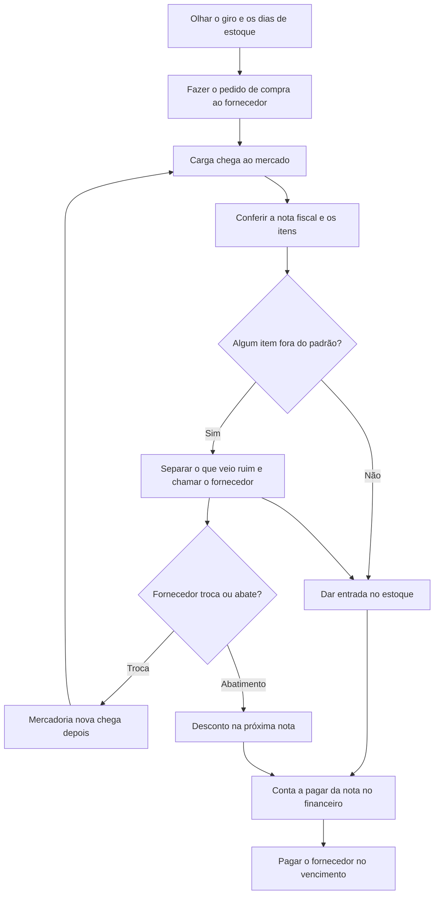
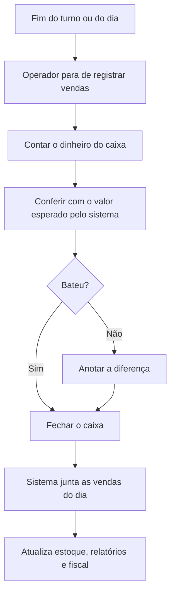

# Entrega 2 — Modelo Lógico, Implementação SQL e Apresentação Final

### Modelagem de um sistema de gestão de informações — Hortifruti União (Tatuapé)

## 1. Relatório Técnico Final

### Integrantes

| Nome completo do aluno | RGM | Usuário do GitHub |
| :---- | :---- | :---- |
| Tarcisio Santos de Oliveira | 47913061 | TarcisioT |
| Gabriela Porfírio da Silva | 48017698 | porfiriogabis |
| Henrique Moura de Oliveira | 47610972 | HenriMoura666 |
| Victor Hugo dos Santos Maciel | 48037630 | vhugo-sm |
| Guilherme Damasceno dos Santos | 48491683 | damascenogs |
| Lucas Praxedes da Silva | 47832550 | lucaspraxedes08sil-gif |

&nbsp;

### 1.1 Revisão do Modelo Conceitual

#### Caracterização da organização

- **Nome e natureza da organização:** O Hortifruti União é um mercado localizado no bairro do Tatuapé, em São Paulo. É uma empresa privada que atua no varejo alimentício, tendo como principal atividade a venda de frutas, legumes e verduras. Além disso, o estabelecimento também conta com setores de padaria, frios, laticínios, alimentos embalados e produtos secos. É a mesma organização real que usamos na Entrega 1, e seguimos com ela nesta etapa.

  A organização foi escolhida pelo grupo para a realização do trabalho, sendo possível obter informações sobre seu funcionamento por meio de uma entrevista com um dos responsáveis pelo mercado.

- **Contexto e porte:** Para contextualizar o trabalho, tratamos o Hortifruti União como um mercado de médio porte considerando os números aproximados informados pelo responsável, como cerca de 110 funcionários e faturamento mensal estimado em R$ 5 milhões. Essa descrição é apenas contextual e não usa uma classificação legal específica. O mercado funciona todos os dias da semana, incluindo domingos e feriados.

  Durante a entrevista, o responsável compartilhou algumas informações sobre o tamanho e o funcionamento do estabelecimento. Como não tinha relatórios disponíveis no momento, os números foram informados de memória e devem ser considerados aproximados.

  - Cerca de 110 funcionários;
  - 7 caixas;
  - Cerca de 1.800 vendas por dia;
  - Aproximadamente 340 fornecedores;
  - Faturamento mensal estimado em R$ 5 milhões;
  - Cerca de 6 mil itens diferentes vendidos por mês.

  Esses números ajudam a entender o tamanho da operação e a quantidade de informações que o mercado precisa controlar diariamente, principalmente em relação aos produtos, estoque, validade e perdas.

- **Problemas e necessidades identificados:**

  **P1 – Falta de controle sobre a perda de produtos**

  Esse foi o primeiro problema mencionado pelo responsável durante a entrevista. Como o mercado trabalha com muitos produtos frescos, parte deles acaba estragando quando não é vendida a tempo. Ele citou exemplos como frutas muito maduras, verduras murchas, tomates amassados e bananas que começam a escurecer.

  Essas perdas também acontecem em outros setores, como padaria, frios e laticínios. Além disso, existem situações em que os produtos são danificados pelos próprios clientes, como quando algum pote de vidro ou garrafa cai e quebra nos corredores. Há ainda os produtos que já chegam do fornecedor fora do padrão, como tomates moles ou alface murcha. Nesses casos, o mercado chama o fornecedor, que troca a mercadoria ou dá um abatimento na próxima nota.

  O principal problema identificado é a falta de um registro organizado dessas perdas. Atualmente, o mercado não consegue acompanhar com precisão quais produtos foram descartados, em que quantidade e por qual motivo. Sem essas informações, fica difícil identificar os setores com mais perdas e entender quanto isso representa de prejuízo.

  Por isso, uma das necessidades do mercado é ter um controle que permita registrar os produtos perdidos, suas quantidades, os motivos do descarte e os setores envolvidos. Dessa forma, seria possível consultar essas informações e acompanhar melhor as perdas do estabelecimento.

  **P2 – Falta de controle de validade dos produtos**

  Outro problema relatado pelo responsável foi a dificuldade em acompanhar as datas de validade dos produtos. Como o mercado comercializa cerca de 6 mil itens diferentes por mês, controlar todos os vencimentos acaba sendo uma tarefa complicada para a equipe.

  Segundo ele, alguns produtos acabam vencendo nas prateleiras ou no estoque, e muitas vezes os funcionários só percebem quando encontram algum item vencido durante a rotina de trabalho.

  O problema está na falta de um controle que permita consultar quais produtos estão próximos do vencimento. Sem essas informações organizadas, o mercado acaba perdendo a oportunidade de tomar alguma medida antes que os produtos vençam.

  Dessa forma, o estabelecimento precisa de um controle que permita registrar e consultar as datas de validade dos produtos, facilitando a identificação daqueles que estão próximos de vencer. Com essas informações, a equipe poderia se organizar melhor para realizar promoções, reorganizar os produtos nas prateleiras ou retirá-los da exposição quando necessário.

- **Escopo do sistema:** O banco de dados do Hortifruti União será desenvolvido para organizar as informações do mercado como um todo, e não apenas dos problemas de perda e validade dos produtos. Ele deverá incluir dados sobre funcionários e a escala de trabalho, fornecedores, produtos e setores, além de registros de compras, devoluções e trocas com fornecedores, vendas, estoque e pagamentos. Também será possível registrar as perdas e acompanhar as datas de validade dos produtos. Com essas informações reunidas em um só lugar, o mercado poderá ter um controle melhor das suas atividades e consultar os dados com mais facilidade.

  Vale lembrar que o VR Software, o sistema que o mercado já usa, tem recursos para registrar lote, validade e perdas, mas, segundo o responsável, eles não são usados no dia a dia. Por isso, o problema não é a falta de um sistema, e sim a falta de um registro organizado e fácil de consultar desses dados.

  Na prática, o grupo entrega uma **implementação acadêmica, independente do VR Software e com dados fictícios**, que representa os processos do mercado (compras, estoque, vendas, caixa, perdas e validade). Como não existe integração, uma venda feita no VR Software não aparece sozinha no nosso banco, e o banco não acompanha a operação real do mercado nem substitui o sistema que ele usa hoje.

- **Justificativa da escolha:** Escolhemos o Hortifruti União porque é um mercado de verdade, que lida todo dia com compras, recebimento de mercadorias, estoque e vendas. O Tarcisio, do nosso grupo, já trabalhou lá e conhece um dos proprietários, e foi isso que facilitou o contato com o mercado. Deixamos esse vínculo claro aqui, mas ele não substitui a comprovação da entrevista com o responsável, que apresentamos no relato abaixo. Também achamos que o mercado era um bom caso para o trabalho, porque os problemas de perdas, lotes e validade dos produtos podem ser organizados em um banco de dados relacional.

- **Evidências da organização:**

  - **Localização no Google Maps:** [Ver localização do Hortifruti União](https://www.google.com/maps/search/?api=1&query=Rua+Filipe+Camar%C3%A3o%2C+67%2C+Tatuap%C3%A9%2C+S%C3%A3o+Paulo)
  - **Perfil comercial no Google:** [Consultar perfil do Hortifruti União no Google](https://share.google/LWFseN2UxnhQwKsNh)
  - **Endereço:** Rua Filipe Camarão, nº 67, Tatuapé, São Paulo, CEP 03065-000
  - **Contato da organização:** (11) 91856-3865
  - **Responsável entrevistado:** Guilherme Takemoto
  - **Função:** um dos proprietários do Hortifruti União – Tatuapé
  - **Telefone de contato autorizado:** (11) 99317-0906


#### Relato da entrevista

- **Quem:** Guilherme Takemoto, um dos proprietários do Hortifruti União – Tatuapé. A entrevista e a visita foram feitas pelo Tarcisio, que já trabalhou no mercado. Os outros integrantes do grupo não participaram.

- **Quando e onde:** A entrevista foi no dia **22/09/2026**, por videochamada no WhatsApp, e durou cerca de uma hora. No dia **30/09/2026**, o Tarcisio foi até o mercado, na Rua Filipe Camarão, 67, no Tatuapé, para observar o funcionamento do local e tirar fotos.

- **O que foi levantado:** Conversamos sobre como o mercado funciona, quantos funcionários e fornecedores tem, o que vende e quais são os principais problemas. Também falamos sobre o VR Software, o controle de estoque, a validade, as perdas, as compras, as vendas e os pagamentos. Depois, no dia 26/10, confirmamos com o responsável, por WhatsApp, alguns detalhes sobre pedidos, notas fiscais, formas de pagamento e fechamento de caixa. No dia 29/10, confirmamos também, por WhatsApp, como o mercado lida com cadastro de clientes, fidelidade, vendas online, entregas, devoluções a fornecedores, escala dos funcionários, cancelamento de vendas, venda restrita por idade, validade dos produtos por setor, venda fiado e troca ou devolução feita pelo cliente.

- **O que o responsável contou:**
  - O mercado perde produtos frescos e de outros setores (padaria, frios e laticínios) por vencimento, por maturação excessiva ou por danos causados por clientes. Essas perdas não são registradas de forma organizada (P1).
  - Acompanhar a validade de cerca de 6 mil itens por mês é difícil, e os funcionários costumam perceber que um produto venceu só quando o encontram na rotina (P2).
  - O VR Software é o sistema da loja e cuida de venda e nota. Ele é usado para cadastrar produtos, dar entrada nas mercadorias, fazer pedidos de compra, operar o caixa, controlar o fiscal e o financeiro e fechar o dia. O sistema tem tela para registrar lote, validade e perdas, mas, segundo o responsável, isso só funciona se alguém cadastrar e baixar tudo todos os dias, o que é difícil com tantos itens. Na prática, esse controle não é feito.
  - Frutas, legumes e verduras geralmente não têm validade impressa e são avaliados visualmente pelos funcionários. Os produtos que têm validade impressa são os embalados e industrializados.
  - O prazo para considerar um produto próximo do vencimento varia conforme o setor.
  - O cancelamento de uma venda no caixa precisa da autorização de um supervisor.
  - Alguns produtos têm venda restrita por idade, e o operador precisa ficar atento a isso no atendimento.
  - O mercado não vende fiado. Todas as vendas são pagas no caixa.
  - A troca ou devolução de produtos pelo cliente existe, mas é rara, e é tratada pela gerência ou pela retaguarda.

- **O que observamos na visita (30/09/2026):**
  - A validade é conferida a olho nu pelos funcionários, sem etiqueta de controle, lista ou qualquer registro das datas (P2).
  - Os produtos perto de vencer recebem uma placa de promoção, sem consulta a uma lista de vencimentos (P2).
  - Os produtos descartados são apenas jogados fora, sem anotação de produto, quantidade, motivo ou setor (P1).
  - O estoque é organizado por setor.
  - Vimos os caixas funcionando, mas não vimos ninguém registrando validade ou perdas no sistema.

- **Comparação entre entrevista e observação:** a visita confirmou o que o responsável contou: a validade é conferida no olho, as perdas não são anotadas e o estoque é separado por setor. Isso também combina com o que ele disse sobre o VR Software: o sistema tem lugar para registrar validade e perdas, mas, na prática, nada disso é registrado. Não percebemos nenhuma divergência.

- **O que mudou em relação à Entrega 1:** na Entrega 1, o único problema levantado era o controle de validade dos produtos. Com a entrevista e a visita desta etapa, encontramos um problema novo: a falta de controle sobre as perdas (P1). Os números do mercado continuam os mesmos. Mudaram também duas coisas: a lista de formas de pagamento, em que o Pix não aparecia e agora entrou porque o responsável confirmou que o mercado aceita Pix, e a composição do grupo, já que Victor Hugo dos Santos Maciel e Guilherme Damasceno dos Santos entraram e Henrico e Nicole saíram.

- **Comprovação:** As fotos tiradas na visita e os registros da entrevista e das confirmações ficam na pasta `imagens/evidencias/`. A entrevista de 22/09 foi realizada por videochamada no WhatsApp e é comprovada pelo respectivo registro. Como ela não aconteceu no ambiente do mercado, não temos uma foto da entrevista em si. A visita presencial de 30/09 está comprovada pelas fotos do local. Também incluímos os prints das confirmações por WhatsApp de 26/10 e 29/10: [videochamada de 22/09](imagens/evidencias/entrevista_videochamada.png), [confirmação por WhatsApp de 26/10](imagens/evidencias/confirmacao_whatsapp_26-10.png) e [confirmação por WhatsApp de 29/10](imagens/evidencias/confirmacao_whatsapp_29-10.png).
  
- **Resumo do levantamento:** Pelo que o responsável explicou, a rotina do mercado funciona assim:
  - **De manhã (retaguarda):** cadastro dos produtos (código de barras, preço, setor, venda por quilo ou por unidade), conferência da nota do fornecedor e entrada no estoque quando a carga chega, e pedidos de compra feitos olhando o giro e os dias de estoque. O fiscal e o financeiro (notas e contas a pagar) também passam pelo sistema. Quando chega algum item fora do padrão, ele pode ser devolvido ou trocado pelo fornecedor, ou então gerar um abatimento na próxima nota.
  - **No caixa:** o operador abre o caixa com o fundo e passa os itens (os de peso vão pela balança). Existem consulta de preço, cancelamento e troca de operador. Cada venda baixa o estoque, na hora se o estoque online estiver ligado, ou depois que o escritório fecha a conferência do dia.
  - **Durante o dia:** repositores e gerência olham o que zerou ou está com pouco giro. Perdas poderiam ser baixadas no sistema, mas não são.
  - **No fim do dia:** fechamento do caixa, sangria e conferência. Depois o sistema junta as vendas do dia e alimenta o estoque, os relatórios e o fiscal.

- **Levantamento completo:** os processos e regras com mais detalhe estão em [levantamento/levantamento.md](levantamento/levantamento.md).

#### Processos de negócio

Com base na entrevista com o responsável, na visita ao Hortifruti União e nas confirmações feitas por WhatsApp em 26/10 e 29/10, identificamos os principais processos que fazem parte da rotina do mercado. Como o estabelecimento trabalha com vários setores e uma grande quantidade de produtos, existem diferentes atividades que precisam ser organizadas e controladas diariamente. Os detalhes de cada processo estão no [levantamento completo](levantamento/levantamento.md).

Para ter certeza de que não esquecemos nenhum processo, comparamos a nossa lista com o que costuma existir em mercados e hortifrutis, usando o ChatGPT e pesquisas. Como usamos IA nessa conferência, o registro está na seção 6.

Os principais processos identificados foram:

- **Cadastro de produtos:** O mercado utiliza o VR Software para cadastrar os produtos, registrando informações como código de barras, preço, setor e forma de venda, que pode ser por quilo ou unidade.

- **Controle de fornecedores:** O mercado trabalha com aproximadamente 340 fornecedores, que abastecem os diferentes setores do estabelecimento. As informações desses fornecedores fazem parte dos dados que precisam ser organizados pelo sistema.

- **Pedidos de compra:** Os pedidos são realizados conforme a necessidade de reposição, considerando o giro dos produtos e a quantidade de dias de estoque disponível.

- **Recebimento de mercadorias:** Quando os produtos chegam ao mercado, é feita a conferência da nota fiscal do fornecedor e a entrada das mercadorias no estoque pelo sistema. Se algum item chega fora do padrão, ele pode ser devolvido ou trocado, como explicado no próximo item.

- **Devolução e troca de mercadorias com fornecedores:** Quando chega mercadoria fora do padrão, como caixa de tomate mole, banana verde demais, alface murcha ou embalado amassado, o mercado chama o fornecedor. Normalmente ele troca o produto ou dá um abatimento na próxima nota. Segundo o responsável, isso acontece quase toda semana. Esse processo tem a ver com o controle de perdas, porque parte do que chega estragado não vira prejuízo para o mercado quando o fornecedor troca ou compensa a mercadoria.

- **Controle de estoque:** Os produtos são organizados por setor, e os funcionários acompanham quais itens precisam ser repostos. As vendas também atualizam as quantidades em estoque, de forma imediata quando o controle online está ativado ou após a conferência do dia.

- **Vendas e operação de caixa:** O mercado possui 7 caixas e realiza aproximadamente 1.800 vendas por dia. Os operadores abrem o caixa com o fundo, registram os produtos vendidos, usam a balança para os itens vendidos por peso, recebem o pagamento dos clientes e podem fazer consultas de preço, cancelamentos de venda e troca de operador. O mercado aceita pagamento em dinheiro, débito, crédito, Pix e vale-alimentação (VA), e as vendas são feitas de forma anônima, sem identificação do cliente.

- **Controle financeiro e fiscal:** O VR Software também é utilizado para controlar notas fiscais, contas a pagar e pagamentos. No final do dia, são realizados o fechamento dos caixas, as sangrias e a conferência das vendas.

- **Controle de validade e lote:** Os funcionários verificam as datas de validade diretamente nos produtos. Apesar de o sistema possuir recursos para registrar lote e validade, esse controle não é utilizado na prática, dificultando a identificação dos itens próximos do vencimento.

- **Controle de perdas:** O mercado descarta produtos que estragam, vencem ou sofrem danos. Porém, essas perdas não são registradas de forma organizada, o que dificulta saber quais produtos foram perdidos, suas quantidades e os motivos.

- **Promoções de produtos próximos do vencimento:** Quando os funcionários encontram produtos próximos da validade, eles podem receber uma placa de promoção para incentivar a venda antes do vencimento. Esse processo é feito por meio da observação dos produtos, sem uma lista de vencimentos.

- **Gestão de funcionários e setores:** O mercado tem cerca de 110 funcionários e vários setores (hortifruti, padaria, frios, laticínios, alimentos embalados e produtos secos). O banco de dados vai guardar as informações sobre funcionários e setores, conforme o escopo definido para o sistema.

- **Escala de trabalho dos funcionários:** Como o mercado abre todos os dias, inclusive domingos e feriados, existe uma escala para organizar o trabalho dos cerca de 110 funcionários. Hoje essa escala é feita em planilha, fora do VR Software. Mesmo sem ligação direta com os problemas de perdas e validade, ela é um processo real do mercado, e por isso entrou no nosso modelo.

##### Processos comuns que não foram incluídos no levantamento

Em mercados e hortifrutis costumam existir outros processos além dos listados acima. Em 29/10/2026, confirmamos com o responsável, por WhatsApp, como o Hortifruti União lida com cada um deles. Os que não foram incluídos no modelo, e os motivos, são:

| Processo comum | Situação no Hortifruti União | Motivo de não entrar no modelo |
| :---- | :---- | :---- |
| Cadastro de clientes | Não realiza | As vendas são feitas de forma anônima no caixa, sem identificação do cliente. |
| Programa de fidelidade | Não possui | Não há cadastro de clientes nem desconto para clientes identificados. |
| Vendas pela internet ou aplicativo | Não realiza | O mercado vende apenas de forma presencial. |
| Entregas em domicílio | Não realiza | O mercado não faz entregas, nem com equipe própria nem com terceiros. |
| Venda fiado e crediário | Não realiza | Todas as vendas são pagas no caixa. |
| Troca ou devolução pelo cliente | Existe, mas é rara | É tratada pela gerência ou retaguarda, com os ajustes feitos no sistema utilizado pelo mercado. Por isso, não foi criado um fluxo próprio no caixa. |
| Inventário ou contagem periódica de estoque | **[CONFIRMAR]** | Se for feito no VR Software ou por equipe externa, o banco não registra a contagem. O saldo vem dos lotes, e a diferença de contagem entraria como perda com motivo "Outros" (RN40). |
| Controle sanitário (temperatura, limpeza, laudos) | **[CONFIRMAR]** | É uma rotina de conformidade e não de dados de venda, estoque ou perda. Não está ligada a P1 nem a P2, e o grupo não levantou como é registrada. |
| Folha de pagamento, ponto e férias | **[CONFIRMAR]** | Costuma ser feita por contabilidade ou sistema próprio. O banco guarda só o cadastro e a escala dos funcionários (RF08 a RF10). |
| Despesas que não vêm de fornecedor de mercadoria (aluguel, energia, impostos) | **[CONFIRMAR]** | O modelo cobre contas a pagar ligadas a recebimentos de mercadoria (RN34). Outras despesas ficam no financeiro do VR Software. |
| Precificação e curva ABC | **[CONFIRMAR]** | O preço é cadastrado no produto (RN04). A definição de preço é decisão comercial e não gera dado que o banco precise guardar além do preço praticado. |
Essa mesma conversa também confirmou a devolução e troca com fornecedores e a escala dos funcionários. Como o mercado realiza os dois, eles entraram na lista principal de processos.

##### Fluxogramas

**Fluxograma do processo de venda:**

[Fluxograma de Vendas](imagens/fluxogramas/fluxograma_venda.jpeg)


Os fluxos do ciclo de compra e do fechamento de caixa representam as rotinas descritas pelo responsável sobre compras, recebimento e conferência do caixa. Eles estão escritos em Mermaid porque o GitHub renderiza esse formato diretamente no README.

**Fluxograma do ciclo de compra:**



**Fluxograma do fechamento de caixa:**



#### Requisitos do sistema

Os requisitos abaixo foram definidos a partir da entrevista de 22/09/2026, da visita de 30/09/2026 e das confirmações por WhatsApp de 26/10 e 29/10/2026. O que foi informado pelo responsável ou observado na visita é tratado como **levantamento**. Já os campos, validações e controles definidos pelo grupo para organizar o banco são tratados como **proposta**.

O banco será desenvolvido em MySQL como uma implementação acadêmica, independente do VR Software, com dados fictícios. Não há integração nem carga automática de dados do sistema atual, então o banco representa os processos do mercado, mas não acompanha a operação real.

##### Requisitos funcionais

###### Cadastros

| Código | Requisito | Dados envolvidos |
| :---- | :---- | :---- |
| RF01 | Cadastrar e atualizar setores. | Nome, descrição, dias de antecedência do alerta de validade e se o setor vende produto. |
| RF02 | Cadastrar, atualizar e inativar produtos. | Código interno (PLU), código de barras quando existir, nome, setor, unidade de venda, preço, estoque mínimo, situação, indicador de validade impressa e restrição de venda por idade. |
| RF03 | Cadastrar, atualizar e inativar fornecedores. | Razão social, CNPJ, telefone, e-mail, endereço e situação. |
| RF04 | Relacionar produtos aos fornecedores. | Fornecedor, produto e código do produto no fornecedor. |
| RF05 | Cadastrar formas de pagamento. | Descrição, uso (venda, fornecedor ou ambos) e situação. |
| RF06 | Cadastrar e inativar caixas. | Número e situação. |
| RF07 | Cadastrar motivos de perda. | Descrição e situação. |

###### Funcionários e escala

| Código | Requisito | Dados envolvidos |
| :---- | :---- | :---- |
| RF08 | Cadastrar, atualizar e inativar funcionários. | Nome, CPF, cargo, telefone, data de admissão, setor, perfil de acesso e situação. |
| RF09 | Registrar a escala de trabalho. | Funcionário, data, tipo (trabalho ou folga) e horários, quando for dia de trabalho. |
| RF10 | Consultar a escala por data, funcionário ou setor. | Funcionário, setor, data e horários. |

###### Compras e recebimento

| Código | Requisito | Dados envolvidos |
| :---- | :---- | :---- |
| RF11 | Registrar pedidos de compra e seus itens. | Fornecedor, funcionário, data, situação, produto, quantidade e custo previsto. |
| RF12 | Atualizar a situação do pedido, inclusive cancelá-lo, sem apagar o histórico. | Pedido, situação e data. |
| RF13 | Registrar o recebimento de mercadorias, com ou sem pedido anterior. | Fornecedor, pedido quando houver, funcionário, nota fiscal, datas e valor total. |
| RF14 | Registrar a conferência dos itens recebidos. | Produto, quantidade da nota, quantidade aceita, quantidade recusada, custo e observação. |
| RF15 | Registrar um ou mais lotes para os produtos aceitos no recebimento. | Produto, item recebido, código do lote quando houver, fabricação, validade quando houver, quantidade, saldo e custo. |
| RF16 | Registrar devolução, troca ou abatimento negociado com o fornecedor. | Fornecedor, recebimento, itens, quantidades, tipo, motivo, valor do abatimento, situação, funcionário e data. |
| RF17 | Consultar pedidos, recebimentos e divergências por fornecedor e período. | Quantidades pedidas, aceitas e recusadas. |

###### Estoque

| Código | Requisito | Dados envolvidos |
| :---- | :---- | :---- |
| RF18 | Consultar o saldo dos produtos a partir dos lotes. | Produto, setor, saldo total, saldo por lote e perdas ainda com lote a confirmar. |
| RF19 | Registrar saídas de lote e seus estornos. | Lote, quantidade, venda ou perda de origem, data e hora. |
| RF20 | Consultar produtos com estoque baixo ou pouco giro. | Produto, setor, saldo, estoque mínimo e quantidade vendida no período. |

###### Vendas e caixa

| Código | Requisito | Dados envolvidos |
| :---- | :---- | :---- |
| RF21 | Abrir a sessão de um caixa. | Caixa, operador, data, hora e fundo inicial. |
| RF22 | Registrar vendas e seus itens, sem identificar o cliente. | Sessão, data, situação, produto, quantidade ou peso, preço praticado, subtotal e total. |
| RF23 | Consultar o preço de um produto durante o atendimento. | PLU, código de barras ou nome, preço e unidade de venda. Como a promoção depende do lote, a consulta mostra o preço normal e avisa quando existe lote do produto em promoção vigente. O preço final de cada linha é fechado na conclusão da venda. |
| RF24 | Registrar o pagamento da venda em uma ou mais formas. | Venda, forma de pagamento e valor. |
| RF25 | Cancelar uma venda com autorização de supervisor, mantendo seu histórico e estornando, na mesma operação, as baixas de estoque dos itens da venda. | Venda, motivo, operador, supervisor, data e hora. |
| RF26 | Cancelar um ou mais itens enquanto a venda estiver em andamento, mantendo-os registrados como cancelados. | Venda, itens, motivo, operador, data e hora. |
| RF27 | Avisar o operador quando o produto tiver venda restrita por idade. | Produto e indicador de restrição. |
| RF28 | Registrar troca de operador no caixa. | Caixa, operador anterior, novo operador e horários. |
| RF29 | Registrar sangrias. | Sessão, valor, data, hora e funcionário. |
| RF30 | Fechar a sessão do caixa com a conferência dos valores. | Data, hora, funcionário que fechou, valor contado, valor esperado e diferença. |
| RF31 | Registrar os dados do documento fiscal relacionado à venda. | Venda, tipo, número, série, chave de acesso, data e situação. |
| RF32 | Consultar vendas por período, caixa, operador e forma de pagamento. | Totais de vendas concluídas e canceladas. |

###### Financeiro

| Código | Requisito | Dados envolvidos |
| :---- | :---- | :---- |
| RF33 | Registrar contas a pagar relacionadas às notas de recebimento. | Recebimento, vencimento, valor e situação. |
| RF34 | Registrar o pagamento de uma conta. | Conta, data, forma de pagamento, funcionário que registrou o pagamento e situação. |
| RF35 | Vincular abatimento do fornecedor à conta em que será descontado. | Devolução de origem, conta e valor abatido. |
| RF36 | Consultar contas por vencimento, situação e fornecedor. | Fornecedor, vencimento, valor e situação. |

###### Perdas (P1)

| Código | Requisito | Dados envolvidos |
| :---- | :---- | :---- |
| RF37 | Registrar perdas de produtos. | Data, produto, lote ou situação "lote a confirmar", quantidade, motivo, setor, funcionário, valor quando possível e observação. |
| RF38 | Consultar perdas por setor, motivo, produto e período. | Quantidades, valores e perdas com lote ainda a confirmar. |
| RF39 | Comparar perdas com mercadorias devolvidas, trocadas ou compensadas pelo fornecedor. | Período, fornecedor, setor, perdas e devoluções. |

###### Validade e promoções (P2)

| Código | Requisito | Dados envolvidos |
| :---- | :---- | :---- |
| RF40 | Consultar lotes próximos do vencimento conforme o prazo definido para o setor. | Produto, setor, lote, validade, dias restantes e saldo. |
| RF41 | Consultar lotes vencidos que ainda tenham saldo. | Produto, setor, lote, validade e saldo. |
| RF42 | Registrar promoções de lotes próximos do vencimento. | Lote, preço normal, preço promocional, início, fim e funcionário. |
| RF43 | Consultar promoções vigentes e encerradas. | Produto, lote, período e preços. |

##### Requisitos não funcionais

| Código | Característica | Requisito |
| :---- | :---- | :---- |
| RNF01 | Segurança | Cada usuário deve acessar somente as funções permitidas pelo seu perfil. |
| RNF02 | Rastreabilidade | Operações importantes devem registrar o funcionário e a data. Nas operações de caixa, venda, baixa de estoque e perda, registram também a hora. |
| RNF03 | Integridade | O banco deve utilizar chaves, campos obrigatórios, unicidade e restrições para evitar dados inválidos. |
| RNF04 | Confiabilidade | Operações que envolvem vários registros devem ser concluídas por inteiro ou não ser gravadas. |
| RNF05 | Histórico | Registros com movimentação não devem ser apagados, mas inativados ou cancelados. |
| RNF06 | Auditoria | Cancelamentos devem permitir identificar quem realizou e, quando necessário, quem autorizou a operação. |
| RNF07 | Proteção de dados | Dados pessoais de funcionários devem ter acesso restrito e a massa de testes deve utilizar dados fictícios. |
| RNF08 | Recuperação | O banco deve permitir cópia de segurança, restauração e recriação por meio do script SQL. |
| RNF09 | Desempenho | As consultas mais utilizadas devem utilizar índices adequados ao volume de aproximadamente 1.800 vendas por dia. |
| RNF10 | Disponibilidade | O banco deve poder ser utilizado durante o funcionamento do mercado, inclusive domingos e feriados. |
| RNF11 | Usabilidade | O registro de perdas deve ser simples e exigir somente as informações necessárias. |
| RNF12 | Compatibilidade | O banco será desenvolvido em MySQL, utilizando InnoDB e `utf8mb4`. |

##### Requisitos comuns não incluídos

Os requisitos ligados a cadastro de clientes, fidelidade, vendas online, entregas e venda fiado não foram criados porque o mercado não realiza esses processos (tabela acima). Também não criamos requisitos para os processos que o mercado faz fora do banco: inventário, controle sanitário, folha e ponto, despesas gerais e precificação. Nesses casos, o dado fica no VR Software, na contabilidade ou em planilhas, e não é necessário para resolver P1 e P2. Do lado técnico, não incluímos requisitos de integração com o VR Software nem de aplicação para os operadores: o banco é uma implementação acadêmica, independente do sistema atual (seção 1.1, Escopo do sistema).

---

#### Regras de negócio

**[Confirmada]** indica uma prática informada pelo responsável ou observada na visita.  
**[Proposta]** indica uma regra definida pelo grupo para organizar o banco.

- A numeração segue a ordem em que as regras foram criadas, e não a ordem de leitura. Por isso RN08A, RN52 a RN57 aparecem dentro dos grupos por assunto.

##### Cadastros

- **RN01 [Confirmada + Proposta]** O mercado cadastra produtos com código de barras, preço, setor e forma de venda. No banco, todo produto também terá um código interno único e nome.
- **RN02 [Confirmada + Proposta]** Produtos pesados podem utilizar etiqueta de código de barras e produtos a granel podem ser informados pelo código interno (PLU). O código interno será único.
- **RN03 [Proposta]** Cada produto terá um setor principal, e esse setor precisa ser um setor que vende produto. Caixa e Retaguarda existem só para organizar os funcionários e não recebem produto nem perda.
- **RN04 [Proposta]** O preço deve ser maior que zero e o estoque mínimo não pode ser negativo. O estoque mínimo também serve para apontar os produtos que precisam de reposição: quando o saldo disponível fica abaixo dele, o produto entra na consulta de estoque baixo (RF20), que mostra se já existe pedido de compra em aberto.
- **RN05 [Proposta]** Produtos, fornecedores, funcionários e caixas com histórico não serão excluídos, apenas inativados.
- **RN06 [Proposta]** O CNPJ do fornecedor não poderá se repetir.
- **RN07 [Proposta]** O CPF do funcionário não poderá se repetir.
- **RN08 [Confirmada]** O mercado aceita pagamento em dinheiro, débito, crédito, Pix e vale-alimentação (VA). Essas formas serão registradas no cadastro de formas de pagamento do banco.
- **RN08A [Proposta]** Cada forma de pagamento tem um uso: venda, fornecedor ou ambos. A venda só aceita formas de uso "venda" ou "ambos", e a conta a pagar só aceita "fornecedor" ou "ambos". Por exemplo, boleto e transferência ficam só para fornecedor, e o Pix vale para os dois lados. O `uso` não pode ser alterado depois que a forma tiver algum pagamento ou conta registrada: para mudar, a forma é inativada e uma nova é cadastrada, assim o histórico continua válido.

##### Compras e recebimento

- **RN09 [Confirmada + Proposta]** Os pedidos são definidos considerando giro e dias de estoque. Todo pedido terá fornecedor, data e ao menos um item.
- **RN10 [Confirmada + Proposta]** A nota do fornecedor é conferida no recebimento e não poderá ser cadastrada duas vezes.
- **RN11 [Confirmada + Proposta]** Pode haver recebimento sem pedido, e um pedido pode ter mais de um recebimento.
- **RN12 [Proposta]** Somente a quantidade aceita no recebimento entra no estoque.
- **RN13 [Confirmada + Proposta]** Mercadorias que chegam fora do padrão podem ser trocadas ou gerar abatimento e não são registradas como perda do mercado.

##### Lotes e estoque

- **RN14 [Proposta]** Todo lote estará relacionado a um produto recebido e terá quantidade positiva.
- **RN15 [Confirmada + Proposta]** Frutas, legumes e verduras geralmente não possuem validade impressa e são avaliados visualmente. Produtos que possuem validade impressa terão essa informação registrada no lote. Os demais serão acompanhados pelo controle de estoque e perdas.
- **RN16 [Proposta]** O saldo do produto será a soma dos saldos dos seus lotes. O saldo disponível para venda é esse saldo menos as perdas que ainda estão com lote a confirmar (RN42).
- **RN17 [Proposta]** Nenhuma saída poderá ultrapassar o saldo disponível do lote. Cancelamentos geram estorno, e não exclusão.
- **RN18 [Proposta]** Nas vendas, o sistema prioriza o lote que vence primeiro, seguindo a lógica FEFO (*First Expire, First Out*). Quando o produto não tiver validade registrada, prioriza o lote mais antigo.
- **RN19 [Proposta]** Neste banco, a baixa de estoque será registrada quando a venda for concluída. No mercado, a baixa pode ser imediata ou após a conferência do dia, conforme o controle online esteja ativado ou não.
- **RN53 [Proposta]** Na conclusão da venda, a quantidade de cada produto não pode ultrapassar o saldo do lote escolhido nem o saldo disponível do produto (RN16). A proteção contra operações simultâneas deve abranger os fluxos que alteram o saldo, com uma estratégia consistente de bloqueios. No SQL atual, o lote escolhido usa `FOR UPDATE`, mas a leitura do saldo agregado e os demais fluxos ainda precisam de revisão e testes de concorrência.
- **RN57 [Proposta]** Enquanto a venda está em andamento, cada item é registrado com o produto, a quantidade ou o peso e o preço normal do cadastro, ainda sem lote. O lote só é escolhido na conclusão, pela procedure concluir_venda (RN18). Se o item sai de um lote só, a linha fica como está. Se precisa de mais de um, a procedure divide a linha, deixando uma para cada lote. O preço de cada linha é o promocional quando o lote tem promoção vigente (RN47 e RN48) e o normal quando não tem. O lote de cada linha fica na baixa (SAIDA_LOTE), que aponta para o item de venda. Os itens cancelados durante a venda (RN26) saem antes dessa etapa e não entram na escolha de lote. O produto do item e o produto do lote têm que ser o mesmo.
##### Vendas e pagamentos

- **RN20 [Proposta]** Toda venda estará ligada a uma sessão de caixa aberta e a um operador. O operador da venda precisa ser o operador da sessão naquele momento: quem abriu o caixa ou, se houve troca, o novo operador da última troca (RN29). O trigger de VENDA confere isso.
- **RN21 [Confirmada]** As vendas são anônimas, sem cadastro de clientes.
- **RN22 [Confirmada + Proposta]** Produtos vendidos por quilo aceitam quantidade decimal e produtos por unidade utilizam quantidade inteira. O banco guarda o peso informado na venda.
- **RN23 [Proposta]** O total da venda será a soma dos itens que não estiverem cancelados. O total fica definitivo na conclusão da venda.
- **RN24 [Confirmada]** O mercado não vende fiado e as vendas são pagas no caixa, podendo utilizar uma ou mais formas de pagamento na mesma venda.

##### Cancelamentos e vendas restritas

- **RN25 [Confirmada + Proposta]** O cancelamento de uma venda exige autorização de supervisor, e o funcionário que autoriza precisa ter perfil de supervisor ou gerência, conforme a validação da procedure. A venda cancelada permanece registrada e não entra nos totais.
- **RN26 [Proposta]** Um ou mais itens podem ser cancelados enquanto a venda estiver em andamento. O item permanece registrado, mas deixa de fazer parte do total.
- **RN27 [Confirmada + Proposta]** Produtos com venda restrita por idade serão identificados no cadastro e o sistema mostrará um aviso ao operador. O banco não armazenará documento do cliente.
- **RN28 [Proposta]** Cancelamento, perda e devolução ao fornecedor são situações diferentes. Uma mercadoria de venda cancelada não será registrada como perda.
- **RN54 [Proposta]** Quando uma venda já concluída é cancelada, todas as baixas de estoque dos itens ativos dela são estornadas na mesma transação, e cada baixa só pode ser estornada uma vez (RN17). Se algum passo falhar, nada é gravado (RNF04).
- **RN55 [Proposta]** Os pagamentos de uma venda cancelada continuam no histórico, mas a venda não entra no faturamento nem no valor esperado do caixa (RN25). O banco não registra a devolução do dinheiro ao cliente: cancelar é desfazer a venda inteira. Por isso o valor esperado do caixa considera que o dinheiro dessa venda voltou ao cliente ou nunca ficou lá. Como essa saída de dinheiro não é rastreada, uma diferença no fechamento causada por ela apareceria no banco sem explicação. Se um dia for preciso separar o que foi recebido do que foi devolvido, o pagamento vai precisar de uma coluna de situação. Isso ficou fora do nosso trabalho.

##### Caixa e fiscal

- **RN29 [Confirmada + Proposta]** Existe troca de operador e cada caixa terá somente uma sessão aberta por vez.
- **RN30 [Confirmada + Proposta]** O caixa é aberto com um fundo inicial, que não poderá ser negativo.
- **RN31 [Confirmada + Proposta]** Sangrias só poderão ser registradas em sessões abertas e com valor positivo.
- **RN32 [Confirmada + Proposta]** No fechamento, a diferença será calculada pelo valor contado menos o valor esperado.
- **RN33 [Confirmada + Proposta]** O processo fiscal continua sendo feito no sistema atual. O banco apenas armazenará os dados dos documentos relacionados às vendas.

##### Financeiro

- **RN34 [Confirmada + Proposta]** Contas a pagar relacionadas às compras terão vencimento, valor e recebimento de origem.
- **RN35 [Proposta]** Uma conta poderá estar aberta, paga ou cancelada. O modelo não registra pagamento parcial: a conta é paga de uma vez, pelo saldo a pagar.
- **RN36 [Proposta]** A conta a pagar mantém o valor original da nota. Os abatimentos do fornecedor ficam em DEVOLUCAO_FORNECEDOR e são ligados à conta. O saldo a pagar é o valor da conta menos a soma dos abatimentos ligados a ela. A soma dos abatimentos de uma conta não pode passar do valor dela, e só dá para ligar abatimento a conta aberta.

##### Devoluções e abatimentos

- **RN37 [Confirmada + Proposta]** O responsável confirmou por WhatsApp que o mercado trabalha com devolução, troca e abatimento junto ao fornecedor quando há problema na mercadoria. No banco, a devolução fica ligada ao recebimento e não pode passar da quantidade recusada. Quando o fornecedor troca o produto, o que chega no lugar entra como um novo recebimento, sem pedido (RN11), e a devolução é registrada como troca (RF16). Quando há abatimento, aplica-se a RN38. O abatimento não altera o `custo_unitario` do lote, para que o custo histórico da mercadoria permaneça igual ao da nota de origem.
- **RN38 [Confirmada + Proposta]** O abatimento concedido pelo fornecedor será relacionado a uma conta do mesmo fornecedor.
- **RN39 [Proposta]** Uma mercadoria devolvida, trocada ou compensada pelo fornecedor não será registrada também como perda.

##### Perdas

- **RN40 [Confirmada + Proposta]** O levantamento identificou perdas por vencimento, maturação excessiva e danos causados por clientes. Esses casos formarão a lista inicial de motivos, além da opção "Outros".
- **RN41 [Proposta]** Toda perda terá produto, quantidade, motivo, setor, funcionário, data e situação do lote.
- **RN42 [Proposta]** Quando o lote da perda for conhecido, a quantidade perdida será baixada desse lote. Se o lote não for conhecido, a perda ficará como "lote a confirmar" até que essa informação seja conferida. Enquanto estiver pendente, a quantidade é descontada do saldo disponível do produto (RN16), e uma perda pendente não pode ser maior que esse saldo disponível.
- **RN43 [Proposta]** Uma perda registrada não será apagada. Para corrigir uma perda (por exemplo, 15 kg registrados que eram 12 kg) ou dividi-la em lotes (RN52), o registro original passa para a situação `substituida`, deixa de entrar nos totais e nas pendências, e a perda nova (ou as novas) aponta para ele. Se o original já tinha baixa em lote, essa baixa é estornada (RN17) e a perda nova gera a sua própria baixa. Só as perdas com situação `valida` contam nos indicadores.
- **RN44 [Proposta]** O valor da perda será calculado com base na quantidade e no custo do lote. Perdas sem lote confirmado ficarão sem valor até a identificação.
- **RN52 [Proposta]** Quando o lote de uma perda pendente é confirmado, o banco faz tudo de uma vez, na mesma transação: baixa a quantidade no lote (saída do tipo perda), marca a perda como confirmada e calcula o valor. A partir daí ela deixa de ser descontada como pendente, então a quantidade sai uma única vez do saldo disponível. A quantidade não pode passar do saldo do lote. Uma perda confirmada pertence a um lote só. Se a mercadoria perdida veio de mais de um lote do mesmo produto, a pendência original passa a `substituida` (RN43) e é trocada por uma perda para cada lote, todas ligadas a ela, e a soma das partes tem que dar a quantidade original. Como só as perdas válidas entram nos totais, nada é contado duas vezes.
##### Validade e promoções

- **RN45 [Confirmada + Proposta]** O prazo de alerta de validade varia conforme o setor. Cada setor que trabalha com validade impressa tem um número de dias definido. Os setores com dias_alerta_validade vazio (hortifruti, Caixa e Retaguarda) não geram alerta pelo setor. Se um produto desses setores tiver validade impressa (RN15), o lote dele usa um prazo padrão de 7 dias, definido pelo grupo. Esse prazo não é coluna do banco: ele aparece como constante na consulta G03, e para mudar o prazo basta editar o valor lá.
- **RN46 [Proposta]** Lote vencido na data da venda não pode ser vendido nem entrar em promoção. A conferência usa a data da operação e não a data de hoje.
- **RN47 [Confirmada + Proposta]** Produtos próximos do vencimento podem entrar em promoção, com preço inferior ao preço normal.
- **RN48 [Proposta]** A promoção terminará na data definida ou no vencimento do lote, o que acontecer primeiro.

##### Funcionários, escala e rastreabilidade

- **RN49 [Confirmada + Proposta]** O mercado funciona todos os dias e organiza a escala em planilha. No banco, dias de trabalho terão horário de início e fim; folgas terão apenas a data.
- **RN50 [Proposta]** Funcionários inativos não poderão realizar novas operações, mas seu histórico será mantido.
- **RN51 [Proposta]** Dados pessoais dos funcionários, e os contatos de fornecedor que for pessoa física ou MEI, serão acessíveis somente a usuários autorizados, por causa da LGPD.
- **RN56 [Proposta]** Todo fechamento de sessão de caixa e todo pagamento de conta a pagar guardam o funcionário que fez a operação, além da data e da hora (por isso `data_pagamento` e `data_fechamento` são `DATETIME`). Esse funcionário precisa estar ativo (RN50).

##### Regras comuns não incluídas

Não criamos regras para cadastro de clientes, fidelidade, entrega, venda a prazo e troca pelo cliente, porque esses processos não fazem parte do fluxo modelado.

Também ficaram de fora regras de processos que o banco não controla:

- **Aferição da balança (Inmetro):** o banco só guarda o peso informado na venda (RN22), e o grupo não confirmou com o responsável como a aferição é feita.
- **Normas sanitárias:** o banco não registra temperatura, limpeza nem laudos. A única regra ligada a produto vencido é a RN46, que impede a venda de lote vencido.
- **Obrigações trabalhistas e fiscais:** ficam no sistema atual e na contabilidade (RN33). O banco guarda só os dados de escala e os dados dos documentos fiscais das vendas.
##### Rastreabilidade dos problemas P1 e P2

| Problema | Requisitos funcionais | Regras de negócio | Como contribuem |
| :---- | :---- | :---- | :---- |
| **P1 – Falta de controle sobre a perda de produtos** | RF07, RF14, RF16, RF19, RF37 a RF39 | RN12, RN13, RN17, RN28, RN37 a RN44 e RN52 | Permitem registrar e consultar as perdas por produto, quantidade, motivo e setor, além de separar perdas de devoluções e compensações de fornecedores. |
| **P2 – Falta de controle de validade dos produtos** | RF01, RF02, RF15, RF18 e RF40 a RF43 | RN14 a RN16, RN18, RN45 a RN48 e RN57 | Permitem registrar a validade dos lotes, identificar produtos próximos do vencimento ou vencidos e acompanhar promoções antes do vencimento. |

A relação entre os problemas, as tabelas do banco e as consultas SQL será detalhada posteriormente na seção 1.6.

---

#### DER conceitual revisado

##### Como montamos o DER

Usamos a entrevista com o responsável, a visita ao mercado e as confirmações pelo WhatsApp. Além dos problemas P1 e P2, quisemos representar o resto da rotina do mercado: compras, recebimento, vendas, pagamentos, caixa e funcionários.

O DER foi feito no brModelo (aplicativo instalado), na notação pedida pelo professor: entidades em retângulos, relacionamentos em losangos e atributos em círculos, com cardinalidades mínimas e máximas. As chaves estrangeiras não aparecem aqui, porque só entram no modelo lógico.

O DER tem **22 entidades**. Os itens de pedido, de recebimento, de devolução e de venda, além do vínculo entre fornecedor e produto, são representados como associações com atributos, como explicamos mais abaixo. Com essa modelagem, o diagrama possui **48 relacionamentos**.

**Ferramenta:** brModelo, aplicativo instalado.

**Arquivo do diagrama:** [Visualizar DER Conceitual](docs/DER_conceitual.png)


##### Entidades e atributos

São **22 entidades**, separadas por assunto. Cada uma tem um identificador, que no diagrama aparece como círculo preenchido.

###### Cadastros e funcionários

| Entidade | Identificador | Principais atributos |
| :--- | :--- | :--- |
| SETOR | id_setor | nome, descricao, dias_alerta_validade, vende_produto |
| PRODUTO | id_produto | codigo_interno, codigo_barras, nome, preco_venda, estoque_minimo, tipo_venda, tem_validade_impressa, venda_restrita_idade, ativo |
| FORNECEDOR | id_fornecedor | razao_social, cnpj, telefone, email, endereco, ativo |
| FUNCIONARIO | id_funcionario | nome, cpf, cargo, telefone, data_admissao, perfil_acesso, ativo |
| ESCALA | id_escala | data, tipo, hora_inicio, hora_fim |
| FORMA_PAGAMENTO | id_forma | descricao, uso, ativo |
| CAIXA | id_caixa | numero, ativo |

- Nem todo produto tem código de barras (os vendidos a granel, por exemplo). Por isso o produto também tem um código interno (PLU), que não se repete. A `id_produto` é só o identificador usado pelo banco.
- A ESCALA entrou porque o mercado abre todos os dias e precisa organizar horários e folgas. Não é um dos problemas principais, mas faz parte da rotina.
- O `vende_produto` do SETOR separa os setores onde se vende produto (hortifruti, padaria, frios etc.) dos setores só de organização dos funcionários (Caixa e Retaguarda). Assim, Caixa e Retaguarda não viram categoria de produto (RN03).
- O `uso` da FORMA_PAGAMENTO diz se a forma vale para venda, para fornecedor ou para os dois (RN08A). Isso evita ter duas tabelas de formas de pagamento.

###### Compras, recebimentos e devoluções

| Entidade | Identificador | Principais atributos |
| :--- | :--- | :--- |
| PEDIDO_COMPRA | id_pedido | data_pedido, status |
| RECEBIMENTO | id_recebimento | numero_nf, serie, data_emissao, chave_acesso, data_recebimento, valor_total |
| DEVOLUCAO_FORNECEDOR | id_devolucao | data, tipo, motivo, valor_abatimento, status |
| CONTA_PAGAR | id_conta | data_vencimento, valor, data_pagamento, status |

- Pedido e recebimento ficam separados porque nem tudo chega de uma vez, e também pode haver recebimento sem pedido.
- Os itens de pedido, de recebimento e de devolução são associações (veja a tabela mais abaixo). O item recebido guarda o que veio na nota e o que o mercado aceitou. Um mesmo item pode gerar mais de um lote, se as validades forem diferentes, e a soma dos lotes tem que bater com a quantidade aceita. Se nada foi aceito, não se cria lote.
- A devolução entrou porque o responsável contou que mercadoria fora do padrão é trocada ou vira abatimento na próxima nota. Isso não pode se misturar com perda.

###### Estoque, perdas e validade

| Entidade | Identificador | Principais atributos |
| :--- | :--- | :--- |
| LOTE | id_lote | codigo_lote, data_fabricacao, data_validade, quantidade_recebida, quantidade_atual, custo_unitario |
| SAIDA_LOTE | id_saida_lote | quantidade, data_hora, tipo |
| MOTIVO_PERDA | id_motivo | descricao, ativo |
| PERDA | id_perda | data_hora, quantidade, valor_estimado, situacao_lote, status, observacao |
| PROMOCAO | id_promocao | data_inicio, data_fim, preco_normal, preco_promocional |

Essa é a parte mais ligada a P1 e P2.

- A validade fica no **LOTE** e não no produto, porque o leite que chegou hoje pode ter validade diferente do que chegou na semana passada.
- A **PERDA** guarda o produto, a quantidade, o motivo e quem registrou. O **MOTIVO_PERDA** organiza as ocorrências, como vencimento, maturação excessiva e dano causado por cliente.
- A **SAIDA_LOTE** registra o que sai do lote por venda ou por perda. O `tipo` pode ser venda, perda ou estorno. Quando uma baixa precisa ser desfeita, o registro não é apagado: é criado um estorno que devolve a quantidade ao lote.
- A **PROMOCAO** é para os produtos perto de vencer, ligada ao lote.

###### Vendas e operação de caixa

| Entidade | Identificador | Principais atributos |
| :--- | :--- | :--- |
| SESSAO_CAIXA | id_sessao | data_abertura, data_fechamento, fundo_inicial, valor_esperado, valor_contado, diferenca, status |
| TROCA_OPERADOR | id_troca | data_hora |
| SANGRIA | id_sangria | data_hora, valor |
| VENDA | id_venda | data_hora, valor_total, status, motivo_cancelamento, data_hora_cancelamento |
| PAGAMENTO | id_pagamento | valor |
| DOCUMENTO_FISCAL | id_documento | tipo_documento, numero_documento, serie, chave_acesso, data_emissao, situacao |

- O item de venda é uma associação entre VENDA e PRODUTO, porque uma venda tem vários produtos e o preço da hora pode ser diferente do preço atual do cadastro.
- O pagamento continua como entidade, porque uma venda pode ser paga de mais de um jeito (parte no Pix, parte no cartão). O valor registrado é o que foi aplicado à venda, sem o troco.
- Sessão de caixa, sangria e troca de operador guardam o histórico do caixa. Venda cancelada continua registrada.

###### Associações com atributos (viram tabelas no lógico)

Cinco ligações do negócio carregam dados próprios e por isso aparecem no DER como losangos com atributos, e não como entidades comuns. Duas delas (item recebido e item vendido) são desenhadas como entidade associativa, com um retângulo em volta do losango. No lógico, cada uma vira uma tabela com chave primária própria e uma chave estrangeira para cada ponta da ligação. A de venda ainda leva uma terceira, a do funcionário que cancela o item.

| Associação | Liga | Cardinalidades | Atributos | Tabela no lógico |
| :--- | :--- | :--- | :--- | :--- |
| fornece | FORNECEDOR e PRODUTO | (0,n) e (0,n) | codigo_no_fornecedor, ultimo_custo | FORNECEDOR_PRODUTO |
| contém (pedido) | PEDIDO_COMPRA e PRODUTO | (1,n) e (0,n) | quantidade, custo_previsto | ITEM_PEDIDO_COMPRA |
| contém (recebimento) | RECEBIMENTO e PRODUTO | (1,n) e (0,n) | quantidade_nf, quantidade_aceita, quantidade_recusada, custo_unitario_nf, observacao_divergencia | ITEM_RECEBIMENTO |
| devolve | DEVOLUCAO_FORNECEDOR e item recebido | (1,n) e (0,n) | quantidade, observacao | ITEM_DEVOLUCAO |
| contém (venda) | VENDA e PRODUTO | (1,n) e (0,n) | quantidade_ou_peso, preco_unitario, subtotal, status, motivo_cancelamento, data_hora_cancelamento | ITEM_VENDA |

Duas dessas associações, a do recebimento e a da venda, precisam ser **entidades associativas** (no brModelo, o retângulo em volta do losango): cada linha tem que poder ser apontada por outras coisas. O item recebido é ligado ao LOTE e à devolução, e o item vendido é ligado à SAIDA_LOTE e ao funcionário que cancelou a linha. Um relacionamento simples não tem identidade de linha, então a entidade associativa é o que deixa essas ligações existirem sem perder informação. A devolução também aponta para uma linha específica do recebimento, e é por isso que ela se liga ao item recebido, e não ao produto.

O subtotal, o total da venda e a diferença do caixa são **atributos derivados**, porque dá para calcular a partir de outros dados. Outros cinco atributos também dariam para calcular, mas vamos guardar:

- **quantidade_atual do lote:** para ver o saldo sem somar todas as movimentações toda vez (são cerca de 1.800 vendas por dia). Ela precisa ser atualizada junto com cada baixa ou estorno;
- **valor_esperado do caixa:** fica gravado como estava no fechamento;
- **valor_estimado da perda:** calculado pela quantidade e pelo custo do lote. Se o lote ainda não foi identificado, fica vazio até a confirmação;
- **quantidade_nf e quantidade_recusada do item recebido:** seguem da conta "nota = aceita + recusada", e um `CHECK` confere que os três batem (explicado na seção 1.4). Contam como dois atributos.

##### Relacionamentos e cardinalidades

As cardinalidades mostram quantas vezes cada registro pode participar de um relacionamento. Por exemplo, um setor tem vários produtos, mas cada produto tem um único setor principal. O relacionamento 45 liga o estorno à baixa que ele corrige. "Item recebido" e "item vendido" são as entidades associativas descritas acima.

| Nº | Relacionamento | Entidade A | Entidade B |
| :--- | :--- | :--- | :--- |
| 1 | possui | SETOR (0,n) | PRODUTO (1,1) |
| 2 | é lotado em | SETOR (0,n) | FUNCIONARIO (1,1) |
| 3 | possui | FUNCIONARIO (0,n) | ESCALA (1,1) |
| 4 | fornece (codigo_no_fornecedor, ultimo_custo) | FORNECEDOR (0,n) | PRODUTO (0,n) |
| 5 | recebe | FORNECEDOR (0,n) | PEDIDO_COMPRA (1,1) |
| 6 | realiza | FUNCIONARIO (0,n) | PEDIDO_COMPRA (1,1) |
| 7 | contém (quantidade, custo_previsto) | PEDIDO_COMPRA (1,n) | PRODUTO (0,n) |
| 8 | entrega | FORNECEDOR (0,n) | RECEBIMENTO (1,1) |
| 9 | origina | PEDIDO_COMPRA (0,n) | RECEBIMENTO (0,1) |
| 10 | confere | FUNCIONARIO (0,n) | RECEBIMENTO (1,1) |
| 11 | contém (dados da nota e da conferência) | RECEBIMENTO (1,n) | PRODUTO (0,n) |
| 12 | gera | item recebido (0,n) | LOTE (1,1) |
| 13 | possui | PRODUTO (0,n) | LOTE (1,1) |
| 14 | gera | RECEBIMENTO (0,n) | CONTA_PAGAR (1,1) |
| 15 | é paga com | FORMA_PAGAMENTO (0,n) | CONTA_PAGAR (0,1) |
| 16 | origina | RECEBIMENTO (0,n) | DEVOLUCAO_FORNECEDOR (1,1) |
| 17 | registra | FUNCIONARIO (0,n) | DEVOLUCAO_FORNECEDOR (1,1) |
| 18 | devolve (quantidade, observacao) | DEVOLUCAO_FORNECEDOR (1,n) | item recebido (0,n) |
| 19 | gera abatimento em | DEVOLUCAO_FORNECEDOR (0,1) | CONTA_PAGAR (0,n) |
| 20 | é consumido em | LOTE (0,n) | SAIDA_LOTE (1,1) |
| 21 | origina | item vendido (0,n) | SAIDA_LOTE (0,1) |
| 22 | origina | PERDA (0,n) | SAIDA_LOTE (0,1) |
| 23 | sofre | PRODUTO (0,n) | PERDA (1,1) |
| 24 | registra ocorrência em | SETOR (0,n) | PERDA (1,1) |
| 25 | classifica | MOTIVO_PERDA (0,n) | PERDA (1,1) |
| 26 | registra | FUNCIONARIO (0,n) | PERDA (1,1) |
| 27 | é afetado por | LOTE (0,n) | PERDA (0,1) |
| 28 | recebe | LOTE (0,n) | PROMOCAO (1,1) |
| 29 | registra | FUNCIONARIO (0,n) | PROMOCAO (1,1) |
| 30 | possui | CAIXA (0,n) | SESSAO_CAIXA (1,1) |
| 31 | abre | FUNCIONARIO (0,n) | SESSAO_CAIXA (1,1) |
| 32 | possui | SESSAO_CAIXA (0,n) | TROCA_OPERADOR (1,1) |
| 33 | é operador anterior em | FUNCIONARIO (0,n) | TROCA_OPERADOR (1,1) |
| 34 | é novo operador em | FUNCIONARIO (0,n) | TROCA_OPERADOR (1,1) |
| 35 | registra | SESSAO_CAIXA (0,n) | SANGRIA (1,1) |
| 36 | realiza | FUNCIONARIO (0,n) | SANGRIA (1,1) |
| 37 | possui | SESSAO_CAIXA (0,n) | VENDA (1,1) |
| 38 | realiza | FUNCIONARIO (0,n) | VENDA (1,1) |
| 39 | autoriza cancelamento | FUNCIONARIO (0,n) | VENDA (0,1) |
| 40 | contém (quantidade_ou_peso, preco_unitario, status etc.) | VENDA (1,n) | PRODUTO (0,n) |
| 41 | cancela | FUNCIONARIO (0,n) | item vendido (0,1) |
| 42 | recebe | VENDA (0,n) | PAGAMENTO (1,1) |
| 43 | classifica | FORMA_PAGAMENTO (0,n) | PAGAMENTO (1,1) |
| 44 | possui | VENDA (0,1) | DOCUMENTO_FISCAL (1,1) |
| 45 | estorna (autorrelacionamento) | SAIDA_LOTE original (0,1) | SAIDA_LOTE de estorno (0,1) |
| 46 | fecha | FUNCIONARIO (0,n) | SESSAO_CAIXA (0,1) |
| 47 | paga | FUNCIONARIO (0,n) | CONTA_PAGAR (0,1) |
| 48 | substitui (autorrelacionamento) | PERDA original (0,n) | PERDA nova (0,1) |

Os relacionamentos 46 e 47 permitem identificar quem fechou cada sessão de caixa e quem registrou o pagamento de cada conta (RN56). O mínimo é 0 do lado da sessão e da conta porque uma sessão aberta ainda não foi fechada e uma conta em aberto ainda não foi paga.

O relacionamento 48 liga a perda nova à perda original que ela corrige ou divide (RN43 e RN52). A original continua guardada com `status = substituida` e sai dos totais.

##### Decisões tomadas na modelagem

- **Sem CLIENTE.** Chegamos a considerar, mas o responsável confirmou que o mercado não cadastra clientes nas vendas comuns.
- **Validade no lote.** Como as mercadorias chegam em dias diferentes, cada lote tem a sua validade. Isso resolve o P2.
- **Sem entidade ESTOQUE.** O saldo do produto é a soma dos saldos dos seus lotes, para não guardar a mesma informação em dois lugares.
- **PERDA separada de DEVOLUCAO_FORNECEDOR.** Mercadoria descartada pelo mercado é diferente de mercadoria devolvida ou compensada pelo fornecedor. Misturar as duas esconderia o prejuízo real.
- **Origem da baixa.** Cada baixa de venda ou de perda tem uma única origem (um item de venda ou uma perda). O estorno não tem origem própria: ele aponta para a baixa que corrige e devolve a quantidade inteira dela. Isso é garantido por um `CHECK` no tipo da baixa e pelo `UNIQUE` em `id_saida_original`, que impede estornar a mesma baixa duas vezes.
- **Venda e pagamento (0,n).** Uma venda em andamento, ou cancelada antes de pagar, não tem pagamento. Para ser concluída, a venda precisa estar paga, e a soma dos pagamentos tem que bater com o total (RN24).
- **Quem fecha o caixa e quem paga a conta.** Quem abriu a sessão pode não ser quem fechou, por causa da troca de operador. Por isso o fechamento e o pagamento da conta têm a própria ligação com FUNCIONARIO (relacionamentos 46 e 47), em vez de o grupo depender de log do banco.
- **Perda corrigida ou dividida.** Para não apagar nem contar duas vezes, a perda original fica com `status = substituida` e a nova aponta para ela (relacionamento 48).
- **Itens como associações, e PAGAMENTO e SAIDA_LOTE como entidades.** Fornecimento, itens de pedido, itens de recebimento, itens de devolução e itens de venda são associações com atributos, e não retângulos. Já PAGAMENTO e SAIDA_LOTE continuam como entidades: o pagamento é um fato próprio da venda (uma venda com mais de uma forma), e a SAIDA_LOTE tem o autorrelacionamento de estorno e duas origens possíveis, o que não cabe num relacionamento simples. A TROCA_OPERADOR também continua como entidade, porque precisa de histórico.
- **Entidade associativa para item recebido e item vendido.** Preservamos a identificação de cada linha pela notação de entidade associativa, porque o item recebido precisa gerar lote e receber devolução, e o item vendido precisa ligar a baixa de estoque e o cancelamento por linha. No lógico, essas associações originam tabelas de itens com chaves próprias.

Alguns caminhos se repetem no DER, e deixamos de propósito:

- **PRODUTO – LOTE (13):** o produto também dá para descobrir pelo item recebido. Deixamos a ligação direta para facilitar as consultas por produto. No modelo lógico e no SQL, a regra de integridade adotada impede que o lote aponte para um produto diferente do item recebido.
- **LOTE – PERDA (27):** a perda aponta para o lote quando ele é conhecido. Se não é, fica como "lote a confirmar" e ainda não tem saída de lote.
- **SETOR – PERDA (24):** o setor também dá para descobrir pelo produto, mas guardamos na perda para manter o histórico caso o produto mude de setor.

O relacionamento 45 não é um caminho repetido, é um autorrelacionamento de SAIDA_LOTE. Mantivemos (0,1) nas duas pontas porque nem toda baixa tem um estorno, e nem toda baixa aponta para outra (uma baixa de venda ou de perda não tem baixa original). Quando o tipo for estorno, porém, o banco vai exigir a ligação com uma baixa original e impedir que ela seja estornada mais de uma vez.

As validações mais detalhadas, como não repetir pares em FORNECEDOR_PRODUTO e conferir as quantidades recebidas, vão para o dicionário de dados e para o banco.

##### Relação do DER com os problemas

| Problema | Entidades relacionadas | Como o modelo ajuda |
| :--- | :--- | :--- |
| **P1 – Perda de produtos** | PERDA, MOTIVO_PERDA, PRODUTO, SETOR, FUNCIONARIO, LOTE, SAIDA_LOTE, DEVOLUCAO_FORNECEDOR e a associação de devolução (ITEM_DEVOLUCAO no lógico) | Registra o que foi perdido, a quantidade, o motivo e o setor, e separa perda de devolução ao fornecedor. |
| **P2 – Validade dos produtos** | PRODUTO, LOTE, SAIDA_LOTE, SETOR, PROMOCAO e a associação de recebimento (ITEM_RECEBIMENTO no lógico) | Acompanha validade e saldo de cada lote, mostra o que está perto de vencer e registra promoções. |

Com isso, o mercado passa a poder consultar coisas que hoje não ficam registradas, como quais setores perdem mais, quais motivos aparecem mais e quais lotes estão perto de vencer. Os indicadores (KPIs) e a ligação deles com as consultas estão na seção 1.6, e as consultas ficam no script SQL (seção 3).

##### Revisão em relação à Entrega 1

Revisamos o modelo com base nos apontamentos da Entrega 1 e nas informações novas do mercado. A principal mudança foi sair de um modelo focado em produtos, estoque e vendas para um que cobre também os outros processos da organização.

**Apontamentos da correção da Entrega 1**

| Apontamento da correção da E1 | O que mudou no trabalho | Por quê |
| :--- | :--- | :--- |
| DER anexado no editor do GitHub | Virou uma imagem referenciada no README | O professor exige o arquivo no repositório. |
| Cardinalidades só com o máximo | Passaram a ter mínimo e máximo | Mostra o que é obrigatório e o que é opcional. |
| Chaves estrangeiras no conceitual | Foram retiradas | Pertencem ao modelo lógico. |
| Venda e produto incompletos | Criamos a entidade associativa VENDA–PRODUTO, com quantidade, preço e situação de cada item (vira a tabela ITEM_VENDA no lógico) | Precisamos da quantidade e do preço de cada produto vendido. |
| Sem entidade de lotes | Criamos LOTE | O controle de validade depende de cada lote. |
| Compra incompleta | Incluímos pedidos, recebimentos, contas a pagar e os itens de pedido e de recebimento (associações com atributos) | Fazem parte da rotina do mercado. |
| Entidade CLIENTE | Foi retirada | As vendas não têm cadastro de cliente. |
| Faltava a operação dos caixas | Incluímos caixa, sessão, pagamento, sangria e troca de operador | O banco precisa mostrar o que acontece no atendimento. |
| Entidade CATEGORIA | Trocada por SETOR | O mercado organiza por setor, e o prazo de alerta de validade varia conforme o setor. A validade de cada produto fica registrada no lote. |
| Perdas não representadas | Criamos PERDA, MOTIVO_PERDA e as ligações | Foi um dos principais problemas do levantamento. |
| Sem funcionários e escalas | Incluímos FUNCIONARIO e ESCALA | São cerca de 110 funcionários e a escala é feita em planilha. |
| Justificativas pouco detalhadas | Passamos a explicar as alternativas e os motivos | Mostra por que cada coisa faz sentido para o mercado. |
| Processos: faltava o fluxo do ciclo de compra e do fechamento de caixa | Acrescentamos os dois fluxogramas na seção de processos | São rotinas reais do mercado e estavam só no texto. |
| Regras: Inmetro, LGPD, estoque mínimo e permissões | LGPD, estoque mínimo e permissões já estavam previstos nas regras e requisitos (RN51, RN04, RN25 e RNF01), então o grupo apenas ajustou o texto. A aferição da balança (Inmetro) ficou de fora de propósito | O banco não controla a balança, e o grupo não confirmou com o responsável como a aferição é feita. O motivo está na tabela de regras comuns não incluídas. |
| Entrevista e evidências | Nova entrevista (22/09), visita (30/09) e confirmações por WhatsApp (26/10 e 29/10), com fotos e prints no repositório | A comprovação ficou mais completa e os registros ficaram reunidos no repositório. |
| Dicionário de dados | Ficou em um arquivo Markdown separado, `docs/dicionario_dados.md` | A turma é GTI. |
| Anexos no GitHub | DER, modelo lógico, script, fotos, prints e levantamento ficam em pastas do repositório e têm link no README | O professor corrige pelo repositório. |
| Forma de pagamento Pix | Entrou no cadastro de formas de pagamento | O responsável confirmou que o mercado aceita Pix. |
| Integrantes | Victor Hugo e Guilherme entraram, Henrico e Nicole saíram | Mudança do grupo desde a Entrega 1. |

Além dos apontamentos, incluímos por conta própria o estorno em SAIDA_LOTE, ligado à baixa original, para corrigir baixas sem apagar o histórico, e as ligações que dizem quem fechou o caixa e quem pagou a conta (relacionamentos 46 e 47) e a que liga uma perda corrigida à original (48).

##### Considerações sobre o modelo conceitual

O DER passou a cobrir o mercado todo, e não só estoque e vendas: cadastros, compras, recebimentos, pagamentos, funcionários e escalas também estão nele. Mesmo assim, o maior cuidado foi com lotes e perdas, que foram os pontos que o responsável mais destacou. O que o mercado não faz, como fidelidade, venda online e entrega, ficou de fora.

Algumas regras não aparecem no desenho, como impedir saída maior que o saldo do lote, impedir venda de lote vencido, conferir as quantidades recebidas e exigir autorização para cancelar. Elas ficam para o modelo lógico e o script SQL.

Na seção seguinte mostramos a conversão das entidades e associações em tabelas, com as chaves primárias e estrangeiras usadas no MySQL.

### 1.2 Conversão do Modelo Conceitual para o Modelo Lógico

Convertemos o DER no brModelo para o modelo lógico do MySQL. O resultado é o seguinte.

**Entidades e associações → tabelas.** As 22 entidades viraram 22 tabelas com o mesmo nome. As 5 associações com atributos (fornece, e os itens de pedido, de recebimento, de devolução e de venda) viraram mais 5 tabelas, cada uma com chave primária própria: FORNECEDOR_PRODUTO, ITEM_PEDIDO_COMPRA, ITEM_RECEBIMENTO, ITEM_DEVOLUCAO e ITEM_VENDA. Dá **27 tabelas** no total. As outras ligações não geraram tabela nova, porque nenhuma é N:N.

**Atributos → colunas.** Cada atributo virou uma coluna. O identificador virou a chave primária (`id_...`), do tipo inteiro com `AUTO_INCREMENT`. Escolhemos os tipos assim:

| Tipo de informação | Tipo no MySQL | Observação |
| :--- | :--- | :--- |
| Identificadores | `INT UNSIGNED` | Chave primária com `AUTO_INCREMENT`. |
| Nomes, descrições, observações | `VARCHAR` | Tamanho conforme o campo. |
| CPF, CNPJ, telefone, código de barras, número e chave de acesso da nota | `VARCHAR` | Texto, e não número, para não perder zeros à esquerda. |
| Valores em reais | `DECIMAL(10,2)` | Nada de `FLOAT` para dinheiro. |
| Quantidade e peso | `DECIMAL(10,3)` | Aceita decimal nos produtos vendidos por quilo. |
| Data | `DATE` | Validade, fabricação, vencimento e escala. |
| Data e hora | `DATETIME` | Vendas, baixas, perdas, sessões de caixa (abertura e fechamento) e pagamento de conta. |
| Sim ou não (`ativo`, `tem_validade_impressa`, `vende_produto` etc.) | `TINYINT(1)` | Com `CHECK` para aceitar só 0 ou 1. |
| Situações e tipos (`status`, `tipo`, `uso`) | `VARCHAR` | Com `CHECK` listando os valores permitidos. |
| Horário | `TIME` | Início e fim da escala de trabalho. |

Algumas colunas pedem um cuidado a mais:

- `SETOR.dias_alerta_validade` aceita `NULL`. Setor sem alerta por validade (hortifruti, que quase não tem data impressa, além de Caixa e Retaguarda) fica com `NULL`;
- `SETOR.vende_produto` diz se o setor tem produto à venda. Caixa e Retaguarda ficam com 0, e por isso não recebem produto nem perda;
- `FORMA_PAGAMENTO.uso` aceita `venda`, `fornecedor` ou `ambos`;
- `PRODUTO.codigo_barras` aceita `NULL` (produto a granel) e é `UNIQUE`, porque o MySQL permite vários `NULL` numa coluna única;
- `LOTE.data_validade` aceita `NULL`, para o lote de produto sem validade impressa.

**Relacionamentos → chaves.** O DER tem 48 relacionamentos, e eles viram chaves estrangeiras de dois jeitos:

- as **5 associações com atributos** viram tabela, e cada tabela leva **2 FKs**, uma para cada lado. Isso dá 10 FKs;
- os **43 relacionamentos restantes** têm máximo 1 em pelo menos uma das pontas. Em cada um, a chave estrangeira ficou na tabela da ponta que tem máximo 1, apontando para a outra. Isso dá 43 FKs.

Somando, são **53 FKs** no modelo lógico (43 + 10), que é a contagem apresentada na seção 1.3. As cinco associações com atributos viram tabelas próprias e geram duas FKs cada; os demais relacionamentos geram as outras 43 FKs.

**Cardinalidades.** A cardinalidade mínima decidiu se a FK aceita nulo:

- mínimo 1 (por exemplo `(1,1)`): a FK é `NOT NULL`. Exemplo: todo produto tem um setor;
- mínimo 0 (por exemplo `(0,1)`): a FK aceita `NULL`. Exemplos: `RECEBIMENTO.id_pedido` (recebimento sem pedido), `CONTA_PAGAR.id_forma` (conta ainda não paga), `DEVOLUCAO_FORNECEDOR.id_conta`, `PERDA.id_lote` (lote a confirmar), `VENDA.id_funcionario_supervisor` (só em venda cancelada), `ITEM_VENDA.id_funcionario_cancelamento`, `SESSAO_CAIXA.id_funcionario_fechamento` (sessão ainda aberta) e `CONTA_PAGAR.id_funcionario_pagamento` (conta ainda não paga).

Os casos que merecem atenção:

- **Relacionamento 44 (1:1):** a FK está em `DOCUMENTO_FISCAL.id_venda`, `NOT NULL` e `UNIQUE`, para a venda ter no máximo um documento.
- **Relacionamento 45 (autorrelacionamento):** `SAIDA_LOTE.id_saida_original` aponta para a própria tabela, aceita `NULL` e é `UNIQUE`, para a mesma baixa não ser estornada duas vezes.
- **Relacionamentos 21 e 22:** `SAIDA_LOTE` tem duas FKs que aceitam nulo (`id_item_venda` e `id_perda`). Uma baixa de venda preenche a primeira, uma de perda preenche a segunda, e um `CHECK` impede preencher as duas. Como o estorno não tem origem própria, o `CHECK` também leva em conta o `tipo`: no estorno as duas ficam vazias e a `id_saida_original` é obrigatória.
- **Dois papéis do mesmo funcionário:** em `VENDA` (operador e supervisor), em `TROCA_OPERADOR` (anterior e novo) e em `SESSAO_CAIXA` (quem abriu e quem fechou) existem duas FKs para `FUNCIONARIO`, com nomes diferentes.
- **Relacionamento 48 (autorrelacionamento):** `PERDA.id_perda_original` aponta para a própria tabela e aceita `NULL`, porque só a perda que corrige ou divide outra tem original.
- **Relacionamentos 46 e 47:** `SESSAO_CAIXA.id_funcionario_fechamento` e `CONTA_PAGAR.id_funcionario_pagamento` aceitam `NULL`, mas um `CHECK` exige o preenchimento quando a sessão está fechada ou a conta está paga (RN56).

**O que a chave estrangeira obrigatória resolve, e o que fica de fora.** Uma FK `NOT NULL` garante que todo registro filho tem um pai: nenhum item de venda fica sem venda e nenhum lote fica sem item recebido. O contrário ela não garante. O mínimo 1 do lado "n" (como o `(1,n)` do pedido na associação de itens de pedido, ou o da venda na de itens de venda) diz que todo pedido tem que ter pelo menos um item e que toda venda concluída tem que ter itens e pagamentos. Nenhuma chave consegue exigir isso sozinha, porque o pai é gravado antes dos filhos. Por isso essa conferência fica na procedure que conclui a venda, que olha itens e pagamentos antes de concluir, e nas consultas de auditoria, que procuram pedido sem item e venda concluída sem pagamento.

**Generalização/especialização.** O nosso DER não tem generalização nem especialização, então não foi preciso escolher uma estratégia de conversão (tabela única, uma tabela por entidade ou só as especializadas).

### 1.3 Definição de Chaves Primárias e Estrangeiras

Todas as 27 tabelas têm chave primária própria, com o prefixo `id_`. As chaves estrangeiras seguem os relacionamentos explicados na seção 1.2 e somam 53: 43 vindas dos relacionamentos simples e 10 das cinco tabelas de associação (duas em cada).

| Tabela | Chave primária (PK) | Chaves estrangeiras (FK) |
| :--- | :--- | :--- |
| `SETOR` | `id_setor` | Não possui |
| `PRODUTO` | `id_produto` | `id_setor` |
| `FORNECEDOR` | `id_fornecedor` | Não possui |
| `FORNECEDOR_PRODUTO` | `id_fornecedor_produto` | `id_fornecedor`, `id_produto` |
| `FUNCIONARIO` | `id_funcionario` | `id_setor` |
| `ESCALA` | `id_escala` | `id_funcionario` |
| `FORMA_PAGAMENTO` | `id_forma` | Não possui |
| `CAIXA` | `id_caixa` | Não possui |
| `PEDIDO_COMPRA` | `id_pedido` | `id_fornecedor`, `id_funcionario` |
| `ITEM_PEDIDO_COMPRA` | `id_item_pedido` | `id_pedido`, `id_produto` |
| `RECEBIMENTO` | `id_recebimento` | `id_fornecedor`, `id_pedido`, `id_funcionario` |
| `ITEM_RECEBIMENTO` | `id_item_recebimento` | `id_recebimento`, `id_produto` |
| `DEVOLUCAO_FORNECEDOR` | `id_devolucao` | `id_recebimento`, `id_funcionario`, `id_conta` |
| `ITEM_DEVOLUCAO` | `id_item_devolucao` | `id_devolucao`, `id_item_recebimento` |
| `CONTA_PAGAR` | `id_conta` | `id_recebimento`, `id_forma`, `id_funcionario_pagamento` |
| `LOTE` | `id_lote` | `id_item_recebimento`, `id_produto` |
| `SAIDA_LOTE` | `id_saida_lote` | `id_lote`, `id_item_venda`, `id_perda`, `id_saida_original` |
| `MOTIVO_PERDA` | `id_motivo` | Não possui |
| `PERDA` | `id_perda` | `id_produto`, `id_setor`, `id_motivo`, `id_funcionario`, `id_lote`, `id_perda_original` |
| `PROMOCAO` | `id_promocao` | `id_lote`, `id_funcionario` |
| `SESSAO_CAIXA` | `id_sessao` | `id_caixa`, `id_funcionario_abertura`, `id_funcionario_fechamento` |
| `TROCA_OPERADOR` | `id_troca` | `id_sessao`, `id_funcionario_anterior`, `id_funcionario_novo` |
| `SANGRIA` | `id_sangria` | `id_sessao`, `id_funcionario` |
| `VENDA` | `id_venda` | `id_sessao`, `id_funcionario_operador`, `id_funcionario_supervisor` |
| `ITEM_VENDA` | `id_item_venda` | `id_venda`, `id_produto`, `id_funcionario_cancelamento` |
| `PAGAMENTO` | `id_pagamento` | `id_venda`, `id_forma` |
| `DOCUMENTO_FISCAL` | `id_documento` | `id_venda` |

Nos relacionamentos 44 e 45 a chave estrangeira precisa ser única: `DOCUMENTO_FISCAL.id_venda` impede dois documentos para a mesma venda, e `SAIDA_LOTE.id_saida_original` impede estornar a mesma baixa duas vezes. No segundo caso a coluna aceita `NULL`, porque uma baixa normal não aponta para outra.

As FKs de funcionário em `VENDA`, `TROCA_OPERADOR` e `SESSAO_CAIXA` têm nomes diferentes (`id_funcionario_operador` e `id_funcionario_supervisor`, `id_funcionario_anterior` e `id_funcionario_novo`, `id_funcionario_abertura` e `id_funcionario_fechamento`) porque o mesmo funcionário participa com papéis diferentes.

As FKs impedem, por exemplo, um item de venda ligado a um produto que não existe. Mas elas sozinhas não resolvem regras que comparam várias linhas ou tabelas, como conferir se a venda foi paga por inteiro ou se a saída passa do saldo do lote. Essas ficam para as restrições e para as operações do SQL, explicadas na seção 1.5.

### 1.4 Processo de Normalização (1FN, 2FN e 3FN)

Usamos a normalização para não misturar, numa mesma tabela, informações de cadastro, venda, compra e estoque.

#### Primeira Forma Normal (1FN)

Na 1FN cada campo guarda um único valor, sem lista de produtos, pagamentos ou datas dentro de uma coluna. O DER não tem nenhum atributo multivalorado. Os itens de venda ficaram em ITEM_VENDA e os de pedido em ITEM_PEDIDO_COMPRA: uma venda com três produtos gera três linhas de item, e não três produtos num campo só.

O mesmo vale para recebimentos, devoluções e pagamentos. Cada item e cada pagamento tem a sua linha. Fornecedor e funcionário têm um telefone cada. Se o mercado quiser guardar vários, será preciso uma tabela própria de telefones. O endereço do fornecedor ficou como um texto único, porque é assim que usamos no levantamento. Se um dia for preciso buscar por CEP ou bairro, essa escolha tem que ser revista.

**Por que a 1FN foi necessária no nosso caso.** Venda, pedido, recebimento e devolução têm vários itens, e uma venda pode ser paga de mais de um jeito. Se esses dados ficassem numa lista dentro de um campo, não daria para somar o subtotal, baixar o estoque do lote de cada item, cancelar só um item (RN26) nem conferir os pagamentos contra o total (RN24). Com uma linha por item e uma por pagamento, cada uma dessas contas vira uma consulta simples.

#### Segunda Forma Normal (2FN)

A 2FN pede que cada dado dependa da chave inteira e não de um pedaço dela. Todas as nossas chaves primárias são simples (`id_item_venda`, `id_item_pedido` etc.), então não existe dependência parcial em relação a elas.

Só que chave primária simples não encerra o assunto. Algumas tabelas também têm chaves candidatas compostas (colunas que ficam juntas num `UNIQUE`), e conferimos as dependências em relação a elas também:

- **FORNECEDOR_PRODUTO**, chave candidata (`id_fornecedor`, `id_produto`): o código no fornecedor e o último custo valem para o par, e não para só um dos dois. Os dados do fornecedor e do produto continuam nas tabelas deles.
- **ESCALA**, chave candidata (`id_funcionario`, `data`): tipo, hora de início e hora de fim pertencem àquele funcionário naquele dia.
- **RECEBIMENTO**, chave candidata (`id_fornecedor`, `numero_nf`, `serie`): as datas, o valor e o funcionário dependem da nota inteira. O número da nota sozinho não define nada, porque outro fornecedor pode ter a mesma numeração.

O **ITEM_VENDA** não tem chave candidata composta: a mesma venda pode ter o mesmo produto em mais de uma linha, por causa da divisão por lotes (RN57), então não existe `UNIQUE` em venda + produto. Aqui só vale a chave simples: quantidade e preço praticado pertencem àquele item, e o nome e o preço atual do produto continuam em PRODUTO.

Para não repetir o par de FORNECEDOR_PRODUTO, usamos `UNIQUE` nas duas FKs.

**Por que a 2FN foi necessária no nosso caso.** As tabelas que ligam duas coisas (FORNECEDOR_PRODUTO, ESCALA, RECEBIMENTO) têm chave candidata composta, e era ali que o erro podia aparecer: guardar o nome do produto ou a razão social do fornecedor junto do par faria o mesmo dado se repetir em cada linha, e corrigir um nome exigiria alterar várias linhas. Conferindo que cada coluna depende do par inteiro, o nome fica só no cadastro e a tabela de ligação guarda apenas o que é do par (código no fornecedor, último custo, horários do dia).

#### Terceira Forma Normal (3FN)

Na 3FN evitamos que um atributo dependa de outro que não seja a chave. Por isso o nome do setor fica só em SETOR e a razão social do fornecedor só em FORNECEDOR, sem repetir em PRODUTO, RECEBIMENTO ou PEDIDO_COMPRA. VENDA e PAGAMENTO são separadas porque uma venda pode ter mais de uma forma de pagamento, e criamos MOTIVO_PERDA para não repetir a descrição do motivo em cada perda. Pela mesma razão as formas de pagamento ficam num cadastro só (FORMA_PAGAMENTO), usado nas vendas e nas contas a pagar, em vez de um texto digitado em cada pagamento.

**Por que a 3FN foi necessária no nosso caso.** O mercado tem poucos setores, motivos de perda e formas de pagamento, mas milhares de produtos, perdas e pagamentos. Se o nome do setor ou a descrição do motivo ficasse em cada linha, uma grafia diferente ("Frios" e "frios") quebraria os indicadores por setor e por motivo (KPI01 e KPI02), que são o centro do P1. Com cada descrição em um lugar só, os totais batem. Onde repetimos de propósito, explicamos o motivo e o controle abaixo.

Em alguns pontos mantivemos uma repetição de propósito, e ali a 3FN não é estrita. Separamos em três grupos, porque o motivo de cada um é diferente.

**Repetições de caminho, controladas pelo banco:**

- **`LOTE.id_produto`:** o item recebido já identifica o produto (lote → item recebido → produto). Guardamos o produto no lote para facilitar consulta por produto. Como o produto de um lote não muda depois de criado, basta o SQL conferir na criação que ele é o mesmo produto do item recebido, e os dois caminhos não divergem.
- **`PERDA.id_setor`:** o setor já se descobre pelo produto (perda → produto → setor, uma dependência transitiva). Guardamos na perda porque ela precisa lembrar o setor onde a perda aconteceu: se o produto mudar de setor depois, a perda antiga continua no setor de antes e os indicadores por setor não mudam sozinhos. A validação é que, ao registrar a perda, o setor seja o setor do produto naquele momento e seja um setor que vende produto (RN03).
- **`PERDA.id_produto`:** quando o lote é conhecido, o produto também se descobre pelo lote. Mas na perda com "lote a confirmar" não existe lote, então o produto precisa ficar na própria perda. Quando o lote é identificado, o SQL confere se os dois produtos são o mesmo.
- **`LOTE.custo_unitario`:** é uma cópia histórica do `custo_unitario_nf` do item recebido, feita quando o lote é criado, e não muda depois. Fica no lote porque é esse custo que calcula o valor da perda (RN44) e porque um mesmo item pode gerar mais de um lote.
- **`SAIDA_LOTE.id_lote`:** o item de venda já identifica o produto, e o lote também. Os dois caminhos precisam levar ao mesmo produto, e o trigger confere isso na baixa.
- **`ITEM_DEVOLUCAO.id_item_recebimento`:** o item recebido pertence a um recebimento, e a devolução também aponta para um recebimento. Os dois precisam ser o mesmo, e o trigger confere na criação do item de devolução.

**Dados históricos, que não são repetição:**

- **`ITEM_VENDA.preco_unitario` e `PROMOCAO.preco_normal`:** parecem repetir o preço do produto, mas são outro fato. Eles registram o preço praticado naquela venda e o preço normal naquela promoção, e não dependem do preço atual do cadastro. Se o preço do produto mudar amanhã, o item vendido ontem não pode mudar. Por isso mantemos como dado da ocorrência, e não como exceção à normalização.

**Valores que dariam para calcular e que decidimos guardar:**

- `LOTE.quantidade_atual`, para não somar todas as movimentações a cada consulta;
- `PERDA.valor_estimado`, para preservar o valor daquela ocorrência;
- `SESSAO_CAIXA.valor_esperado`, o valor do momento do fechamento;
- `ITEM_RECEBIMENTO.quantidade_nf` e `quantidade_recusada`. Aqui vale separar duas coisas: a restrição aritmética "quantidade da nota = aceita + recusada", que um `CHECK` garante, e a escolha de guardar os três números mesmo dando para calcular um deles a partir dos outros. A restrição existe sempre; a redundância é opção nossa. Guardamos os três porque o fornecedor reclama em cima do que veio na nota e do que foi recusado, e a consulta de divergências (G09) fica mais simples.

Esses valores precisam ser mantidos junto com cada baixa, estorno, recebimento e fechamento, para não ficarem diferentes do histórico.

`ITEM_VENDA.subtotal`, `VENDA.valor_total` e `SESSAO_CAIXA.diferenca` são **derivados**, porque podem ser calculados a partir de outros campos. No SQL, `ITEM_VENDA.subtotal` é uma coluna gerada a partir da quantidade vezes o preço, e `SESSAO_CAIXA.diferenca` é uma coluna gerada a partir do valor contado menos o valor esperado. Já `VENDA.valor_total` é gravado pela procedure `concluir_venda`, depois da conferência dos itens ativos e dos pagamentos (RN23 e RN24). Assim, os cálculos simples ficam por conta do próprio banco e o total da venda só é fechado quando a venda realmente é concluída.

#### O que ganhamos com isso

Cada informação fica em um lugar só. Se um fornecedor muda de telefone, o grupo atualiza apenas o cadastro dele, sem precisar procurar o mesmo dado em pedido, nota ou conta. Se o mesmo produto chega em lotes diferentes, cada lote guarda a sua validade e o cadastro do produto não muda. E como os números não ficam repetidos por aí, as consultas de perdas, validade, vendas e estoque têm menos chance de dar resultados diferentes para a mesma coisa.

### 1.5 Justificativas Técnicas das Decisões

#### Chaves primárias e estrangeiras

Usamos uma chave numérica própria em cada tabela, porque ela não muda quando um nome, telefone ou código comercial precisa ser corrigido. O `codigo_interno` (PLU) e o código de barras continuam em PRODUTO, mas não ligam uma tabela à outra. CPF e CNPJ também não servem de chave: são dados pessoais ou comerciais que podem ser corrigidos, e preferimos não espalhá-los pelas tabelas filhas.

As chaves estrangeiras seguem as cardinalidades do DER. Por exemplo, PRODUTO aponta para SETOR, ITEM_VENDA aponta para VENDA e PRODUTO, e LOTE aponta para o item recebido. Assim não sobra item solto, e dá para cruzar informações de várias tabelas. Nas FKs usamos `ON DELETE RESTRICT`, para ninguém apagar um cadastro que já tem histórico (RN05).

#### Restrições de integridade

A tabela abaixo mostra como cada restrição foi pensada e como as regras de integridade foram distribuídas entre chaves, `CHECK`, triggers, procedures e perfis de acesso.

| Decisão | Como o banco controla | Regra ligada |
| :--- | :--- | :--- |
| Código interno, CNPJ e CPF sem repetição | `UNIQUE` em PRODUTO, FORNECEDOR e FUNCIONARIO | RN02, RN06, RN07 |
| Produto, fornecedor, funcionário e caixa não são apagados | Coluna `ativo` e FKs com `ON DELETE RESTRICT` | RN05 |
| Funcionário inativo não faz novas operações | Triggers e procedures verificam `ativo` em diferentes operações, incluindo venda, recebimento, perda e fechamento. A cobertura precisa ser conferida também nas alterações diretas de dados | RN50 |
| Produto com setor definido | `PRODUTO.id_setor NOT NULL` e FK | RN03 |
| Produto e perda só em setor que vende | Coluna `SETOR.vende_produto` e trigger que recusa produto ou perda em setor com 0 (Caixa e Retaguarda) | RN03, RN41 |
| Setor da perda igual ao setor do produto no momento do registro | Trigger em PERDA | RN03, RN41 |
| Preço positivo e estoque mínimo sem valor negativo | `CHECK` em PRODUTO | RN04 |
| Formas de pagamento cadastradas | Tabela FORMA_PAGAMENTO com carga inicial (dinheiro, débito, crédito, Pix, VA, boleto e transferência) | RN08 |
| Forma de pagamento coerente com o uso | `CHECK` nos valores de `uso` e trigger em PAGAMENTO (aceita `venda` ou `ambos`) e em CONTA_PAGAR (aceita `fornecedor` ou `ambos`). Outro trigger impede mudar o `uso` depois que a forma tem histórico | RN08, RN08A |
| Nota fiscal sem duplicidade | `UNIQUE` em fornecedor + número + série, e na chave de acesso quando existir | RN10 |
| Recebimento com ou sem pedido | `RECEBIMENTO.id_pedido` aceita `NULL` | RN11 |
| Quantidades aceitas e recusadas coerentes | `CHECK` no item (aceita + recusada = quantidade da nota) e validação da soma dos lotes | RN12, RN14 |
| Saldo do lote sem negativo e saída dentro do saldo | `CHECK` no lote e trigger antes de cada baixa | RN16, RN17 |
| Venda dentro do saldo disponível do produto | A procedure `concluir_venda` confere o saldo e bloqueia o lote escolhido com `SELECT ... FOR UPDATE` durante a transação. O bloqueio foi implementado, mas não fizemos teste com várias conexões ao mesmo tempo | RN16, RN17, RN53 |
| Estorno sem exclusão nem duplicação | Autorrelacionamento com UNIQUE em id_saida_original (impede estornar a mesma baixa duas vezes) e CHECK no tipo. A conferência da baixa original é feita pela procedure estornar_saida e pela auditoria A09 | RN17 |
| Baixa com uma única origem | `CHECK` impedindo preencher item de venda e perda ao mesmo tempo | RN17, RN28 |
| Saldo disponível do produto | Consulta (view) que soma os lotes e desconta as perdas com "lote a confirmar" | RN16, RN42 |
| Perda pendente não passa do saldo disponível | Validação no registro da perda com lote a confirmar | RN42 |
| Lote da perda confirmado sem contar duas vezes | Procedure com transação: baixa o lote, marca a perda como confirmada e calcula o valor juntos, e a perda confirmada deixa de entrar no desconto das pendentes | RN42, RN44, RN52 |
| Produto vendido por quilo ou por unidade | Validação da quantidade conforme o tipo do produto | RN22 |
| Venda só em sessão de caixa aberta e com o operador correto | Trigger em VENDA que confere se a sessão está aberta e se o funcionário da venda é o operador atual da sessão, considerando a última troca de operador quando existir | RN20, RN29 |
| Lote com validade mais próxima sai primeiro, e lote vencido não é vendido | A procedure de venda prioriza o lote pela validade, seguindo FEFO, ou o lote mais antigo quando não houver validade. O trigger de SAIDA_LOTE recusa baixa de venda em lote vencido | RN18, RN46 |
| Baixa de estoque na conclusão da venda | Procedure `concluir_venda`, dentro de uma transação | RN19 |
| Preço promocional só no lote promocional | A procedure de venda cria uma linha de item por lote e aplica o preço promocional só ao lote que tem promoção vigente | RN18, RN47, RN48, RN57 |
| Venda concluída só com pagamento completo | Conferência da soma dos itens ativos com os pagamentos, dentro da procedure `concluir_venda` | RN23, RN24 |
| Cancelamento de venda com supervisor | Campos obrigatórios (motivo, data, supervisor) quando o status é cancelada, e conferência do perfil do supervisor | RN25 |
| Cancelamento de venda concluída estorna todas as baixas | Procedure de cancelamento, em transação: estorna cada baixa dos itens ativos uma única vez e muda o status da venda | RN17, RN54, RNF04 |
| Pagamento de venda cancelada fica no histórico mas não entra nos totais | As consultas de faturamento e o cálculo do valor esperado do caixa só consideram venda concluída | RN25, RN55 |
| Item cancelado continua registrado | `status` do item e `CHECK` exigindo motivo e data quando cancelado | RN26 |
| Aviso de venda restrita por idade | Coluna `venda_restrita_idade` em PRODUTO, que o atendimento consulta | RN27 |
| Uma sessão aberta por caixa | Coluna gerada com `CASE WHEN status = 'aberta' THEN id_caixa ELSE NULL END` e `UNIQUE` nela (o MySQL não tem índice parcial) | RN29 |
| Sangria positiva e fundo inicial sem valor negativo | `CHECK`, e validação de sessão aberta na sangria | RN30, RN31 |
| Diferença do caixa | Calculada no fechamento: contado menos esperado | RN32 |
| Fechamento de caixa com responsável | `id_funcionario_fechamento` e `CHECK` que exige o preenchimento quando a sessão está fechada | RN56, RNF02 |
| Pagamento de conta com responsável | `id_funcionario_pagamento` e `CHECK` que exige o preenchimento (junto com a data) quando a conta está paga | RN56, RNF02 |
| Conta a pagar completa | `NOT NULL` em recebimento, vencimento e valor, e `CHECK` nos status | RN34, RN35 |
| Conta mantém o valor original | O abatimento fica em DEVOLUCAO_FORNECEDOR, sem alterar `CONTA_PAGAR.valor` | RN36 |
| Devolução até o limite recusado e abatimento na conta do mesmo fornecedor | Trigger em ITEM_DEVOLUCAO e em DEVOLUCAO_FORNECEDOR, porque comparam tabelas diferentes | RN37, RN38 |
| Perda separada de devolução | Tabelas diferentes para a parcela recusada do recebimento e as perdas de estoque. Não há uma identificação geral da mercadoria física que impeça qualquer registro duplicado entre os dois processos | RN28, RN39 |
| Perda com motivo e situação do lote | FK, `NOT NULL` e validação condicional | RN40 a RN42 |
| Perda não é apagada | Sem `DELETE` para o perfil de uso. Correção ou divisão por novo registro ligado ao original, que passa a `substituida` e sai dos totais | RN43, RN52 |
| Valor da perda só com lote confirmado | `valor_estimado` aceita `NULL` e `CHECK` ligado à situação do lote | RN44 |
| Alerta de validade por setor | `SETOR.dias_alerta_validade` (`NULL` nos setores sem alerta) e consultas por lote | RN45 |
| Prazo padrão de 7 dias para produto com validade em setor sem alerta | Constante escrita na consulta G03, e não coluna do banco. Para mudar o prazo, edita-se o valor na consulta | RN45 |
| Promoção com preço menor e dentro da validade | `CHECK` (promocional menor que normal) e trigger entre PROMOCAO e LOTE | RN46 a RN48 |
| Escala de trabalho e folga | `CHECK` por tipo e `UNIQUE` em funcionário + data | RN49 |
| Reposição por estoque mínimo | Consulta que compara o saldo disponível com `PRODUTO.estoque_minimo` e mostra se já existe pedido de compra em aberto | RN04, RN09, RF20 |
| Proteção de dados e perfis de acesso | Perfis (roles) do MySQL com `GRANT` por coluna, criados no script (seção 3). O modelo não tem tabela de usuários: `perfil_acesso` só descreve o perfil, e o vínculo entre o funcionário e a conta do MySQL não é modelado | RN51, RNF01, RNF07 |
| Peso do item vendido por quilo | O banco só guarda o peso informado na venda, e a balança fica fora do banco | RN22 |
| Baixa de venda no lote do produto certo | Trigger em SAIDA_LOTE que compara o produto do item de venda com o produto do lote | RN17, RN57 |
| Item devolvido pertence ao recebimento da devolução | Trigger em ITEM_DEVOLUCAO que compara o recebimento do item com o da devolução | RN37 |
| Item de venda com várias linhas do mesmo produto | Sem `UNIQUE` em venda + produto em ITEM_VENDA: a mesma venda pode ter o mesmo produto em mais de uma linha, uma por lote | RN57 |

Algumas regras não dá para garantir só com PK, FK e `CHECK`, porque precisam comparar várias linhas ou tabelas. É o caso da soma dos pagamentos, da soma dos lotes de um recebimento e de a venda concluída ter pelo menos um item. Para essas decidimos o seguinte:

- **Triggers** (a maioria `BEFORE INSERT` e `BEFORE UPDATE`) para as conferências curtas, que olham uma ou duas linhas: saída dentro do saldo, devolução até o limite recusado, produto do lote igual ao do item recebido, setor da perda, forma de pagamento conforme o uso, funcionário ativo. Onze dos 38 triggers só são criados depois da carga histórica, e a partir daí toda venda nova começa com status `em_andamento` e total zero.
- **Procedures com transação** para os fluxos de vários passos previstos pela RNF04, com rollback nas condições tratadas explicitamente e também nos erros inesperados (`EXIT HANDLER FOR SQLEXCEPTION`): concluir uma venda, cancelar uma venda já concluída, registrar um recebimento com um item e seu lote, confirmar o lote de uma perda, estornar uma baixa e fechar uma sessão de caixa. Quando o mesmo item recebido tiver outros lotes, eles podem ser incluídos pela procedure `adicionar_lote_recebimento`, que confere se a soma dos lotes não ultrapassa a quantidade aceita.
- **Consultas de auditoria** (A01 a A12) para conferir depois o que o banco não consegue impedir sozinho.

#### Quem fez cada operação (RNF02 e RNF06)

Quase todas as tabelas de operação têm uma FK para quem registrou: pedido, recebimento, devolução, perda, promoção, sangria, venda, troca de operador e cancelamento. Só faltavam o fechamento do caixa e o pagamento de uma conta a pagar. A primeira ideia era descobrir isso pela sessão e por um log de acesso do banco, mas não funciona: quem abriu o caixa pode não ser quem fechou (por causa da troca de operador), e o usuário técnico que roda um comando no banco nem sempre é o funcionário responsável. Por isso criamos duas ligações próprias com FUNCIONARIO: `SESSAO_CAIXA.id_funcionario_fechamento` e `CONTA_PAGAR.id_funcionario_pagamento` (relacionamentos 46 e 47). Com elas e com a ligação das perdas corrigidas (48), o DER ganhou três relacionamentos, e o responsável passou a ser obrigatório quando a sessão é fechada ou a conta é paga (RN56).

#### Escopo da implementação

O banco é uma implementação acadêmica, feita só para este trabalho, com dados fictícios e sem ligação com o VR Software. Ele modela os processos do mercado (caixa, vendas, pagamentos, documentos fiscais, estoque e fechamento), mas não recebe as vendas reais, então não serve para operar o mercado em paralelo ao sistema que ele já usa. Os dados fiscais guardados são só informações ligadas às vendas e não substituem o sistema fiscal do mercado (RN33).

RN25, RN51, RNF01 e RNF07 dependem do perfil do funcionário. No banco, isso fica como regra de projeto: os perfis (roles) e permissões por coluna estão no script, mas o vínculo entre o funcionário e a conta do MySQL não é modelado. Por isso tratamos essas regras como implementadas só até onde o script chega.

#### Índices

Para o volume de cerca de 1.800 vendas por dia (RNF09), além das chaves, criamos índices nas colunas mais usadas nas consultas:

- `LOTE (data_validade)` e `LOTE (id_produto)`, para validade e saldo;
- `PERDA (data_hora)`, `PERDA (id_setor)` e `PERDA (id_motivo)`, para as consultas de perdas;
- `VENDA (data_hora)` e `VENDA (id_sessao)`, para faturamento e fechamento;
- `ITEM_VENDA (id_venda)` e `ITEM_VENDA (id_produto)`, para os itens e o giro;
- `PAGAMENTO (id_venda)`, para conferir o pagamento de cada venda;
- `SAIDA_LOTE (id_lote)`, para a conferência do saldo;
- `PRODUTO (codigo_barras)`, para a consulta de preço no caixa (esse já vem do `UNIQUE` da coluna, por isso não entra nos 12 índices adicionais da seção 3);
- `CONTA_PAGAR (data_vencimento, status)`, para contas por vencimento.

#### Alternativas que descartamos

- **Tabela ESTOQUE separada.** O saldo ficaria guardado em dois lugares (no estoque e nos lotes) e podia divergir. Preferimos somar os lotes e guardar só `LOTE.quantidade_atual`.
- **Entidade CLIENTE.** A Entrega 1 tinha, mas o mercado não cadastra cliente. Manter só criaria uma tabela sem uso.
- **Entidade CATEGORIA.** O mercado se organiza por setor, e o prazo de alerta de validade muda por setor. Por isso trocamos CATEGORIA por SETOR.
- **Validade no produto.** Cada entrega do mesmo produto pode ter validade diferente, então a validade ficou no lote.
- **Perda como um tipo de devolução ao fornecedor.** Misturar esconderia o prejuízo do mercado, porque devolução e troca com o fornecedor não são prejuízo. Mantivemos as duas separadas.
- **Perda só como `tipo = perda` em SAIDA_LOTE.** Perdemos o motivo, o setor e a perda sem lote ("lote a confirmar"). Por isso PERDA é uma entidade própria, ligada à saída quando o lote é conhecido.
- **Chave natural no lugar da chave numérica.** CNPJ, CPF e código de barras podem faltar ou mudar, então ficaram como colunas com `UNIQUE`.
- **Duas tabelas de formas de pagamento (uma para venda e outra para fornecedor).** Repetiria o cadastro de formas como o Pix, que vale para os dois lados. Ficamos com uma tabela só e a coluna `uso`.
- **Deixar quem trabalha em compras e financeiro sem setor.** `FUNCIONARIO.id_setor` ficaria opcional e as consultas por setor teriam de tratar o `NULL`. Preferimos criar os setores Caixa e Retaguarda, que não vendem produto.
- **Descobrir quem fechou o caixa e quem pagou a conta pelo log do banco.** Não prova quem foi o funcionário responsável, então preferimos as duas FKs.
- **Representar os itens como entidades comuns no DER.** Descartamos essa opção porque esses itens existem por causa da ligação entre outras entidades. Por isso, no conceitual eles aparecem como associações com atributos (e como entidade associativa quando a linha precisa ser referenciada), enquanto as tabelas de item ficam no modelo lógico.

#### Outras escolhas do modelo

O banco é em **MySQL**, com tabelas InnoDB e `utf8mb4`, para aproveitar as chaves estrangeiras e as transações. Usamos o MySQL 8.0, porque as restrições `CHECK` só são aplicadas de fato a partir da versão 8.0.16. O modelo funciona separado do VR Software. Não afirmamos que existe integração automática entre os dois.

Sobre dados pessoais (LGPD): além dos dados dos funcionários, o telefone e o e-mail de fornecedor que é MEI ou pessoa física também podem ser dado pessoal. Por isso essas colunas entram na mesma restrição de acesso por perfil (RN51).

### 1.6 Proposta de Arquitetura Analítica para BI e IA

Pensamos em indicadores que ajudem o responsável com os problemas do levantamento. O foco é perdas e validade, mas também entram vendas, estoque, fornecedores e contas a pagar.

#### Informações estratégicas

Com os dados registrados, o mercado passa a responder perguntas que hoje não tem como responder:

- Quais setores e produtos mais perdem, e quanto isso custa.
- Quais motivos de perda aparecem mais (vencimento, maturação ou dano de cliente).
- Quais lotes vão vencer nos próximos dias e se já foram para promoção.
- Quais fornecedores mais entregam mercadoria fora do padrão e quanto foi recusado.
- Quais produtos estão abaixo do estoque mínimo e precisam de pedido.
- Como estão as vendas, o ticket médio e os cancelamentos por dia, caixa e operador.
- Quanto há de contas a pagar em aberto, quanto já venceu sem pagar e quando o resto vence.

#### Como o hortifruti entra no controle de validade

O hortifruti é o setor mais forte do mercado, mas frutas, legumes e verduras quase nunca têm validade impressa (RN15). Por isso, nesse setor, o P2 não funciona do mesmo jeito que na padaria, nos frios ou nos laticínios, e o `SETOR.dias_alerta_validade` do hortifruti fica vazio. O banco ajuda o setor de três formas:

- a data de recebimento da carga fica no recebimento ligado ao lote, e o lote mais antigo sai primeiro (RN18), mesmo sem validade;
- a perda por **maturação excessiva** é o principal motivo de perda do setor, e o P1 mostra quanto custa (KPI01 e KPI02);
- o recebimento recusa ou devolve a carga que já chega mole ou murcha, e isso aparece nos relatórios de fornecedor (KPI09).

Os lotes perto do vencimento (KPI03 e KPI04) só valem para os produtos que têm data impressa, em qualquer setor. No hortifruti a validade é conferida no olho, e o banco não muda isso.

**Limite do controle de validade.** O banco só avisa de vencimento dos produtos que têm data conhecida. Nos perecíveis sem data, que são a maior parte do hortifruti, ele não prevê quando o produto vai estragar, e isso continua com os funcionários. O que o banco faz é registrar a perda depois que acontece e mostrar onde ela mais ocorre. Para ir além, seria preciso um registro de inspeção ou uma estimativa de prazo por produto, que seria proposta nossa e não está no modelo atual.

#### Indicadores gerenciais (KPIs)

Cada indicador tem fórmula, período e uma consulta no script SQL. As metas abaixo são **sugestões do grupo**. Não conversamos metas com o responsável, e elas precisam ser validadas com ele. São metas hipotéticas, escolhidas por nós sem dados históricos do mercado: os 2% do KPI01, o 1% do KPI08 e o prazo de 7 dias do KPI11 não vieram do responsável. Só as referências de faturamento e ticket médio partem de números que ele informou.

Nos indicadores de perda (KPI01, KPI02 e KPI11) só contam as perdas com `status = valida`. As perdas `substituida` ficam de fora, como diz a RN43, para uma perda corrigida ou dividida não ser contada duas vezes. Na massa atual, as 24 perdas estão com `status = valida`: 18 já têm lote confirmado e 6 ainda estão com lote a confirmar. Por isso, no KPI11, o cálculo fica 6 ÷ 24 = 25%.

| Código | Indicador e cálculo | Período | Meta sugerida (a validar) | Consulta SQL |
| :--- | :--- | :--- | :--- | :--- |
| KPI01 | Custo das perdas em relação às vendas do setor: valor estimado das perdas válidas e confirmadas ÷ valor vendido pelo setor no mesmo período × 100. Compara um custo (perda, valorada pelo custo do lote) com uma receita (venda, valorada pelo preço), então serve para acompanhar a tendência, e não como margem de prejuízo. | Mensal | Até 2% do que o setor vende | G01 |
| KPI02 | Ocorrências de perda por motivo: contagem de registros de perda válidos por motivo (mede o número de ocorrências, não unidades nem valor) | Mensal | Queda das ocorrências de perda por vencimento mês a mês | G02 |
| KPI03 | Lotes perto do vencimento: lotes com saldo dentro do alerta do setor, mostrando se já têm promoção registrada | Diário | Acompanhar a lista todo dia. Promover ou não é decisão comercial do responsável, e a consulta só mostra a situação | G03 |
| KPI04 | Lotes vencidos com saldo: lotes vencidos que ainda têm quantidade | Diário | Zero | G04 |
| KPI05 | Faturamento: soma do valor das vendas concluídas | Diário | Referência de cerca de R$ 167 mil por dia (R$ 5 milhões ÷ 30) | G05 |
| KPI06 | Ticket médio: valor das vendas concluídas ÷ quantidade de vendas concluídas | Diário | Referência de cerca de R$ 93 (R$ 167 mil ÷ 1.800 vendas) | G06 |
| KPI07 | Produtos abaixo do mínimo: produtos com saldo disponível (soma dos lotes menos as perdas com lote a confirmar) menor que o estoque mínimo, separando os que já têm pedido de compra em aberto dos que não têm | Diário | Zero produtos abaixo do mínimo sem pedido de compra em aberto | G07 |
| KPI08 | Taxa de cancelamento: vendas canceladas ÷ total de vendas registradas (concluídas + canceladas) × 100 | Mensal | Até 1% | G08 |
| KPI09 | Quantidade recusada no recebimento por fornecedor: soma das quantidades recusadas | Por período | Comparar fornecedores e acompanhar os piores | G09 |
| KPI10 | Soma do saldo a pagar das contas abertas (valor da conta menos os abatimentos ligados a ela), separando as vencidas das que ainda vão vencer. | Por vencimento | Nenhuma conta vencida sem pagar | G10 |
| KPI11 | Perdas com lote a confirmar: perdas válidas pendentes ÷ total de perdas válidas × 100, com a idade de cada pendência (data da consulta menos data da perda) | Mensal | Resolver as pendências em até 7 dias, ou seja, nenhuma pendência com mais de 7 dias | G11 |

**Observação sobre o KPI08:** A G08 calcula a taxa por mês, então devolve duas linhas: outubro com 3 canceladas em 175 vendas (≈ 1,71%) e novembro com 1 em 25 (4,00%). A taxa total da massa é 4/200 = 2%, obtida somando os dois meses. Ambos os meses ficam acima da meta sugerida de 1% apenas para deixar casos de cancelamento e estorno na demonstração; não representam a taxa real do Hortifruti União.

A consulta G12 complementa a análise de validade e mostra as promoções vigentes e encerradas. Não tratamos o número de promoções como indicador de resultado, porque isso sozinho não prova que houve menos perda.

Os valores de referência de faturamento e ticket médio são contas feitas com os números que o responsável informou de memória, então são aproximados.

O KPI01 fica um pouco abaixo do prejuízo real enquanto houver perda com lote a confirmar, porque essa perda ainda não tem valor (RN44). Por isso o KPI11 anda junto com ele.

A perda guarda o setor da época em que aconteceu, mas as vendas por setor usam o setor atual do produto. Se um produto mudar de setor no meio do período, o numerador e o denominador do KPI01 passam a olhar setores diferentes. Aceitamos essa diferença porque a mudança de setor é rara, mas deixamos registrado.

#### Rastreabilidade entre problemas, tabelas e consultas

| Problema ou indicador | Tabelas principais | Consulta no script |
| :--- | :--- | :--- |
| P1 — Falta de controle das perdas | PERDA, MOTIVO_PERDA, PRODUTO, SETOR | G01, G02, G11 |
| P2 — Falta de controle de validade | LOTE, PRODUTO, SETOR, PROMOCAO | G03, G04, G12 |
| KPI01 — Custo das perdas em relação às vendas do setor | PERDA, SETOR, PRODUTO, ITEM_VENDA, VENDA | G01 |
| KPI02 — Ocorrências de perda por motivo | PERDA, MOTIVO_PERDA | G02 |
| KPI03 — Lotes perto do vencimento | LOTE, PRODUTO, SETOR, PROMOCAO | G03 |
| KPI04 — Lotes vencidos | LOTE, PRODUTO, SETOR | G04 |
| KPI05 — Faturamento diário | VENDA | G05 |
| KPI06 — Ticket médio | VENDA | G06 |
| KPI07 — Produtos com estoque baixo | PRODUTO, LOTE, PERDA, PEDIDO_COMPRA, ITEM_PEDIDO_COMPRA | G07 |
| KPI08 — Taxa de cancelamentos | VENDA | G08 |
| KPI09 — Mercadorias recusadas | ITEM_RECEBIMENTO, RECEBIMENTO, FORNECEDOR | G09 |
| KPI10 — Contas em aberto e vencidas | CONTA_PAGAR, RECEBIMENTO, FORNECEDOR | G10 |
| KPI11 — Perdas sem lote confirmado | PERDA | G11 |

#### Uso dos dados para BI e IA

**BI.** Os dados permitem montar painéis com perdas por setor e por motivo, lotes perto de vencer, estoque abaixo do mínimo, vendas por dia e por caixa, recusas por fornecedor e contas a pagar. As consultas usam só o que já está no modelo, sem inventar informação nova.

**IA.** Algumas ideias, que ficam como possibilidade futura e não estão implementadas neste trabalho:

- estimar o risco de perda de um produto, juntando histórico de vendas, validade, saldo e perdas anteriores;
- sugerir quais lotes colocar em promoção e com que desconto, antes de vencerem;
- sugerir a quantidade de cada pedido de compra com base no giro e nas perdas;
- avisar quando houver um padrão estranho de cancelamentos ou de diferença de caixa por operador.

Para isso dar resultado, o mercado teria que registrar lotes, validades e perdas todos os dias, coisa que hoje não acontece.

---

## 2. Modelo Lógico Relacional

**Software utilizado:** brModelo 3.2.0.

O modelo lógico relacional do Hortifruti União foi desenvolvido a partir do DER conceitual revisado. A estrutura implementada no SQL atual contém **27 tabelas e 53 restrições de chave estrangeira**, além dos atributos, tipos de dados, chaves primárias e restrições de integridade. As associações com atributos do modelo conceitual foram convertidas em tabelas, conforme as seções 1.2 e 1.3.

**Arquivo do modelo lógico:** [Visualizar modelo lógico](docs/modelo_logico.png)


As tabelas representam os cadastros e as operações do mercado, incluindo funcionários, fornecedores, produtos, compras, recebimentos, lotes, perdas, vendas, pagamentos e sessões de caixa. As chaves estrangeiras relacionam esses registros e impedem referências a registros inexistentes.

A implementação está no [script SQL](docs/script.sql), desenvolvido para **MySQL 8.0.16 ou superior**, no banco `hortifruti_uniao`. Os detalhes da execução e as limitações identificadas estão na seção 3.

O [Dicionário de Dados](docs/dicionario_dados.md) detalha os campos e as restrições das tabelas. As regras que não aparecem no desenho, como `CHECK`, `DEFAULT` e validações entre tabelas, estão descritas no dicionário e no SQL. A imagem e o dicionário devem acompanhar a mesma versão do script, com **27 tabelas e 53 chaves estrangeiras**; a revisão textual não substitui a conferência desses arquivos.

---

## 3. Script SQL Completo

O script foi desenvolvido para **MySQL 8.0.16 ou superior** e contém a criação do banco, as tabelas, as restrições de integridade (`PK`, `FK`, `NOT NULL`, `UNIQUE` e `CHECK`), índices, uma view de saldo, triggers, procedures, massa de dados fictícia, consultas com `JOIN`, exemplos de `UPDATE` e `DELETE`, consultas gerenciais e de auditoria e perfis de acesso (roles) com `GRANT`.

**Arquivo SQL:** [docs/script.sql](docs/script.sql)

O script utiliza o banco `hortifruti_uniao`. Cada execução completa apaga e recria esse banco, permitindo repetir a demonstração com a mesma massa de dados.

### Execução e conferência

O script foi executado em ambiente isolado no MySQL 8.0.46, com apoio de IA, pelo mecanismo de inicialização de scripts e com ajuste de DEFINER somente na cópia de teste. A carga confirmou 200 vendas, 27 tabelas, 53 chaves estrangeiras, 38 triggers e 9 procedures, e as consultas terminaram sem erro de execução. O teste do fechamento de caixa comparou o valor esperado gravado em cada sessão fechada com o fundo inicial mais os pagamentos em dinheiro das vendas concluídas, menos as sangrias, e a consulta voltou vazia, sem divergências. As auditorias retornaram seis perdas pendentes em A01 e nenhum registro nas demais condições verificadas. A execução no ambiente de apresentação deve usar este mesmo arquivo. Os limites dessa validação estão descritos abaixo.

As demais conferências abaixo descrevem a estrutura e a massa definidas no script. As consultas gerenciais e de auditoria ficam no próprio arquivo SQL e podem ser executadas novamente durante a demonstração.

| Verificação | Resultado |
| :--- | :--- |
| Tabelas criadas | 27 |
| Chaves estrangeiras | 53 |
| Triggers | 38 |
| Procedures | 9 |
| Views | 1 |
| Índices explícitos adicionais aos de chaves | 12 |
| Vendas simuladas | 200 |
| Vendas concluídas | 196 |
| Vendas canceladas | 4 |
| Período das vendas | 26/10/2026 a 01/11/2026 |
| Caixas cadastrados | 7 |
| Sessões de caixa | 49 |
| Sessões fechadas | 47 |
| Sessões abertas | 2 |

A massa inclui vendas concluídas e canceladas, pagamentos em diferentes modalidades, troca de operador, sangrias, perdas confirmadas, perdas com lote a confirmar, promoções, devoluções, trocas e abatimentos de fornecedores, além de contas a pagar.

Existem recebimentos entre **15/10/2026 e 25/10/2026**, utilizados para formar o estoque inicial da simulação.

### Procedures implementadas

| Procedure | Finalidade |
| :--- | :--- |
| `concluir_venda` | Confere a venda, realiza as baixas por lote, calcula o total e verifica se os pagamentos correspondem ao valor final. |
| `cancelar_venda` | Valida o perfil de supervisor ou gerência, registra o cancelamento, estorna as baixas de estoque e marca o documento fiscal da venda como cancelado. |
| `confirmar_lote_perda` | Vincula uma perda pendente ao lote informado, calcula seu valor e registra a baixa correspondente. |
| `estornar_saida` | Registra o estorno de uma saída, mantendo o movimento original no histórico. |
| `fechar_sessao` | Calcula o valor esperado somando o fundo inicial aos pagamentos em dinheiro das vendas concluídas e subtraindo as sangrias. Depois grava o valor contado e quem fechou a sessão. |
| `adicionar_lote_recebimento` | Adiciona um lote vinculado a um item de recebimento. |
| `registrar_recebimento` | Registra o recebimento de mercadorias. |
| `registrar_perda_pendente` | Registra uma perda com lote a confirmar. |
| `registrar_abatimento_fornecedor` | Registra um abatimento concedido pelo fornecedor. |

As procedures utilizam transações e executam `ROLLBACK` nas condições de erro tratadas explicitamente. Todas têm também um `EXIT HANDLER FOR SQLEXCEPTION`, que desfaz a transação e repassa o erro quando acontece uma falha inesperada.

As procedures foram mantidas no script para demonstrar os fluxos transacionais do projeto. Na `concluir_venda`, os lotes são escolhidos pela ordem FEFO, o lote selecionado é lido com `FOR UPDATE` e o preço é definido de acordo com a promoção daquele lote, quando houver. Se for preciso usar mais de um lote, o item é dividido. O bloqueio está no script, mas não fizemos teste com várias conexões ao mesmo tempo. Por isso, não afirmamos que a concorrência foi testada.

### Limitações identificadas na implementação

A carga foi executada, mas a revisão encontrou pontos que ainda precisam de ajuste no SQL:

- **Consulta G09:** é necessário separar kg e unidade para comparar as quantidades recusadas.
- **Uso direto das tabelas:** algumas validações acumuladas dependem das procedures; não há garantia de que todos os caminhos de alteração direta apliquem as mesmas regras. Concorrência e correção ou divisão de perdas precisam de testes próprios.

Esses pontos descrevem a versão atual do script.

### Consultas com JOIN, UPDATE e DELETE

Logo depois da carga, o script traz três consultas com `JOIN` (produtos com seus setores, recebimentos com seus fornecedores e vendas com o operador) e os exemplos de manutenção, escolhidos para respeitar as regras de histórico:

- **`UPDATE` de cadastro:** reajuste do preço de um produto. As vendas antigas não mudam, porque o item vendido guarda o preço praticado na hora da venda.
- **`UPDATE` de inativação:** um fornecedor que já tem movimentação é inativado (`ativo = 0`) em vez de apagado (RN05).
- **`DELETE` sem histórico:** só em registros criados na hora para o teste, sem nenhuma ligação com outras tabelas: um produto cadastrado por engano e uma linha de escala.

### Resultados e validação das consultas

O script contém as consultas gerenciais **G01 a G12** e as auditorias **A01 a A12** para a massa de 200 vendas. Os indicadores de faturamento e ticket médio consideram apenas as vendas concluídas.

| Consulta | Objetivo ou resultado da validação |
| :--- | :--- |
| G01 | Compara o custo das perdas confirmadas com o valor das vendas por setor e mês. A consulta parte dos setores com vendas e não inclui necessariamente setores que tiveram somente perdas no período. |
| G02 | Apresenta a quantidade de ocorrências de perda por motivo e mês. |
| G03 | Identifica lotes próximos do vencimento conforme o prazo de alerta definido para cada setor. |
| G04 | Identifica lotes vencidos que ainda possuem saldo em estoque. |
| G05 | Apresenta o faturamento diário das vendas concluídas. |
| G06 | Calcula o ticket médio diário das vendas concluídas. |
| G07 | Identifica produtos abaixo do estoque mínimo e informa se possuem pedido de compra aberto ou parcial. |
| G08 | Calcula a taxa de cancelamento por mês. Por mês, a massa tem 1,71% em outubro (3/175) e 4,00% em novembro (1/25); o total é 4/200 = 2%. |
| G09 | Soma as quantidades recusadas por fornecedor. O SQL atual não separa quilos e unidades, o que limita a comparação entre fornecedores. |
| G10 | Apresenta as contas abertas, separando vencidas e a vencer e considerando os abatimentos registrados. |
| G11 | Identifica perdas com lote a confirmar e calcula o tempo de pendência. Na massa, são 6 perdas pendentes entre 24 perdas válidas, equivalentes a 25%. |
| G12 | Apresenta as promoções como vigentes ou encerradas em relação à data de referência. |
| A01 | Foi preparada para localizar as 6 perdas com lote a confirmar, que são pendências intencionais da massa. |
| A04 | Procura vendas concluídas em que o total pago é diferente do valor da venda, inclusive quando a diferença é de apenas um centavo. |
| A02, A03 e A05 a A12 | Verificam as demais condições de integridade e devem retornar vazio quando não houver inconsistência no cenário analisado. |

A ausência de registros em uma consulta de auditoria é o resultado esperado quando nenhum dado viola a condição investigada. Isso não comprova, isoladamente, o atendimento a todas as regras de negócio do sistema.

As consultas que dependem de uma data de referência usam diretamente a data fixa **01/11/2026** no SQL (G03, G04, G10, G11 e G12), para permitir a reprodução dos resultados da demonstração. Em uso real, essa data poderia ser substituída pela data atual ou por um parâmetro.

Os resultados dependem da massa carregada e podem mudar caso os dados ou a data de referência sejam alterados. Os resultados detalhados ficam disponíveis pela execução das consultas no script SQL.

### Integridade e histórico

As chaves estrangeiras mantêm os relacionamentos entre os registros, enquanto as restrições `CHECK` validam domínios e condições dos dados. Os triggers complementam essas verificações, incluindo compatibilidade entre produto e lote, controle de saldo e limites de quantidades.

Os cancelamentos de venda mantêm o histórico e geram estornos das saídas de estoque. Os pagamentos dessas vendas permanecem registrados, mas não entram nos totais de vendas concluídas.

O script traz exemplos de `UPDATE` e `DELETE` na seção 7 do script SQL. Os `DELETE`s só atingem registros criados na hora, sem nenhum histórico. Os exemplos de manutenção não apagam vendas, perdas ou lotes com histórico. A execução completa do arquivo, porém, apaga e recria o banco; a seção de recarga também limpa os dados de demonstração.

### Ordem e características da carga

As tabelas, restrições, procedures e 27 dos 38 triggers são criados antes da carga dos dados. Os outros 11 triggers são criados depois dela, porque a carga é uma importação histórica de vendas já concluídas. A partir deles, toda venda nova começa como `em_andamento` e só passa a `concluida` ou `cancelada` pelo fluxo previsto.

A massa é carregada como uma **carga histórica demonstrativa**: as vendas são inseridas como concluídas, acompanhadas de itens, pagamentos e saídas de lote. As procedures `cancelar_venda` e `fechar_sessao` são chamadas durante a carga para gerar os cancelamentos e fechamentos previstos.

Por isso, a carga não reproduz integralmente a sequência de uso de uma aplicação. A procedure `concluir_venda` não é usada para montar essa carga histórica; ela permanece no script para demonstrar o fluxo transacional de conclusão de uma venda.

Na organização da massa:

- os recebimentos formam o estoque utilizado nas movimentações;
- as vendas não utilizam lotes vencidos nem anteriores ao recebimento;
- as sangrias são registradas enquanto a sessão está aberta;
- as vendas canceladas possuem os estornos correspondentes;
- as perdas com lote a confirmar permanecem identificadas como pendências;
- os totais das vendas, os pagamentos e os saldos foram conferidos.

A validação realizada é funcional e voltada à demonstração acadêmica. Ela não representa um teste de desempenho, concorrência ou cobertura integral de todas as regras de negócio.

---

## 4. Massa de Dados

A massa de dados é totalmente fictícia e foi criada exclusivamente para fins acadêmicos.

Utilizamos uma amostra demonstrativa do funcionamento do Hortifruti União, com volume reduzido para facilitar a execução do SQL, a conferência dos resultados e a apresentação do projeto.

### Volume da massa

A carga contempla:

| Tabela | Registros | Justificativa na amostra |
| :--- | ---: | :--- |
| `SETOR` | 8 | Seis setores de venda, mais Caixa e Retaguarda. |
| `PRODUTO` | 60 | Amostra de produtos dos seis setores, com venda por quilo/unidade e com/sem validade impressa. |
| `FORNECEDOR` | 12 | Subconjunto fictício dos cerca de 340 fornecedores informados pelo responsável. |
| `FORNECEDOR_PRODUTO` | 90 | Liga os produtos da amostra a um ou mais fornecedores. |
| `FUNCIONARIO` | 16 | Amostra dos cerca de 110 funcionários, cobrindo os perfis necessários aos processos simulados. |
| `ESCALA` | 112 | Sete dias de escala para os 16 funcionários da amostra. |
| `FORMA_PAGAMENTO` | 7 | Dinheiro, débito, crédito, Pix, VA, boleto e transferência, conforme o uso em venda/fornecedor. |
| `CAIXA` | 7 | Corresponde aos 7 caixas informados pelo responsável. |
| `PEDIDO_COMPRA` | 12 | Pedidos fictícios suficientes para demonstrar compras e reposição. |
| `ITEM_PEDIDO_COMPRA` | 70 | Distribui vários produtos entre os 12 pedidos. |
| `RECEBIMENTO` | 12 | Recebimentos fictícios que formam o estoque inicial e cobrem conferência de mercadoria. |
| `ITEM_RECEBIMENTO` | 66 | Itens das notas, incluindo quantidades aceitas e recusadas. |
| `CONTA_PAGAR` | 12 | Uma conta por recebimento na amostra, com situações pagas e abertas. |
| `DEVOLUCAO_FORNECEDOR` | 6 | Casos de devolução, troca e abatimento para demonstrar o processo com fornecedores. |
| `ITEM_DEVOLUCAO` | 6 | Itens específicos vinculados às seis ocorrências de devolução/troca/abatimento. |
| `LOTE` | 126 | Mais de um lote para parte dos itens, permitindo variar validade, saldo e FEFO. |
| `MOTIVO_PERDA` | 8 | Motivos fictícios para classificar as perdas demonstradas. |
| `PERDA` | 24 | Casos em diferentes setores, sendo 18 confirmados e 6 com lote a confirmar. |
| `PROMOCAO` | 5 | Promoções de lotes com validade para demonstrar o P2. |
| `SESSAO_CAIXA` | 49 | Sessões distribuídas pelos 7 caixas e pelos 7 dias simulados. |
| `TROCA_OPERADOR` | 5 | Casos pontuais para demonstrar troca de operador durante a sessão. |
| `SANGRIA` | 16 | Sangrias em parte das sessões, mantendo variedade sem ocorrer em todas. |
| `VENDA` | 200 | Amostra didática distribuída em sete datas. Não representa sete dias completos da operação real. |
| `ITEM_VENDA` | 810 | Quatro itens por venda em média, mais linhas canceladas para demonstrar histórico. |
| `PAGAMENTO` | 220 | Inclui pagamentos simples e vendas com pagamento dividido. |
| `DOCUMENTO_FISCAL` | 200 | Um documento fiscal por venda simulada. |
| `SAIDA_LOTE` | 834 | 800 baixas de itens ativos, 18 baixas de perdas confirmadas e 16 estornos das 4 vendas canceladas. |
| **Total** | **2.993** | Total de registros finais nas 27 tabelas após a carga e os estornos previstos. |

Os **810 itens de venda** incluem 800 itens ativos e 10 cancelados.

As **24 perdas** estão distribuídas em 18 confirmadas e 6 com lote a confirmar. Das **49 sessões de caixa**, 47 estão fechadas e 2 permanecem abertas.

### Justificativa do volume da massa

O responsável informou, de memória, cerca de 110 funcionários, 7 caixas, 340 fornecedores, 6 mil itens diferentes vendidos por mês e 1.800 vendas por dia. A massa não usa uma escala única, porque os cadastros e o movimento têm naturezas diferentes. Usamos três critérios:

1. **Cadastros pequenos e fixos, na escala real (1:1):** 8 setores, 7 caixas e 7 formas de pagamento. São poucos, e reduzi-los deixaria processos sem demonstração.
2. **Cadastros grandes, reduzidos, mas com todos os tipos representados:** 16 de cerca de 110 funcionários (cobrindo os 5 perfis de acesso), 12 de cerca de 340 fornecedores e 60 produtos dos 6 setores, com venda por quilo e por unidade e com e sem validade impressa.
3. **Movimento reduzido, com todas as situações presentes:** 200 vendas em 7 dias (de 26/10 a 01/11/2026), cerca de 29 por dia, ou aproximadamente 1,6% das 1.800 vendas diárias informadas.

A quantidade das demais tabelas decorre desses números: 4 itens por venda em média (810 itens de venda), 220 pagamentos para 200 vendas (parte paga em mais de uma forma), 1 documento fiscal por venda, 112 escalas (16 funcionários × 7 dias) e 49 sessões de caixa (7 caixas × 7 dias).

Dentro dessa redução, forçamos os casos que as consultas precisam mostrar: 4 vendas canceladas com estorno, 24 perdas (18 com lote confirmado e 6 pendentes), lotes vencidos e próximos do vencimento, produtos abaixo do mínimo, promoções vigentes e encerradas, devoluções, trocas e abatimentos, e contas abertas, vencidas e pagas. Essas proporções (por exemplo, 2% de cancelamento) foram escolhidas para a demonstração e não refletem o mercado real.

Esta massa valida regras e consultas. Ela não serve para teste de desempenho com o volume real.

### Período simulado

As vendas representam o período de **26/10/2026 a 01/11/2026**, totalizando sete dias consecutivos. A distribuição prevista nos registros do script é de **25, 27, 28, 30, 32, 33 e 25 vendas por dia**, respectivamente, totalizando 200.

Existem recebimentos entre **15/10/2026 e 25/10/2026**, utilizados para formar o estoque inicial da simulação.

### Variedade dos dados

A massa inclui:

- Lotes com e sem validade;
- Lotes vencidos e próximos do vencimento;
- Produtos abaixo do estoque mínimo;
- Promoções vigentes e encerradas;
- Perdas por diferentes motivos;
- Vendas canceladas com estorno de estoque;
- Pagamentos em diferentes modalidades, incluindo pagamentos mistos;
- Contas pagas e contas abertas, vencidas e a vencer;
- Devoluções, trocas e abatimentos de fornecedores;
- Sessões de caixa abertas e fechadas.
  
### Objetivo e validação

A massa permite demonstrar o controle de estoque, lotes, validade, perdas, vendas, pagamentos e fechamento de caixa, além das **12 consultas gerenciais e 12 consultas de auditoria**.

O script foi executado no **MySQL 8.0.46** e a conferência realizada após a carga confirmou **200 vendas, 27 tabelas, 53 chaves estrangeiras, 38 triggers e 9 procedures**, além da distribuição das vendas pelos sete dias simulados.

Também foi feita uma checagem rápida de integridade após a carga. Ela não encontrou saldo disponível negativo, pedido não cancelado sem item, venda concluída sem item ativo, divergência entre pagamento e total da venda concluída, lote ligado a produto diferente do item recebido nem lote com saldo fora do intervalo permitido.

A massa contém **6 perdas com lote a confirmar**, criadas de propósito para demonstrar o acompanhamento das pendências na auditoria A01. As demais auditorias permanecem no script para a conferência das outras regras de integridade.

A amostra foi montada para mostrar os principais cenários do banco sem tentar copiar o volume real do mercado. As sete datas servem para dar variedade às consultas e à demonstração; os 200 registros não correspondem ao movimento completo desses sete dias.

### Limite da amostra

Essa massa não representa um mês completo do Hortifruti União e não serve como teste de desempenho. O volume real informado pelo responsável é muito maior. Os índices descritos na seção 1.5 foram pensados considerando esse cenário, mas nesta entrega o objetivo dos testes foi verificar se as regras e as consultas funcionam corretamente com casos controlados.

---

## 5. Repositório GitHub

O relatório técnico está neste arquivo `README.md`, localizado na raiz da branch principal do projeto.

#### Principais arquivos da entrega

- `README.md` – Relatório Técnico Final
- `docs/DER_conceitual.png` – DER Conceitual
- `docs/modelo_logico.png` – Modelo Lógico
- `docs/script.sql` – Script SQL completo
- `docs/dicionario_dados.md` – Dicionário de Dados
- `levantamento/levantamento.md` – Levantamento de requisitos
- `apresentacao/pitch_final.pptx` – Apresentação final

#### Estrutura do repositório

```text
README.md
docs/
  DER_conceitual.png
  modelo_logico.png
  script.sql
  dicionario_dados.md
levantamento/
  levantamento.md
imagens/
  evidencias/
    fachada_mercado.jpeg
    interior_mercado.jpeg
    estoque_mercado.jpeg
    entrevista_videochamada.png
    confirmacao_whatsapp_26-10.png
    confirmacao_whatsapp_29-10.png
  fluxogramas/
    fluxograma_venda.jpeg
apresentacao/
  pitch_final.pptx
```

Os fluxogramas do ciclo de compra e do fechamento de caixa não têm arquivo de imagem: estão em Mermaid, direto no README.

**Dicionário de dados:** [docs/dicionario_dados.md](docs/dicionario_dados.md). Como a turma é GTI, o dicionário é um único arquivo Markdown, separado do README. Ele traz as 27 tabelas com os campos, tipos, obrigatoriedade, unicidade, valores permitidos e valor padrão, além da versão do MySQL com data, dos índices e da parte de LGPD (que inclui os contatos de fornecedor que são pessoa física ou MEI).

As fotos da organização, os registros da entrevista e os prints das confirmações ficam em `imagens/evidencias/`. O levantamento completo fica separado, em `levantamento/levantamento.md`. O DER, o modelo lógico, o script e o dicionário de dados ficam em `docs/`, e a apresentação final fica em `apresentacao/`.

---

## 6. Uso de Inteligência Artificial

Usamos IA como apoio na organização, revisão e validação do trabalho. As informações sobre a rotina do mercado vieram da entrevista, da visita e das confirmações feitas com o responsável. A IA foi usada para ajudar a organizar essas informações, revisar a modelagem, conferir o SQL, estruturar a massa fictícia e validar os indicadores. As decisões finais foram comparadas com o levantamento, o DER, o modelo lógico, o dicionário de dados e as regras de negócio. Não usamos IA na realização da entrevista, da visita e das confirmações com o responsável, nem na produção das fotos e dos prints de evidência. As utilizações de IA que fizeram parte do desenvolvimento do trabalho estão registradas nos itens abaixo.

#### Uso 1 — ChatGPT: revisão do DER e das chaves

| Item | Registro |
| :--- | :--- |
| **Ferramenta e etapa** | ChatGPT, na revisão do DER conceitual e na conferência das chaves do modelo lógico. |
| **Motivação** | Conferir se entidades, atributos, relacionamentos, cardinalidades e chaves estavam coerentes com o levantamento e com a conversão para o modelo lógico. |
| **Prompt(s) utilizados** | "Analisa nosso DER e vê se as entidades, atributos, relacionamentos e cardinalidades fazem sentido com o levantamento que fizemos. Também verifica se tem algum relacionamento N:N que precisa virar uma entidade associativa. Não coloca chave estrangeira no DER, porque isso vai ficar só no modelo lógico."<br><br>"Analisa as chaves primárias e estrangeiras das tabelas e vê se os relacionamentos estão corretos e me mostre onde esta errado." |
| **Resposta recebida** | Revisão das entidades e cardinalidades, identificação das associações com atributos e conferência das PKs e FKs geradas na conversão para o lógico. |
| **Fontes consultadas e verificadas** | Comparamos as sugestões com o levantamento, as regras de negócio, a lista de 22 entidades, os 48 relacionamentos do DER e as 53 FKs do modelo lógico. |
| **Trechos corrigidos ou rejeitados** | Os itens de pedido, recebimento, devolução e venda foram mantidos como associações com atributos no conceitual e como tabelas no lógico. PAGAMENTO, SAIDA_LOTE e TROCA_OPERADOR foram mantidos como entidades porque têm comportamento e relacionamentos próprios. |
| **Justificativa da escolha final** | Mantivemos somente as alterações que correspondiam aos processos levantados e à notação escolhida para o DER. |
| **Reflexão crítica** | A IA ajudou a localizar inconsistências, mas a decisão final dependeu da comparação entre o desenho, as regras e o modelo lógico. |

#### Uso 2 — ChatGPT: revisão do SQL

| Item | Registro |
| :--- | :--- |
| **Ferramenta e etapa** | ChatGPT, na criação e revisão do rascunho da estrutura SQL, dos triggers, das procedures e das consultas G01 a G12 e A01 a A12. O grupo revisou e ajustou o que foi necessário. A execução do script no MySQL 8.0.46, em ambiente isolado, e a conferência dos resultados foram feitas pelo grupo junto com a IA, com ajuste de DEFINER somente na cópia de teste. |
| **Motivação** | Verificar se o script seguia o modelo lógico e se as regras de integridade estavam representadas de forma coerente. |
| **Prompt(s) utilizados** | "Confere esse SQL e vê se está de acordo com o nosso modelo lógico e com as regras de negócio. Verifica chaves, relacionamentos, tipos de dados, NOT NULL, UNIQUE, CHECK e possíveis erros de sintaxe." |
| **Resposta recebida** | A IA revisou PKs, FKs, tipos, obrigatoriedade, unicidade, restrições de domínio e regras que exigem validação por trigger ou procedure. |
| **Fontes consultadas e verificadas** | A conferência foi feita contra o modelo lógico, o dicionário de dados, as regras de negócio e a documentação do MySQL 8.0. |
| **Trechos corrigidos ou rejeitados** | Foram ajustadas restrições de status, tipo de venda, escala, lotes, perdas, sessão de caixa e cancelamento de itens. Também foram mantidas como lógica de trigger ou procedure as regras que dependem da consulta de outras linhas ou tabelas. |
| **Justificativa da escolha final** | As correções foram aplicadas quando reforçavam regras já definidas pelo grupo sem alterar o processo real levantado. |
| **Reflexão crítica** | Nem toda regra pode ser garantida apenas com PK, FK e `CHECK`; parte da integridade depende de operações transacionais e validações entre tabelas. |

#### Uso 3 — ChatGPT: criação e revisão da massa de dados fictícia

| Item | Registro |
| :--- | :--- |
| **Ferramenta e etapa** | ChatGPT, no apoio à criação da massa de dados usada nos testes do banco. |
| **Motivação** | Criar uma amostra coerente com o porte e os processos da organização, sem utilizar dados pessoais reais. |
| **Prompt(s) utilizados** | "Ajuda a criar uma massa de dados fictícia para testar o banco. Os dados precisam ser coerentes com a realidade da organização, mas sem usar dados reais de clientes, funcionários ou outras pessoas." |
| **Resposta recebida** | Sugestão de distribuição de registros entre produtos, fornecedores, funcionários, compras, recebimentos, lotes, perdas, vendas, pagamentos e demais tabelas. |
| **Fontes consultadas e verificadas** | Os volumes foram comparados com os números aproximados informados pelo responsável, como cerca de 110 funcionários, 340 fornecedores, 1.800 vendas por dia e 6 mil itens diferentes vendidos por mês. |
| **Trechos corrigidos ou rejeitados** | Ajustamos a quantidade de casos para incluir vendas concluídas e canceladas, perdas, lotes vencidos ou próximos do vencimento, estoque baixo, devoluções, abatimentos, sessões de caixa e diferentes formas de pagamento. |
| **Justificativa da escolha final** | A massa foi organizada para gerar situações variadas e permitir que as consultas gerenciais e de auditoria tenham resultados demonstráveis. |
| **Reflexão crítica** | A amostra representa cenários de teste e não uma reprodução estatística do movimento real do mercado. |

#### Uso 4 — ChatGPT: definição dos indicadores gerenciais

| Item | Registro |
| :--- | :--- |
| **Ferramenta e etapa** | ChatGPT, na definição e revisão dos KPIs da seção de BI e IA. |
| **Motivação** | Selecionar indicadores úteis para a gestão e que pudessem ser calculados somente com os dados existentes no banco. |
| **Prompt(s) utilizados** | "com base nos dados que existem no nosso banco, quais indicadores fariam sentido para a gestão? Só mande KPI que dê para calcular com as tabelas que já temos" |
| **Resposta recebida** | Sugestões de indicadores de perdas, validade, vendas, ticket médio, estoque mínimo, cancelamentos, recusas de fornecedor, contas a pagar e perdas com lote a confirmar. |
| **Fontes consultadas e verificadas** | Cada KPI foi relacionado às tabelas existentes e a uma consulta gerencial G01 a G11. A G12 foi mantida como consulta complementar para validade e promoções. |
| **Trechos corrigidos ou rejeitados** | Foram descartadas sugestões que exigiam informações que o modelo não registra. As metas permaneceram identificadas como sugestões do grupo, e não como metas informadas pelo responsável. |
| **Justificativa da escolha final** | Só foram mantidos indicadores que podem ser calculados com a estrutura atual do banco. |
| **Reflexão crítica** | Um indicador pode parecer útil, mas não deve ser apresentado como KPI calculável quando os dados necessários não existem no modelo. |

#### Uso 5 — ChatGPT: requisitos, regras, normalização, README e processos comuns

| Item | Registro |
| :--- | :--- |
| **Ferramenta e etapa** | ChatGPT, na organização do README, dos requisitos funcionais e não funcionais, das regras de negócio, da normalização, do dicionário de dados e na comparação com processos comuns de mercados e hortifrutis. |
| **Motivação** | Organizar os tópicos pedidos pelo professor, verificar se havia processos comuns não considerados e conferir se as seções do trabalho estavam coerentes entre si. |
| **Prompt(s) utilizados** | "Me ajuda a criar os requisitos funcionais e não funcionais do nosso sistema, com mais detalhes."<br>"Dá uma olhada nos requisitos do sistema e vê se está faltando alguma coisa importante."<br>"Confere se meu banco de dados está seguindo a 1FN, 2FN e 3FN e me explica o que precisa ajustar."<br>"Me ajuda a organizar o README.md do GitHub seguindo o que o professor pediu na entrega."<br>"Me ajuda a montar o dicionário de dados, colocando os campos, tipos e restrições de cada tabela." |
| **Resposta recebida** | Textos em Markdown, sugestões de organização, revisão de normalização e uma lista de processos típicos para comparação com o levantamento. |
| **Fontes consultadas e verificadas** | Usamos o esqueleto do professor, o levantamento, as confirmações por WhatsApp e as regras do projeto. Os processos genéricos sugeridos pela IA foram comparados com o que o responsável informou. |
| **Trechos corrigidos ou rejeitados** | Rejeitamos cadastro de clientes, fidelidade, venda online, entrega e fiado porque o mercado não realiza esses processos. A troca pelo cliente existe, mas é rara e ficou fora do fluxo próprio do caixa. Escala, devolução ao fornecedor e fechamento de caixa foram mantidos porque fazem parte da rotina levantada. |
| **Justificativa da escolha final** | O modelo foi limitado ao que a organização realmente faz e ao que é necessário para representar seus dados. |
| **Reflexão crítica** | Listas genéricas de processos de mercado não podem substituir o levantamento; elas serviram apenas para comparação e foram filtradas pelas informações confirmadas com o responsável. |

#### Uso 6 — Claude e ChatGPT: revisão geral do README e correções de consistência

| Item | Registro |
| :--- | :--- |
| **Ferramenta e etapa** | Claude e ChatGPT, na revisão do README contra o esqueleto do professor, o guia do DER, a correção da Entrega 1 e as versões atualizadas do modelo. |
| **Motivação** | Encontrar divergências de numeração, regras citadas, contagens, rastreabilidade, cardinalidades, trechos que não correspondiam mais à versão atual do DER e do modelo lógico e deixar os textos menos técnicos e mais fáceis de entender. |
| **Prompt(s) utilizados** | "veja se existe divergências e quais correções precisam ser feitas";<br>"verifique se há alguma divergência e aponte por ordem de mais crítica até as mais leves";<br>"Dá uma revisada no trabalho e vê se está tudo de acordo com o que o professor pediu.";<br>"Deixe os textos com as descrições menos técnicas, e mais fáceis de compreendê-las com um vocabulário mais didático.";<br>Na revisão final também pedimos para corrigir pontos específicos do README, como o rótulo "Caso A", o texto sobre o Pix, o alinhamento das RN18 e RN20 com a seção 1.5, a repetição das tabelas de itens não incluídos, a hierarquia dos títulos e a explicação do porte do mercado.<br>Para o Claude: "com base no esqueleto e nesse trabalho que eu já fiz uma parte, tem umas correções que uma IA apontou, verifique se realmente precisa delas e faça as correções, e se existir mais alguma coisa para arrumar, arrume". |
| **Resposta recebida** | Listas de inconsistências, propostas de correção e versões revisadas de partes do README. |
| **Fontes consultadas e verificadas** | As correções foram conferidas contra o esqueleto, o levantamento, as regras, as seções 1.2 e 1.3, o DER de 22 entidades, os 48 relacionamentos e as 53 FKs do lógico. |
| **Trechos corrigidos ou rejeitados** | Foram corrigidas referências duplicadas, regras antigas, contagens, rastreabilidade de fechamento de caixa e pagamento de contas, tratamento de perdas corrigidas, forma de pagamento e relação entre KPIs e consultas. Na revisão final, o grupo também aceitou os ajustes de texto sobre Pix, FEFO, operador da sessão, porte, títulos e repetições. As sugestões que mudariam decisões já sustentadas pelo levantamento foram rejeitadas; por isso PAGAMENTO, SAIDA_LOTE e TROCA_OPERADOR permaneceram como entidades. |
| **Justificativa da escolha final** | O objetivo foi fazer com que README, DER, modelo lógico, regras e SQL descrevessem a mesma solução. |
| **Reflexão crítica** | A IA foi útil para localizar divergências, mas as contagens e as decisões finais foram revisadas pela equipe com base nos artefatos do projeto. Ela também sugeriu mudar PAGAMENTO, SAIDA_LOTE e TROCA_OPERADOR, mas a equipe rejeitou porque o levantamento sustentava o modelo atual.|


#### Uso 7 — ChatGPT: organização e revisão da apresentação final

| Item | Registro |
| :--- | :--- |
| **Ferramenta e etapa** | ChatGPT, no apoio à organização e revisão dos slides da apresentação final, com edição do material no Canva. |
| **Motivação** | Transformar o conteúdo técnico do README em um pitch de 8 minutos, com pouco texto e na ordem exigida pelo professor. |
| **Prompt(s) utilizados** | “Me ajuda a organizar a apresentação final seguindo o que o professor pediu, deixando os slides mais visuais e com pouco texto.” Também pedimos ajustes específicos no slide do DER conceitual e no slide reservado ao modelo lógico. |
| **Resposta recebida** | Sugestões de sequência, títulos, redução de texto e organização dos slides para problema, solução, modelo, SQL, consultas, BI/IA e benefícios. |
| **Fontes consultadas e verificadas** | A sequência foi conferida com a seção 7 do esqueleto do professor e com o conteúdo final do README, DER, modelo lógico e SQL. |
| **Trechos corrigidos ou rejeitados** | Foram corrigidos slides que misturavam DER conceitual e modelo lógico, mantendo os dois assuntos separados. Também reduzimos textos longos para adequar o pitch ao tempo disponível. |
| **Justificativa da escolha final** | A apresentação foi mantida alinhada à ordem exigida e aos artefatos efetivamente entregues no repositório. |
| **Reflexão crítica** | A IA ajudou na síntese visual, mas os slides precisam continuar fiéis ao modelo e ao SQL; simplificar demais poderia esconder diferenças entre o conceitual e o lógico. |

**Referências técnicas consultadas no SQL:** [restrições CHECK no MySQL 8.0](https://dev.mysql.com/doc/refman/8.0/en/create-table-check-constraints.html) e [colunas geradas no MySQL](https://dev.mysql.com/doc/refman/8.0/en/create-table-generated-columns.html).

## 7. Apresentação Corporativa Final

O pitch tem **8 minutos**, com pouco texto nos slides e a demonstração do banco rodando no MySQL. Primeiro mostramos o problema do Hortifruti União e depois como o projeto organiza as informações.

### Roteiro

| Parte | O que vamos mostrar | Tempo |
| :--- | :--- | :--- |
| 1. Problemas do mercado | Falta de registro das perdas (P1) e dificuldade de acompanhar a validade (P2). | 1 min |
| 2. Solução proposta | Lotes, perdas, compras, vendas e controles do mercado num banco relacional. | 1 min |
| 3. Modelo lógico | As tabelas principais e como LOTE, PERDA, PRODUTO e VENDA se ligam. | 1 min |
| 4. Implementação SQL | A criação das tabelas e as principais restrições. | 1 min |
| 5. Consultas e auditorias | Rodar G01 e G03 e pelo menos uma auditoria, explicando o resultado. | 2 min |
| 6. BI e IA | Indicadores de perdas, lotes perto de vencer e a ideia de prever risco de perda. | 1 min |
| 7. Benefícios | Mais controle, menos produto perdido e decisões com base em dados. | 1 min |

**Arquivo da apresentação:** `apresentacao/pitch_final.pptx`.

Depois do pitch todos os integrantes ficam para a defesa do modelo lógico, e cada um responde o que foi perguntado a ele. Cada aluno precisa saber explicar as partes do modelo, principalmente chaves, cardinalidades e as decisões de normalização.
