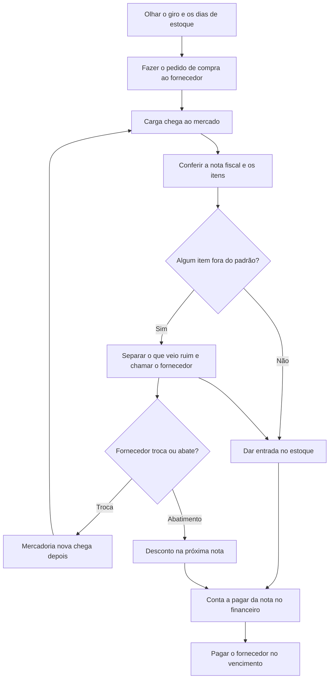
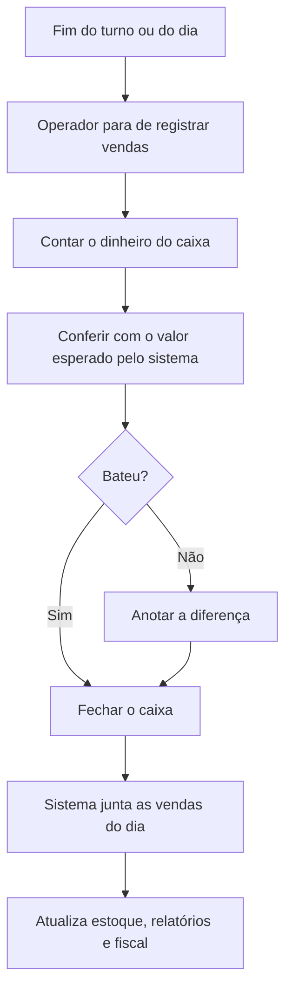
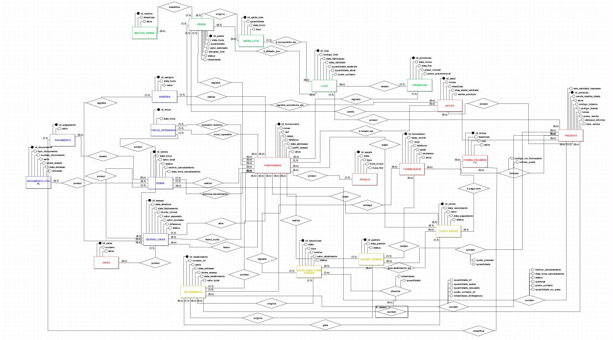

# Entrega 2 — Modelo Lógico, Implementação SQL e Apresentação Final

### Modelagem de um sistema de gestão de informações — Hortifruti União (Tatuapé)

## 1. Relatório Técnico Final

## Integrantes

| Nome completo do aluno | RGM | Usuário do GitHub |
| :---- | :---- | :---- |
| Tarcisio Santos de Oliveira | 47913061 | TarcisioT |
| Gabriela Porfírio da Silva | 48017698 | porfiriogabis |
| Henrique Moura de Oliveira | 47610972 | Bkrusher666 |
| Victor Hugo dos Santos Maciel | 48037630 | vhugo-sm |
| Guilherme Damasceno dos Santos | 48491683 | damascenogs |
| Lucas Praxedes da Silva | 47832550 | lucaspraxedes08sil-gif |

&nbsp;

## 1.1 Revisão do Modelo Conceitual

### Caracterização da organização

- **Nome e natureza da organização:** O Hortifruti União é um mercado localizado no bairro do Tatuapé, em São Paulo. É uma empresa privada que atua no varejo alimentício, tendo como principal atividade a venda de frutas, legumes e verduras. Além disso, o estabelecimento também conta com setores de padaria, frios, laticínios, alimentos embalados e produtos secos. É a mesma organização real que usamos na Entrega 1, e seguimos com ela nesta etapa.

  A organização foi escolhida pelo grupo para a realização do trabalho, sendo possível obter informações sobre seu funcionamento por meio de uma entrevista com um dos responsáveis pelo mercado.

- **Contexto e porte:** O Hortifruti União é uma empresa de médio porte, com fins lucrativos, que funciona todos os dias da semana, incluindo domingos e feriados.

  Durante a entrevista, o responsável compartilhou algumas informações sobre o tamanho e o funcionamento do estabelecimento. Como não tinha relatórios disponíveis no momento, os números foram informados de memória e devem ser considerados aproximados.

  - Cerca de 110 funcionários;
  - 7 caixas;
  - Cerca de 1.800 vendas por dia;
  - Aproximadamente 340 fornecedores;
  - Faturamento mensal estimado em R$ 5 milhões;
  - Cerca de 6 mil itens diferentes vendidos por mês.

  Esses números ajudam a entender o tamanho da operação e a quantidade de informações que o mercado precisa controlar diariamente, principalmente em relação aos produtos, estoque, validade e perdas.

- **Problemas e necessidades identificados:**

  **P1 – Falta de controle sobre a perda de produtos**

  Esse foi o primeiro problema mencionado pelo responsável durante a entrevista. Como o mercado trabalha com muitos produtos frescos, parte deles acaba estragando quando não é vendida a tempo. Ele citou exemplos como frutas muito maduras, verduras murchas, tomates amassados e bananas que começam a escurecer.

  Essas perdas também acontecem em outros setores, como padaria, frios e laticínios. Além disso, existem situações em que os produtos são danificados pelos próprios clientes, como quando algum pote de vidro ou garrafa cai e quebra nos corredores. Há ainda os produtos que já chegam do fornecedor fora do padrão, como tomates moles ou alface murcha. Nesses casos, o mercado chama o fornecedor, que troca a mercadoria ou dá um abatimento na próxima nota.

  O principal problema identificado é a falta de um registro organizado dessas perdas. Atualmente, o mercado não consegue acompanhar com precisão quais produtos foram descartados, em que quantidade e por qual motivo. Sem essas informações, fica difícil identificar os setores com mais perdas e entender quanto isso representa de prejuízo.

  Por isso, uma das necessidades do mercado é ter um controle que permita registrar os produtos perdidos, suas quantidades, os motivos do descarte e os setores envolvidos. Dessa forma, seria possível consultar essas informações e acompanhar melhor as perdas do estabelecimento.

  **P2 – Falta de controle de validade dos produtos**

  Outro problema relatado pelo responsável foi a dificuldade em acompanhar as datas de validade dos produtos. Como o mercado comercializa cerca de 6 mil itens diferentes por mês, controlar todos os vencimentos acaba sendo uma tarefa complicada para a equipe.

  Segundo ele, alguns produtos acabam vencendo nas prateleiras ou no estoque, e muitas vezes os funcionários só percebem quando encontram algum item vencido durante a rotina de trabalho.

  O problema está na falta de um controle que permita consultar quais produtos estão próximos do vencimento. Sem essas informações organizadas, o mercado acaba perdendo a oportunidade de tomar alguma medida antes que os produtos vençam.

  Dessa forma, o estabelecimento precisa de um controle que permita registrar e consultar as datas de validade dos produtos, facilitando a identificação daqueles que estão próximos de vencer. Com essas informações, a equipe poderia se organizar melhor para realizar promoções, reorganizar os produtos nas prateleiras ou retirá-los da exposição quando necessário.

- **Escopo do sistema:** O banco de dados do Hortifruti União será desenvolvido para organizar as informações do mercado como um todo, e não apenas dos problemas de perda e validade dos produtos. Ele deverá incluir dados sobre funcionários e a escala de trabalho, fornecedores, produtos e setores, além de registros de compras, devoluções e trocas com fornecedores, vendas, estoque e pagamentos. Também será possível registrar as perdas e acompanhar as datas de validade dos produtos. Com essas informações reunidas em um só lugar, o mercado poderá ter um controle melhor das suas atividades e consultar os dados com mais facilidade.

  Vale lembrar que o VR Software, o sistema que o mercado já usa, tem recursos para registrar lote, validade e perdas, mas, segundo o responsável, eles não são usados no dia a dia. Por isso, o problema não é a falta de um sistema, e sim a falta de um registro organizado e fácil de consultar desses dados.

  Na prática, o grupo entrega uma implementação acadêmica, independente do VR Software e com dados fictícios, que representa os processos do mercado (compras, estoque, vendas, caixa, perdas e validade). Como não existe integração, uma venda feita no VR Software não aparece sozinha no nosso banco, e o banco não acompanha a operação real do mercado nem substitui o sistema que ele usa hoje.

- **Justificativa da escolha:** Escolhemos o Hortifruti União porque é um mercado de verdade, que lida todo dia com compras, recebimento de mercadorias, estoque e vendas. O Tarcisio, do nosso grupo, já trabalhou lá e conhece um dos proprietários, e foi isso que facilitou o contato com o mercado. Deixamos esse vínculo claro aqui, mas ele não substitui a comprovação da entrevista com o responsável, que apresentamos no relato abaixo. Também achamos que o mercado era um bom caso para o trabalho, porque os problemas de perdas, lotes e validade dos produtos podem ser organizados em um banco de dados relacional.

- **Evidências da organização:**

  - **Localização no Google Maps:** [Ver localização do Hortifruti União](https://www.google.com/maps/search/?api=1&query=Rua+Filipe+Camar%C3%A3o%2C+67%2C+Tatuap%C3%A9%2C+S%C3%A3o+Paulo)
  - **Perfil comercial no Google:** [Consultar perfil do Hortifruti União no Google](https://share.google/LWFseN2UxnhQwKsNh)
  - **Endereço:** Rua Filipe Camarão, nº 67, Tatuapé, São Paulo, CEP 03065-000
  - **Contato da organização:** (11) 91856-3865
  - **Responsável entrevistado:** Guilherme Takemoto
  - **Função:** um dos proprietários do Hortifruti União – Tatuapé
  - **Telefone de contato autorizado:** (11) 99317-0906

.

### Relato da entrevista

- **Quem:** Guilherme Takemoto, um dos proprietários do Hortifruti União – Tatuapé. A entrevista e a visita foram feitas pelo Tarcisio, que já trabalhou no mercado. Os outros integrantes do grupo não participaram.

- **Quando e onde:** A entrevista foi no dia **22/09/2026**, por videochamada no WhatsApp, e durou cerca de uma hora. No dia **30/09/2026**, o Tarcisio foi até o mercado, na Rua Filipe Camarão, 67, no Tatuapé, para observar o funcionamento do local e tirar fotos.

- **O que foi levantado:** Conversamos sobre como o mercado funciona, quantos funcionários e fornecedores tem, o que vende e quais são os principais problemas. Também falamos sobre o VR Software, o controle de estoque, a validade, as perdas, as compras, as vendas e os pagamentos. Depois, no dia 26/10, confirmamos com o responsável, por WhatsApp, alguns detalhes sobre pedidos, notas fiscais, formas de pagamento e fechamento de caixa. No dia 29/10, confirmamos também, por WhatsApp, como o mercado lida com cadastro de clientes, fidelidade, vendas online, entregas, devoluções a fornecedores, escala dos funcionários, cancelamento de vendas, venda restrita por idade, validade dos produtos por setor, venda fiado e troca ou devolução feita pelo cliente.

- **O que o responsável contou:**
  - O mercado perde produtos frescos e de outros setores (padaria, frios e laticínios) por vencimento, por maturação excessiva ou por danos causados por clientes. Essas perdas não são registradas de forma organizada (P1).
  - Acompanhar a validade de cerca de 6 mil itens por mês é difícil, e os funcionários costumam perceber que um produto venceu só quando o encontram na rotina (P2).
  - O VR Software é o sistema da loja e cuida de venda e nota. Ele é usado para cadastrar produtos, dar entrada nas mercadorias, fazer pedidos de compra, operar o caixa, controlar o fiscal e o financeiro e fechar o dia. O sistema tem tela para registrar lote, validade e perdas, mas, segundo o responsável, isso só funciona se alguém cadastrar e baixar tudo todos os dias, o que é difícil com tantos itens. Na prática, esse controle não é feito.
  - Frutas, legumes e verduras geralmente não têm validade impressa e são avaliados visualmente pelos funcionários. Os produtos que têm validade impressa são os embalados e industrializados.
  - O prazo para considerar um produto próximo do vencimento varia conforme o setor.
  - O cancelamento de uma venda no caixa precisa da autorização de um supervisor.
  - Alguns produtos têm venda restrita por idade, e o operador precisa ficar atento a isso no atendimento.
  - O mercado não vende fiado. Todas as vendas são pagas no caixa.
  - A troca ou devolução de produtos pelo cliente existe, mas é rara, e é tratada pela gerência ou pela retaguarda.

- **O que observamos na visita (30/09/2026):**
  - A validade é conferida a olho nu pelos funcionários, sem etiqueta de controle, lista ou qualquer registro das datas (P2).
  - Os produtos perto de vencer recebem uma placa de promoção, sem consulta a uma lista de vencimentos (P2).
  - Os produtos descartados são apenas jogados fora, sem anotação de produto, quantidade, motivo ou setor (P1).
  - O estoque é organizado por setor.
  - Vimos os caixas funcionando, mas não vimos ninguém registrando validade ou perdas no sistema.

- **Comparação entre entrevista e observação:** a visita confirmou o que o responsável contou: a validade é conferida no olho, as perdas não são anotadas e o estoque é separado por setor. Isso também combina com o que ele disse sobre o VR Software: o sistema tem lugar para registrar validade e perdas, mas, na prática, nada disso é registrado. Não percebemos nenhuma divergência.

- **O que mudou em relação à Entrega 1:** na Entrega 1, o único problema levantado era o controle de validade dos produtos. Com a entrevista e a visita desta etapa, encontramos um problema novo: a falta de controle sobre as perdas (P1). Os números do mercado continuam os mesmos. Mudaram também duas coisas: a lista de formas de pagamento, em que o Pix não aparecia e agora entrou porque o responsável confirmou que o mercado aceita Pix, e a composição do grupo, já que Victor Hugo dos Santos Maciel e Guilherme Damasceno dos Santos entraram e Henrico e Nicole saíram.

- **Comprovação:** As fotos tiradas na visita e os registros da entrevista e das confirmações ficam na pasta `imagens/evidencias/`. A entrevista de 22/09 foi realizada por videochamada no WhatsApp e é comprovada pelo respectivo registro. Como ela não aconteceu no ambiente do mercado, não temos uma foto da entrevista em si. A visita presencial de 30/09 está comprovada pelas fotos do local. Também incluímos os prints das confirmações por WhatsApp de 26/10 e 29/10: [videochamada de 22/09](imagens/evidencias/entrevista_videochamada.png), [confirmação por WhatsApp de 26/10](imagens/evidencias/confirmacao_whatsapp_26-10.png) e [confirmação por WhatsApp de 29/10](imagens/evidencias/confirmacao_whatsapp_29-10.png).

- **Resumo do levantamento:** Pelo que o responsável explicou, a rotina do mercado funciona assim:
  - **De manhã (retaguarda):** cadastro dos produtos (código de barras, preço, setor, venda por quilo ou por unidade), conferência da nota do fornecedor e entrada no estoque quando a carga chega, e pedidos de compra feitos olhando o giro e os dias de estoque. O fiscal e o financeiro (notas e contas a pagar) também passam pelo sistema. Quando chega algum item fora do padrão, ele pode ser devolvido ou trocado pelo fornecedor, ou então gerar um abatimento na próxima nota.
  - **No caixa:** o operador abre o caixa com o fundo e passa os itens (os de peso vão pela balança). Existem consulta de preço, cancelamento e troca de operador. Cada venda baixa o estoque, na hora se o estoque online estiver ligado, ou depois que o escritório fecha a conferência do dia.
  - **Durante o dia:** repositores e gerência olham o que zerou ou está com pouco giro. Perdas poderiam ser baixadas no sistema, mas não são.
  - **No fim do dia:** fechamento do caixa, sangria e conferência. Depois o sistema junta as vendas do dia e alimenta o estoque, os relatórios e o fiscal.

- **Levantamento completo:** os processos e regras com mais detalhe estão em [levantamento/levantamento.md](levantamento/levantamento.md).

### Processos de negócio

Com base na entrevista com o responsável, na visita ao Hortifruti União e nas confirmações feitas por WhatsApp em 26/10 e 29/10, identificamos os principais processos que fazem parte da rotina do mercado. Como o estabelecimento trabalha com vários setores e uma grande quantidade de produtos, existem diferentes atividades que precisam ser organizadas e controladas diariamente. Os detalhes de cada processo estão no [levantamento completo](levantamento/levantamento.md).

Para ter certeza de que não esquecemos nenhum processo, comparamos a nossa lista com o que costuma existir em mercados e hortifrutis, usando o ChatGPT e pesquisas. Como usamos IA nessa conferência, o registro está na seção 6.

Os principais processos identificados foram:

- **Cadastro de produtos:** O mercado utiliza o VR Software para cadastrar os produtos, registrando informações como código de barras, preço, setor e forma de venda, que pode ser por quilo ou unidade.

- **Controle de fornecedores:** O mercado trabalha com aproximadamente 340 fornecedores, que abastecem os diferentes setores do estabelecimento. As informações desses fornecedores fazem parte dos dados que precisam ser organizados pelo sistema.

- **Pedidos de compra:** Os pedidos são realizados conforme a necessidade de reposição, considerando o giro dos produtos e a quantidade de dias de estoque disponível.

- **Recebimento de mercadorias:** Quando os produtos chegam ao mercado, é feita a conferência da nota fiscal do fornecedor e a entrada das mercadorias no estoque pelo sistema. Se algum item chega fora do padrão, ele pode ser devolvido ou trocado, como explicado no próximo item.

- **Devolução e troca de mercadorias com fornecedores:** Quando chega mercadoria fora do padrão, como caixa de tomate mole, banana verde demais, alface murcha ou embalado amassado, o mercado chama o fornecedor. Normalmente ele troca o produto ou dá um abatimento na próxima nota. Segundo o responsável, isso acontece quase toda semana. Esse processo tem a ver com o controle de perdas, porque parte do que chega estragado não vira prejuízo para o mercado quando o fornecedor troca ou compensa a mercadoria.

- **Controle de estoque:** Os produtos são organizados por setor, e os funcionários acompanham quais itens precisam ser repostos. As vendas também atualizam as quantidades em estoque, de forma imediata quando o controle online está ativado ou após a conferência do dia.

- **Vendas e operação de caixa:** O mercado possui 7 caixas e realiza aproximadamente 1.800 vendas por dia. Os operadores abrem o caixa com o fundo, registram os produtos vendidos, usam a balança para os itens vendidos por peso, recebem o pagamento dos clientes e podem fazer consultas de preço, cancelamentos de venda e troca de operador. O mercado aceita pagamento em dinheiro, débito, crédito, Pix e vale-alimentação (VA), e as vendas são feitas de forma anônima, sem identificação do cliente.

- **Controle financeiro e fiscal:** O VR Software também é utilizado para controlar notas fiscais, contas a pagar e pagamentos. No final do dia, são realizados o fechamento dos caixas, as sangrias e a conferência das vendas.

- **Controle de validade e lote:** Os funcionários verificam as datas de validade diretamente nos produtos. Apesar de o sistema possuir recursos para registrar lote e validade, esse controle não é utilizado na prática, dificultando a identificação dos itens próximos do vencimento.

- **Controle de perdas:** O mercado descarta produtos que estragam, vencem ou sofrem danos. Porém, essas perdas não são registradas de forma organizada, o que dificulta saber quais produtos foram perdidos, suas quantidades e os motivos.

- **Promoções de produtos próximos do vencimento:** Quando os funcionários encontram produtos próximos da validade, eles podem receber uma placa de promoção para incentivar a venda antes do vencimento. Esse processo é feito por meio da observação dos produtos, sem uma lista de vencimentos.

- **Gestão de funcionários e setores:** O mercado tem cerca de 110 funcionários e vários setores (hortifruti, padaria, frios, laticínios, alimentos embalados e produtos secos). O banco de dados vai guardar as informações sobre funcionários e setores, conforme o escopo definido para o sistema.

- **Escala de trabalho dos funcionários:** Como o mercado abre todos os dias, inclusive domingos e feriados, existe uma escala para organizar o trabalho dos cerca de 110 funcionários. Hoje essa escala é feita em planilha, fora do VR Software. Mesmo sem ligação direta com os problemas de perdas e validade, ela é um processo real do mercado, e por isso entrou no nosso modelo.

#### Processos comuns que não foram incluídos no levantamento

Em mercados e hortifrutis costumam existir outros processos além dos listados acima. Em 29/10/2026, confirmamos com o responsável, por WhatsApp, como o Hortifruti União lida com cada um deles. Os que não foram incluídos no modelo, e os motivos, são:

| Processo comum | Situação no Hortifruti União | Motivo de não entrar no modelo |
| :---- | :---- | :---- |
| Cadastro de clientes | Não realiza | As vendas são feitas de forma anônima no caixa, sem identificação do cliente. |
| Programa de fidelidade | Não possui | Não há cadastro de clientes nem desconto para clientes identificados. |
| Vendas pela internet ou aplicativo | Não realiza | O mercado vende apenas de forma presencial. |
| Entregas em domicílio | Não realiza | O mercado não faz entregas, nem com equipe própria nem com terceiros. |
| Venda fiado e crediário | Não realiza | Todas as vendas são pagas no caixa. |
| Troca ou devolução pelo cliente | Existe, mas é rara | É tratada pela gerência ou retaguarda, com os ajustes feitos no sistema utilizado pelo mercado. Por isso, não foi criado um fluxo próprio no caixa. |

Essa mesma conversa também confirmou a devolução e troca com fornecedores e a escala dos funcionários. Como o mercado realiza os dois, eles entraram na lista principal de processos.

#### Fluxogramas

**Fluxograma do processo de venda:**

**Fluxograma do processo de estoque:**

Os fluxos do ciclo de compra e do fechamento de caixa representam as rotinas descritas pelo responsável sobre compras, recebimento e conferência do caixa. Eles estão escritos em Mermaid porque o GitHub renderiza esse formato diretamente no README.

**Fluxograma do ciclo de compra:**

**Fluxograma do fechamento de caixa:**

#### Requisitos do Sistema

Os requisitos abaixo foram definidos a partir da entrevista de 22/09/2026, da visita de 30/09/2026 e das confirmações por WhatsApp de 26/10 e 29/10/2026. O que foi informado pelo responsável ou observado na visita é tratado como **levantamento**. Já os campos, validações e controles definidos pelo grupo para organizar o banco são tratados como **proposta**.

O banco será desenvolvido em MySQL como uma implementação acadêmica, independente do VR Software, com dados fictícios. Não há integração nem carga automática de dados do sistema atual, então o banco representa os processos do mercado, mas não acompanha a operação real.

### Requisitos Funcionais

#### Cadastros

| Código | Requisito | Dados envolvidos |
| :---- | :---- | :---- |
| RF01 | Cadastrar e atualizar setores. | Nome, descrição e dias de antecedência do alerta de validade. |
| RF02 | Cadastrar, atualizar e inativar produtos. | Código interno (PLU), código de barras quando existir, nome, setor, unidade de venda, preço, estoque mínimo, situação, indicador de validade impressa e restrição de venda por idade. |
| RF03 | Cadastrar, atualizar e inativar fornecedores. | Razão social, CNPJ, telefone, e-mail, endereço e situação. |
| RF04 | Relacionar produtos aos fornecedores. | Fornecedor, produto e código do produto no fornecedor. |
| RF05 | Cadastrar formas de pagamento. | Descrição e situação. |
| RF06 | Cadastrar e inativar caixas. | Número e situação. |
| RF07 | Cadastrar motivos de perda. | Descrição e situação. |

#### Funcionários e escala

| Código | Requisito | Dados envolvidos |
| :---- | :---- | :---- |
| RF08 | Cadastrar, atualizar e inativar funcionários. | Nome, CPF, cargo, telefone, data de admissão, setor, perfil de acesso e situação. |
| RF09 | Registrar a escala de trabalho. | Funcionário, data, tipo (trabalho ou folga) e horários, quando for dia de trabalho. |
| RF10 | Consultar a escala por data, funcionário ou setor. | Funcionário, setor, data e horários. |

#### Compras e recebimento

| Código | Requisito | Dados envolvidos |
| :---- | :---- | :---- |
| RF11 | Registrar pedidos de compra e seus itens. | Fornecedor, funcionário, data, situação, produto, quantidade e custo previsto. |
| RF12 | Atualizar a situação do pedido, inclusive cancelá-lo, sem apagar o histórico. | Pedido, situação e data. |
| RF13 | Registrar o recebimento de mercadorias, com ou sem pedido anterior. | Fornecedor, pedido quando houver, funcionário, nota fiscal, datas e valor total. |
| RF14 | Registrar a conferência dos itens recebidos. | Produto, quantidade da nota, quantidade aceita, quantidade recusada, custo e observação. |
| RF15 | Registrar um ou mais lotes para os produtos aceitos no recebimento. | Produto, item recebido, código do lote quando houver, fabricação, validade quando houver, quantidade, saldo e custo. |
| RF16 | Registrar devolução, troca ou abatimento negociado com o fornecedor. | Fornecedor, recebimento, itens, quantidades, tipo, motivo, valor do abatimento, situação, funcionário e data. |
| RF17 | Consultar pedidos, recebimentos e divergências por fornecedor e período. | Quantidades pedidas, aceitas e recusadas. |

#### Estoque

| Código | Requisito | Dados envolvidos |
| :---- | :---- | :---- |
| RF18 | Consultar o saldo dos produtos a partir dos lotes. | Produto, setor, saldo total, saldo por lote e perdas ainda com lote a confirmar. |
| RF19 | Registrar saídas de lote e seus estornos. | Lote, quantidade, venda ou perda de origem, data e hora. |
| RF20 | Consultar produtos com estoque baixo ou pouco giro. | Produto, setor, saldo, estoque mínimo e quantidade vendida no período. |

#### Vendas e caixa

| Código | Requisito | Dados envolvidos |
| :---- | :---- | :---- |
| RF21 | Abrir a sessão de um caixa. | Caixa, operador, data, hora e fundo inicial. |
| RF22 | Registrar vendas e seus itens, sem identificar o cliente. | Sessão, data, situação, produto, quantidade ou peso, preço praticado, subtotal e total. |
| RF23 | Consultar o preço de um produto durante o atendimento. | PLU, código de barras ou nome, preço e unidade de venda. |
| RF24 | Registrar o pagamento da venda em uma ou mais formas. | Venda, forma de pagamento e valor. |
| RF25 | Cancelar uma venda com autorização de supervisor, mantendo seu histórico. | Venda, motivo, operador, supervisor, data e hora. |
| RF26 | Cancelar um ou mais itens enquanto a venda estiver em andamento, mantendo-os registrados como cancelados. | Venda, itens, motivo, operador, data e hora. |
| RF27 | Avisar o operador quando o produto tiver venda restrita por idade. | Produto e indicador de restrição. |
| RF28 | Registrar troca de operador no caixa. | Caixa, operador anterior, novo operador e horários. |
| RF29 | Registrar sangrias. | Sessão, valor, data, hora e funcionário. |
| RF30 | Fechar a sessão do caixa com a conferência dos valores. | Data, hora, valor contado, valor esperado e diferença. |
| RF31 | Registrar os dados do documento fiscal relacionado à venda. | Venda, tipo, número, série, chave de acesso, data e situação. |
| RF32 | Consultar vendas por período, caixa, operador e forma de pagamento. | Totais de vendas concluídas e canceladas. |

#### Financeiro

| Código | Requisito | Dados envolvidos |
| :---- | :---- | :---- |
| RF33 | Registrar contas a pagar relacionadas às notas de recebimento. | Recebimento, vencimento, valor e situação. |
| RF34 | Registrar o pagamento de uma conta. | Conta, data, forma de pagamento e situação. |
| RF35 | Vincular abatimento do fornecedor à conta em que será descontado. | Devolução de origem, conta e valor abatido. |
| RF36 | Consultar contas por vencimento, situação e fornecedor. | Fornecedor, vencimento, valor e situação. |

#### Perdas (P1)

| Código | Requisito | Dados envolvidos |
| :---- | :---- | :---- |
| RF37 | Registrar perdas de produtos. | Data, produto, lote ou situação "lote a confirmar", quantidade, motivo, setor, funcionário, valor quando possível e observação. |
| RF38 | Consultar perdas por setor, motivo, produto e período. | Quantidades, valores e perdas com lote ainda a confirmar. |
| RF39 | Comparar perdas com mercadorias devolvidas, trocadas ou compensadas pelo fornecedor. | Período, fornecedor, setor, perdas e devoluções. |

#### Validade e promoções (P2)

| Código | Requisito | Dados envolvidos |
| :---- | :---- | :---- |
| RF40 | Consultar lotes próximos do vencimento conforme o prazo definido para o setor. | Produto, setor, lote, validade, dias restantes e saldo. |
| RF41 | Consultar lotes vencidos que ainda tenham saldo. | Produto, setor, lote, validade e saldo. |
| RF42 | Registrar promoções de lotes próximos do vencimento. | Lote, preço normal, preço promocional, início, fim e funcionário. |
| RF43 | Consultar promoções vigentes e encerradas. | Produto, lote, período e preços. |

### Requisitos Não Funcionais

| Código | Característica | Requisito |
| :---- | :---- | :---- |
| RNF01 | Segurança | Cada usuário deve acessar somente as funções permitidas pelo seu perfil. |
| RNF02 | Rastreabilidade | Operações importantes devem registrar funcionário, data e hora. |
| RNF03 | Integridade | O banco deve utilizar chaves, campos obrigatórios, unicidade e restrições para evitar dados inválidos. |
| RNF04 | Confiabilidade | Operações que envolvem vários registros devem ser concluídas por inteiro ou não ser gravadas. |
| RNF05 | Histórico | Registros com movimentação não devem ser apagados, mas inativados ou cancelados. |
| RNF06 | Auditoria | Cancelamentos devem permitir identificar quem realizou e, quando necessário, quem autorizou a operação. |
| RNF07 | Proteção de dados | Dados pessoais de funcionários devem ter acesso restrito e a massa de testes deve utilizar dados fictícios. |
| RNF08 | Recuperação | O banco deve permitir cópia de segurança, restauração e recriação por meio do script SQL. |
| RNF09 | Desempenho | As consultas mais utilizadas devem utilizar índices adequados ao volume de aproximadamente 1.800 vendas por dia. |
| RNF10 | Disponibilidade | O banco deve poder ser utilizado durante o funcionamento do mercado, inclusive domingos e feriados. |
| RNF11 | Usabilidade | O registro de perdas deve ser simples e exigir somente as informações necessárias. |
| RNF12 | Compatibilidade | O banco será desenvolvido em MySQL, utilizando InnoDB e `utf8mb4`. |

##### Requisitos comuns não incluídos

Os processos que o Hortifruti União não realiza, como cadastro de clientes, fidelidade, vendas online, entregas e venda fiado, já estão registrados na tabela **“Processos comuns que não foram incluídos no levantamento”** desta seção. Por esse motivo, não criamos requisitos funcionais para esses casos. A troca ou devolução pelo cliente existe, mas é rara e continua fora de um fluxo próprio de caixa.

---

## Regras de Negócio

**[Confirmada]** indica uma prática informada pelo responsável ou observada na visita.  
**[Proposta]** indica uma regra definida pelo grupo para organizar o banco.

- A numeração segue a ordem em que as regras foram criadas, e não a ordem de leitura. Por isso RN08A, RN52 a RN57 aparecem dentro dos grupos por assunto.

### Cadastros

- **RN01 [Confirmada + Proposta]** O mercado cadastra produtos com código de barras, preço, setor e forma de venda. No banco, todo produto também terá um código interno único e nome.
- **RN02 [Confirmada + Proposta]** Produtos pesados podem utilizar etiqueta de código de barras e produtos a granel podem ser informados pelo código interno (PLU). O código interno será único.
- **RN03 [Proposta]** Cada produto terá um setor principal, e esse setor precisa ser um setor que vende produto. Caixa e Retaguarda existem só para organizar os funcionários e não recebem produto nem perda.
- **RN04 [Proposta]** O preço deve ser maior que zero e o estoque mínimo não pode ser negativo. O estoque mínimo também serve para apontar os produtos que precisam de reposição: quando o saldo disponível fica abaixo dele, o produto entra na consulta de estoque baixo (RF20), que mostra se já existe pedido de compra em aberto.
- **RN05 [Proposta]** Produtos, fornecedores, funcionários e caixas com histórico não serão excluídos, apenas inativados.
- **RN06 [Proposta]** O CNPJ do fornecedor não poderá se repetir.
- **RN07 [Proposta]** O CPF do funcionário não poderá se repetir.
- **RN08 [Confirmada]** O mercado aceita pagamento em dinheiro, débito, crédito, Pix e vale-alimentação (VA). Essas formas serão registradas no cadastro de formas de pagamento do banco.
- **RN08A [Proposta]** Cada forma de pagamento tem um uso: venda, fornecedor ou ambos. A venda só aceita formas de uso "venda" ou "ambos", e a conta a pagar só aceita "fornecedor" ou "ambos". Por exemplo, boleto e transferência ficam só para fornecedor, e o Pix vale para os dois lados. O `uso` não pode ser alterado depois que a forma tiver algum pagamento ou conta registrada: para mudar, a forma é inativada e uma nova é cadastrada, assim o histórico continua válido.

### Compras e recebimento

- **RN09 [Confirmada + Proposta]** Os pedidos são definidos considerando giro e dias de estoque. Todo pedido terá fornecedor, data e ao menos um item.
- **RN10 [Confirmada + Proposta]** A nota do fornecedor é conferida no recebimento e não poderá ser cadastrada duas vezes.
- **RN11 [Confirmada + Proposta]** Pode haver recebimento sem pedido, e um pedido pode ter mais de um recebimento.
- **RN12 [Proposta]** Somente a quantidade aceita no recebimento entra no estoque.
- **RN13 [Confirmada + Proposta]** Mercadorias que chegam fora do padrão podem ser trocadas ou gerar abatimento e não são registradas como perda do mercado.

### Lotes e estoque

- **RN14 [Proposta]** Todo lote estará relacionado a um produto recebido e terá quantidade positiva.
- **RN15 [Confirmada + Proposta]** Frutas, legumes e verduras geralmente não possuem validade impressa e são avaliados visualmente. Produtos que possuem validade impressa terão essa informação registrada no lote. Os demais serão acompanhados pelo controle de estoque e perdas.
- **RN16 [Proposta]** O saldo do produto será a soma dos saldos dos seus lotes. O saldo disponível para venda é esse saldo menos as perdas que ainda estão com lote a confirmar (RN42).
- **RN17 [Proposta]** Nenhuma saída poderá ultrapassar o saldo disponível do lote. Cancelamentos geram estorno, e não exclusão.
- **RN18 [Proposta]** Nas vendas, o sistema prioriza o lote que vence primeiro, seguindo a lógica FEFO (*First Expire, First Out*). Quando o produto não tiver validade registrada, prioriza o lote mais antigo.
- **RN19 [Proposta]** Neste banco, a baixa de estoque será registrada quando a venda for concluída. No mercado, a baixa pode ser imediata ou após a conferência do dia, conforme o controle online esteja ativado ou não.
- **RN53 [Proposta]** Na conclusão da venda, a quantidade de cada produto não pode passar do saldo disponível. A procedure `concluir_venda` escolhe os lotes pela regra FEFO e usa `SELECT ... FOR UPDATE` no lote selecionado enquanto a transação está aberta. Assim, aquele lote fica bloqueado até a operação terminar. Como não fizemos um teste com várias conexões ao mesmo tempo, não dá para dizer que a concorrência foi testada; o que foi implementado foi o bloqueio previsto no fluxo.
- **RN57 [Proposta]** Enquanto a venda está em andamento, cada item é registrado com o produto, a quantidade ou o peso e o preço normal do cadastro, ainda sem lote. O lote só é escolhido na conclusão, pela procedure concluir_venda (RN18). Se o item sai de um lote só, a linha fica como está. Se precisa de mais de um, a procedure divide a linha, deixando uma para cada lote. O preço de cada linha é o promocional quando o lote tem promoção vigente (RN47 e RN48) e o normal quando não tem. O lote de cada linha fica na baixa (SAIDA_LOTE), que aponta para o item de venda. Os itens cancelados durante a venda (RN26) saem antes dessa etapa e não entram na escolha de lote. O produto do item e o produto do lote têm que ser o mesmo.

### Vendas e pagamentos

- **RN20 [Proposta]** Toda venda estará ligada a uma sessão de caixa aberta e a um operador. O operador da venda precisa ser o operador da sessão naquele momento: quem abriu o caixa ou, se houve troca, o novo operador da última troca (RN29). O trigger de VENDA confere isso.
- **RN21 [Confirmada]** As vendas são anônimas, sem cadastro de clientes.
- **RN22 [Confirmada + Proposta]** Produtos vendidos por quilo aceitam quantidade decimal e produtos por unidade utilizam quantidade inteira. O banco guarda o peso informado na venda.
- **RN23 [Proposta]** O total da venda será a soma dos itens que não estiverem cancelados. O total fica definitivo na conclusão da venda.
- **RN24 [Confirmada]** O mercado não vende fiado e as vendas são pagas no caixa, podendo utilizar uma ou mais formas de pagamento na mesma venda.

### Cancelamentos e vendas restritas

- **RN25 [Confirmada + Proposta]** O cancelamento de uma venda exige autorização de supervisor, e o funcionário que autoriza precisa ter perfil de supervisor. A venda cancelada permanece registrada e não entra nos totais.
- **RN26 [Proposta]** Um ou mais itens podem ser cancelados enquanto a venda estiver em andamento. O item permanece registrado, mas deixa de fazer parte do total.
- **RN27 [Confirmada + Proposta]** Produtos com venda restrita por idade serão identificados no cadastro e o sistema mostrará um aviso ao operador. O banco não armazenará documento do cliente.
- **RN28 [Proposta]** Cancelamento, perda e devolução ao fornecedor são situações diferentes. Uma mercadoria de venda cancelada não será registrada como perda.
- **RN54 [Proposta]** Quando uma venda já concluída é cancelada, todas as baixas de estoque dos itens ativos dela são estornadas na mesma transação, e cada baixa só pode ser estornada uma vez (RN17). Se algum passo falhar, nada é gravado (RNF04).
- **RN55 [Proposta]** Os pagamentos de uma venda cancelada continuam no histórico, mas a venda não entra no faturamento nem no valor esperado do caixa (RN25). O banco não registra a devolução do dinheiro ao cliente: cancelar é desfazer a venda inteira. Por isso o valor esperado do caixa considera que o dinheiro dessa venda voltou ao cliente ou nunca ficou lá. Como essa saída de dinheiro não é rastreada, uma diferença no fechamento causada por ela apareceria no banco sem explicação. Se um dia for preciso separar o que foi recebido do que foi devolvido, o pagamento vai precisar de uma coluna de situação. Isso ficou fora do nosso trabalho.

### Caixa e fiscal

- **RN29 [Confirmada + Proposta]** Existe troca de operador e cada caixa terá somente uma sessão aberta por vez.
- **RN30 [Confirmada + Proposta]** O caixa é aberto com um fundo inicial, que não poderá ser negativo.
- **RN31 [Confirmada + Proposta]** Sangrias só poderão ser registradas em sessões abertas e com valor positivo.
- **RN32 [Confirmada + Proposta]** No fechamento, a diferença será calculada pelo valor contado menos o valor esperado.
- **RN33 [Confirmada + Proposta]** O processo fiscal continua sendo feito no sistema atual. O banco apenas armazenará os dados dos documentos relacionados às vendas.

### Financeiro

- **RN34 [Confirmada + Proposta]** Contas a pagar relacionadas às compras terão vencimento, valor e recebimento de origem.
- **RN35 [Proposta]** Uma conta poderá estar aberta, paga ou cancelada. O modelo não registra pagamento parcial: a conta é paga de uma vez, pelo saldo a pagar.
- **RN36 [Proposta]**A conta a pagar mantém o valor original da nota. Os abatimentos do fornecedor ficam em DEVOLUCAO_FORNECEDOR e são ligados à conta. O saldo a pagar é o valor da conta menos a soma dos abatimentos ligados a ela. A soma dos abatimentos de uma conta não pode passar do valor dela, e só dá para ligar abatimento a conta aberta.

### Devoluções e abatimentos

- **RN37 [Proposta]** O responsável confirmou por WhatsApp que o mercado trabalha com devolução, troca e abatimento junto ao fornecedor quando há problema na mercadoria. No banco, a devolução fica ligada ao recebimento e não pode passar da quantidade recusada. Quando o fornecedor troca o produto, o que chega no lugar entra como um novo recebimento, sem pedido (RN11), e a devolução é registrada como troca (RF16). Quando há abatimento, aplica-se a RN38. O abatimento não altera o custo_unitario do lote, para que o custo histórico da mercadoria permaneça igual ao da nota de origem.
- **RN38 [Confirmada + Proposta]** O abatimento concedido pelo fornecedor será relacionado a uma conta do mesmo fornecedor.
- **RN39 [Proposta]** Uma mercadoria devolvida, trocada ou compensada pelo fornecedor não será registrada também como perda.

### Perdas

- **RN40 [Confirmada + Proposta]** O levantamento identificou perdas por vencimento, maturação excessiva e danos causados por clientes. Esses casos formarão a lista inicial de motivos, além da opção "Outros".
- **RN41 [Proposta]** Toda perda terá produto, quantidade, motivo, setor, funcionário, data e situação do lote.
- **RN42 [Proposta]** Quando o lote da perda for conhecido, a quantidade perdida será baixada desse lote. Se o lote não for conhecido, a perda ficará como "lote a confirmar" até que essa informação seja conferida. Enquanto estiver pendente, a quantidade é descontada do saldo disponível do produto (RN16), e uma perda pendente não pode ser maior que esse saldo disponível.
- **RN43 [Proposta]** Uma perda registrada não será apagada. Para corrigir uma perda (por exemplo, 15 kg registrados que eram 12 kg) ou dividi-la em lotes (RN52), o registro original passa para a situação substituida, deixa de entrar nos totais e nas pendências, e a perda nova (ou as novas) aponta para ele. Se o original já tinha baixa em lote, essa baixa é estornada (RN17) e a perda nova gera a sua própria baixa. Só as perdas com situação valida contam nos indicadores.
- **RN44 [Proposta]** O valor da perda será calculado com base na quantidade e no custo do lote. Perdas sem lote confirmado ficarão sem valor até a identificação.
- **RN52 [Proposta]** Quando o lote de uma perda pendente é confirmado, o banco faz tudo de uma vez, na mesma transação: baixa a quantidade no lote (saída do tipo perda), marca a perda como confirmada e calcula o valor. A partir daí ela deixa de ser descontada como pendente, então a quantidade sai uma única vez do saldo disponível. A quantidade não pode passar do saldo do lote. Uma perda confirmada pertence a um lote só. Se a mercadoria perdida veio de mais de um lote do mesmo produto, a pendência original passa a `substituida` (RN43) e é trocada por uma perda para cada lote, todas ligadas a ela, e a soma das partes tem que dar a quantidade original. Como só as perdas válidas entram nos totais, nada é contado duas vezes.

### Validade e promoções

- **RN45 [Confirmada + Proposta]** O prazo de alerta de validade varia conforme o setor. Cada setor que trabalha com validade impressa tem um número de dias definido. Os setores com dias_alerta_validade vazio (hortifruti, Caixa e Retaguarda) não geram alerta pelo setor. Se um produto desses setores tiver validade impressa (RN15), o lote dele usa um prazo padrão de 7 dias, definido pelo grupo. Esse prazo não é coluna do banco: ele aparece como constante na consulta G03, e para mudar o prazo basta editar o valor lá.
- **RN46 [Proposta]** Lote vencido na data da venda não pode ser vendido nem entrar em promoção. A conferência usa a data da operação e não a data de hoje.
- **RN47 [Confirmada + Proposta]** Produtos próximos do vencimento podem entrar em promoção, com preço inferior ao preço normal.
- **RN48 [Proposta]** A promoção terminará na data definida ou no vencimento do lote, o que acontecer primeiro.

### FuncionárioS, escala e rastreabilidade

- **RN49 [Confirmada + Proposta]** O mercado funciona todos os dias e organiza a escala em planilha. No banco, dias de trabalho terão horário de início e fim; folgas terão apenas a data.
- **RN50 [Proposta]** Funcionários inativos não poderão realizar novas operações, mas seu histórico será mantido.
- **RN51 [Proposta]** Dados pessoais dos funcionários, e os contatos de fornecedor que for pessoa física ou MEI, serão acessíveis somente a usuários autorizados, por causa da LGPD.
- **RN56 [Proposta]** Todo fechamento de sessão de caixa e todo pagamento de conta a pagar guardam o funcionário que fez a operação, além da data e da hora (por isso `data_pagamento` e `data_fechamento` são `DATETIME`). Esse funcionário precisa estar ativo (RN50).

### Regras comuns não incluídas

As regras ligadas a cadastro de clientes, fidelidade, entrega, venda a prazo e troca pelo cliente seguem as situações já registradas na tabela **“Processos comuns que não foram incluídos no levantamento”**. Como esses processos não fazem parte do fluxo modelado, não criamos regras de negócio específicas para eles.

A aferição da balança (Inmetro) também ficou fora do modelo. O banco apenas guarda o peso informado na venda (RN22), e o grupo não confirmou com o responsável como a aferição é realizada. Por isso, não foi criada uma regra para um processo que o banco não controla.

### Rastreabilidade dos problemas P1 e P2

| Problema | Requisitos funcionais | Regras de negócio | Como contribuem |
| :---- | :---- | :---- | :---- |
| **P1 – Falta de controle sobre a perda de produtos** | RF07, RF14, RF16, RF19, RF37 a RF39 | RN12, RN13, RN17, RN28, RN37 a RN44 e RN52 | Permitem registrar e consultar as perdas por produto, quantidade, motivo e setor, além de separar perdas de devoluções e compensações de fornecedores. |
| **P2 – Falta de controle de validade dos produtos** | RF01, RF02, RF15, RF18 e RF40 a RF43 | RN14 a RN16, RN18, RN45 a RN48 e RN57 | Permitem registrar a validade dos lotes, identificar produtos próximos do vencimento ou vencidos e acompanhar promoções antes do vencimento. |

A relação entre os problemas, as tabelas do banco e as consultas SQL será detalhada posteriormente na seção 1.6.

---

#### DER Conceitual Revisado

##### Como montamos o DER

Usamos a entrevista com o responsável, a visita ao mercado e as confirmações pelo WhatsApp. Além dos problemas P1 e P2, quisemos representar o resto da rotina do mercado: compras, recebimento, vendas, pagamentos, caixa e funcionários.

O DER foi feito no brModelo (aplicativo instalado), na notação pedida pelo professor: entidades em retângulos, relacionamentos em losangos e atributos em círculos, com cardinalidades mínimas e máximas. As chaves estrangeiras não aparecem aqui, porque só entram no modelo lógico.

O DER tem **22 entidades**. Os itens de pedido, de recebimento, de devolução e de venda, além do vínculo entre fornecedor e produto, são representados como associações com atributos, como explicamos mais abaixo. Com essa modelagem, o diagrama possui **48 relacionamentos**.

**Ferramenta:** [brModelo Web](https://app.brmodeloweb.com)

**Link do modelo:** [DER do Hortifruti União no brModelo](https://app.brmodeloweb.com/conceptual/6ae380e92407b9c8c2a6db74)

**Arquivo do diagrama:** [Visualizar DER Conceitual](diagramas/der.conceitual.png)

##### Entidades e atributos

São **27 entidades**, separadas por assunto. Cada uma tem um identificador, que no diagrama aparece como círculo preenchido.

###### Cadastros e funcionários

| Entidade | Identificador | Principais atributos |
| :--- | :--- | :--- |
| SETOR | chave_setor | nome, descricao, dias_alerta_validade |
| PRODUTO | chave_produto | codigo_interno, codigo_barras, nome, preco_venda, estoque_minimo, tipo_venda, tem_validade_impressa, venda_restrita_idade, ativo |
| FORNECEDOR | chave_fornecedor | razao_social, cnpj, telefone, email, endereco, ativo |
| FORNECEDOR_PRODUTO | chave_fornecedor_produto | codigo_no_fornecedor, ultimo_custo |
| FUNCIONARIO | chave_funcionario | nome, cpf, cargo, telefone, data_admissao, perfil_acesso, ativo |
| ESCALA | chave_escala | data, tipo, hora_inicio, hora_fim |
| FORMA_PAGAMENTO | chave_forma | descricao, ativo |
| CAIXA | chave_caixa | numero, ativo |

- Nem todo produto tem código de barras (os vendidos a granel, por exemplo). Por isso o produto também tem um código interno (PLU), que não se repete. A `chave_produto` é só o identificador usado pelo banco.
- A FORNECEDOR_PRODUTO existe porque um produto pode ter mais de um fornecedor. O banco não vai deixar cadastrar o mesmo par duas vezes.
- A ESCALA entrou porque o mercado abre todos os dias e precisa organizar horários e folgas. Não é um dos problemas principais, mas faz parte da rotina.

###### Compras, recebimentos e devoluções

| Entidade | Identificador | Principais atributos |
| :--- | :--- | :--- |
| PEDIDO_COMPRA | chave_pedido | data_pedido, status |
| ITEM_PEDIDO_COMPRA | chave_item_pedido | quantidade, custo_previsto |
| RECEBIMENTO | chave_recebimento | numero_nf, serie, data_emissao, chave_acesso, data_recebimento, valor_total |
| ITEM_RECEBIMENTO | chave_item_recebimento | quantidade_nf, quantidade_aceita, quantidade_recusada, custo_unitario_nf, observacao_divergencia |
| DEVOLUCAO_FORNECEDOR | chave_devolucao | data, tipo, motivo, valor_abatimento, status |
| ITEM_DEVOLUCAO | chave_item_devolucao | quantidade, observacao |
| CONTA_PAGAR | chave_conta | data_vencimento, valor, data_pagamento, status |

- Pedido e recebimento ficam separados porque nem tudo chega de uma vez, e também pode haver recebimento sem pedido.
- O item recebido guarda o que veio na nota e o que o mercado aceitou. Um mesmo item pode gerar mais de um lote, se as validades forem diferentes, e a soma dos lotes tem que bater com a quantidade aceita. Se nada foi aceito, não se cria lote.
- A devolução entrou porque o responsável contou que mercadoria fora do padrão é trocada ou vira abatimento na próxima nota. Isso não pode se misturar com perda.

###### Estoque, perdas e validade

| Entidade | Identificador | Principais atributos |
| :--- | :--- | :--- |
| LOTE | chave_lote | codigo_lote, data_fabricacao, data_validade, quantidade_recebida, quantidade_atual, custo_unitario |
| SAIDA_LOTE | chave_saida_lote | quantidade, data_hora, tipo |
| MOTIVO_PERDA | chave_motivo | descricao, ativo |
| PERDA | chave_perda | data_hora, quantidade, valor_estimado, situacao_lote, observacao |
| PROMOCAO | chave_promocao | data_inicio, data_fim, preco_normal, preco_promocional |

Essa é a parte mais ligada a P1 e P2.

- A validade fica no **LOTE** e não no produto, porque o leite que chegou hoje pode ter validade diferente do que chegou na semana passada.
- A **PERDA** guarda o produto, a quantidade, o motivo e quem registrou. O **MOTIVO_PERDA** organiza as ocorrências, como vencimento, maturação excessiva e dano causado por cliente.
- A **SAIDA_LOTE** registra o que sai do lote por venda ou por perda. O `tipo` pode ser venda, perda ou estorno. Quando uma baixa precisa ser desfeita, a gente não apaga: cria um estorno que devolve a quantidade ao lote.
- A **PROMOCAO** é para os produtos perto de vencer, ligada ao lote.

###### Vendas e operação de caixa

| Entidade | Identificador | Principais atributos |
| :--- | :--- | :--- |
| SESSAO_CAIXA | chave_sessao | data_abertura, data_fechamento, fundo_inicial, valor_esperado, valor_contado, diferenca, status |
| TROCA_OPERADOR | chave_troca | data_hora |
| SANGRIA | chave_sangria | data_hora, valor |
| VENDA | chave_venda | data_hora, valor_total, status, motivo_cancelamento, data_hora_cancelamento |
| ITEM_VENDA | chave_item_venda | quantidade_ou_peso, preco_unitario, subtotal, status, motivo_cancelamento, data_hora_cancelamento |
| PAGAMENTO | chave_pagamento | valor |
| DOCUMENTO_FISCAL | chave_documento | tipo_documento, numero_documento, serie, chave_acesso, data_emissao, situacao |

- A venda e os itens ficam separados porque uma venda tem vários produtos, e o preço da hora pode ser diferente do preço atual do cadastro.
- O pagamento também é separado, porque uma venda pode ser paga de mais de um jeito (parte no Pix, parte no cartão). O valor registrado é o que foi aplicado à venda, sem o troco.
- Sessão de caixa, sangria e troca de operador guardam o histórico do caixa. Venda cancelada continua registrada.

O subtotal, o total da venda e a diferença do caixa são **atributos derivados**, porque dá para calcular a partir de outros dados. Outros três também dariam para calcular, mas vamos guardar:

- **quantidade_atual do lote:** para ver o saldo sem somar todas as movimentações toda vez (são cerca de 1.800 vendas por dia). Ela precisa ser atualizada junto com cada baixa ou estorno;
- **valor_esperado do caixa:** fica gravado como estava no fechamento;
- **valor_estimado da perda:** calculado pela quantidade e pelo custo do lote. Se o lote ainda não foi identificado, fica vazio até a confirmação.

##### Relacionamentos e cardinalidades

As cardinalidades mostram quantas vezes cada registro pode participar de um relacionamento. Por exemplo, um setor tem vários produtos, mas cada produto tem um único setor principal. O relacionamento 50 liga o estorno à baixa que ele corrige.

| Nº | Relacionamento | Entidade A | Entidade B |
| :--- | :--- | :--- | :--- |
| 1 | possui | SETOR (0,n) | PRODUTO (1,1) |
| 2 | é lotado em | SETOR (0,n) | FUNCIONARIO (1,1) |
| 3 | possui | FUNCIONARIO (0,n) | ESCALA (1,1) |
| 4 | fornece | FORNECEDOR (0,n) | FORNECEDOR_PRODUTO (1,1) |
| 5 | é fornecido por | PRODUTO (0,n) | FORNECEDOR_PRODUTO (1,1) |
| 6 | recebe | FORNECEDOR (0,n) | PEDIDO_COMPRA (1,1) |
| 7 | realiza | FUNCIONARIO (0,n) | PEDIDO_COMPRA (1,1) |
| 8 | contém | PEDIDO_COMPRA (1,n) | ITEM_PEDIDO_COMPRA (1,1) |
| 9 | é pedido em | PRODUTO (0,n) | ITEM_PEDIDO_COMPRA (1,1) |
| 10 | entrega | FORNECEDOR (0,n) | RECEBIMENTO (1,1) |
| 11 | origina | PEDIDO_COMPRA (0,n) | RECEBIMENTO (0,1) |
| 12 | confere | FUNCIONARIO (0,n) | RECEBIMENTO (1,1) |
| 13 | contém | RECEBIMENTO (1,n) | ITEM_RECEBIMENTO (1,1) |
| 14 | é recebido em | PRODUTO (0,n) | ITEM_RECEBIMENTO (1,1) |
| 15 | gera | ITEM_RECEBIMENTO (0,n) | LOTE (1,1) |
| 16 | possui | PRODUTO (0,n) | LOTE (1,1) |
| 17 | gera | RECEBIMENTO (0,n) | CONTA_PAGAR (1,1) |
| 18 | é paga com | FORMA_PAGAMENTO (0,n) | CONTA_PAGAR (0,1) |
| 19 | origina | RECEBIMENTO (0,n) | DEVOLUCAO_FORNECEDOR (1,1) |
| 20 | registra | FUNCIONARIO (0,n) | DEVOLUCAO_FORNECEDOR (1,1) |
| 21 | contém | DEVOLUCAO_FORNECEDOR (1,n) | ITEM_DEVOLUCAO (1,1) |
| 22 | é devolvido em | ITEM_RECEBIMENTO (0,n) | ITEM_DEVOLUCAO (1,1) |
| 23 | gera abatimento em | DEVOLUCAO_FORNECEDOR (0,1) | CONTA_PAGAR (0,n) |
| 24 | é consumido em | LOTE (0,n) | SAIDA_LOTE (1,1) |
| 25 | origina | ITEM_VENDA (0,n) | SAIDA_LOTE (0,1) |
| 26 | origina | PERDA (0,n) | SAIDA_LOTE (0,1) |
| 27 | sofre | PRODUTO (0,n) | PERDA (1,1) |
| 28 | registra ocorrência em | SETOR (0,n) | PERDA (1,1) |
| 29 | classifica | MOTIVO_PERDA (0,n) | PERDA (1,1) |
| 30 | registra | FUNCIONARIO (0,n) | PERDA (1,1) |
| 31 | é afetado por | LOTE (0,n) | PERDA (0,1) |
| 32 | recebe | LOTE (0,n) | PROMOCAO (1,1) |
| 33 | registra | FUNCIONARIO (0,n) | PROMOCAO (1,1) |
| 34 | possui | CAIXA (0,n) | SESSAO_CAIXA (1,1) |
| 35 | abre | FUNCIONARIO (0,n) | SESSAO_CAIXA (1,1) |
| 36 | possui | SESSAO_CAIXA (0,n) | TROCA_OPERADOR (1,1) |
| 37 | é operador anterior em | FUNCIONARIO (0,n) | TROCA_OPERADOR (1,1) |
| 38 | é novo operador em | FUNCIONARIO (0,n) | TROCA_OPERADOR (1,1) |
| 39 | registra | SESSAO_CAIXA (0,n) | SANGRIA (1,1) |
| 40 | realiza | FUNCIONARIO (0,n) | SANGRIA (1,1) |
| 41 | possui | SESSAO_CAIXA (0,n) | VENDA (1,1) |
| 42 | realiza | FUNCIONARIO (0,n) | VENDA (1,1) |
| 43 | autoriza cancelamento | FUNCIONARIO (0,n) | VENDA (0,1) |
| 44 | contém | VENDA (1,n) | ITEM_VENDA (1,1) |
| 45 | é vendido em | PRODUTO (0,n) | ITEM_VENDA (1,1) |
| 46 | cancela | FUNCIONARIO (0,n) | ITEM_VENDA (0,1) |
| 47 | recebe | VENDA (0,n) | PAGAMENTO (1,1) |
| 48 | classifica | FORMA_PAGAMENTO (0,n) | PAGAMENTO (1,1) |
| 49 | possui | VENDA (0,1) | DOCUMENTO_FISCAL (1,1) |
| 50 | estorna (autorrelacionamento) | SAIDA_LOTE original (0,1) | SAIDA_LOTE de estorno (0,1) |

##### Decisões tomadas na modelagem

- **Sem CLIENTE.** Chegamos a considerar, mas o responsável confirmou que o mercado não cadastra clientes nas vendas comuns.
- **Validade no lote.** Como as mercadorias chegam em dias diferentes, cada lote tem a sua validade. Isso resolve o P2.
- **Sem entidade ESTOQUE.** O saldo do produto é a soma dos saldos dos seus lotes, para não guardar a mesma informação em dois lugares.
- **PERDA separada de DEVOLUCAO_FORNECEDOR.** Mercadoria descartada pelo mercado é diferente de mercadoria devolvida ou compensada pelo fornecedor. Misturar as duas esconderia o prejuízo real.
- **Origem da baixa.** Cada baixa de venda ou de perda tem uma única origem (um item de venda ou uma perda). O estorno não tem origem própria: ele aponta para a baixa que corrige e devolve a quantidade inteira dela. O banco precisa garantir isso e impedir que a mesma baixa seja estornada duas vezes.
- **Venda e pagamento (0,n).** Uma venda em andamento, ou cancelada antes de pagar, não tem pagamento. Para ser concluída, a venda precisa estar paga, e a soma dos pagamentos tem que bater com o total (RN24).
- **Entidades de item e de troca de operador.** Cada item precisa guardar quantidade, custo, preço e situação, e a troca de operador precisa de histórico, por isso ficaram separados.

Alguns caminhos se repetem no DER, e deixamos de propósito:

- **PRODUTO – LOTE (16):** o produto também dá para descobrir pelo item recebido. Deixamos a ligação direta para facilitar as consultas por produto. No modelo lógico e no SQL, vamos impedir que o lote aponte para um produto diferente do item recebido.
- **LOTE – PERDA (31):** a perda aponta para o lote quando ele é conhecido. Se não é, fica como "lote a confirmar" e ainda não tem saída de lote.
- **SETOR – PERDA (28):** o setor também dá para descobrir pelo produto, mas guardamos na perda para manter o histórico caso o produto mude de setor.

O relacionamento 50 não é um caminho repetido, é um autorrelacionamento de SAIDA_LOTE. Mantivemos (0,1) nas duas pontas porque nem toda baixa tem um estorno, e nem toda baixa aponta para outra (uma baixa de venda ou de perda não tem baixa original). Quando o tipo for estorno, porém, o banco vai exigir a ligação com uma baixa original e impedir que ela seja estornada mais de uma vez.

As validações mais detalhadas, como não repetir pares em FORNECEDOR_PRODUTO e conferir as quantidades recebidas, vão para o dicionário de dados e para o banco.

##### Relação do DER com os problemas

| Problema | Entidades relacionadas | Como o modelo ajuda |
| :--- | :--- | :--- |
| **P1 – Perda de produtos** | PERDA, MOTIVO_PERDA, PRODUTO, SETOR, FUNCIONARIO, LOTE, SAIDA_LOTE, DEVOLUCAO_FORNECEDOR e ITEM_DEVOLUCAO | Registra o que foi perdido, a quantidade, o motivo e o setor, e separa perda de devolução ao fornecedor. |
| **P2 – Validade dos produtos** | PRODUTO, LOTE, ITEM_RECEBIMENTO, SAIDA_LOTE, SETOR e PROMOCAO | Acompanha validade e saldo de cada lote, mostra o que está perto de vencer e registra promoções. |

Com isso, o mercado passa a poder consultar coisas que hoje não ficam registradas, como quais setores perdem mais, quais motivos aparecem mais e quais lotes estão perto de vencer. Os indicadores (KPIs) e a ligação deles com as consultas estão na seção 1.6, e as consultas ficam no script SQL (seção 3).

##### Revisão em relação à Entrega 1

Revisamos o modelo com base nos apontamentos da Entrega 1 e nas informações novas do mercado. A principal mudança foi sair de um modelo focado em produtos, estoque e vendas para um que cobre também os outros processos da organização.

| Apontamento da correção da E1 | O que mudou no trabalho | Por quê |
| :--- | :--- | :--- |
| DER anexado no editor do GitHub | Virou uma imagem referenciada no README | O professor exige o arquivo no repositório. |
| Cardinalidades só com o máximo | Passaram a ter mínimo e máximo | Mostra o que é obrigatório e o que é opcional. |
| Chaves estrangeiras no conceitual | Foram retiradas | Pertencem ao modelo lógico. |
| Venda e produto incompletos | Criamos ITEM_VENDA | Precisamos da quantidade e do preço de cada produto vendido. |
| Sem entidade de lotes | Criamos LOTE | O controle de validade depende de cada lote. |
| Compra incompleta | Incluímos pedidos, itens, recebimentos e contas a pagar | Fazem parte da rotina do mercado. |
| Entidade CLIENTE | Foi retirada | As vendas não têm cadastro de cliente. |
| Faltava a operação dos caixas | Incluímos caixa, sessão, pagamento, sangria e troca de operador | O banco precisa mostrar o que acontece no atendimento. |
| Entidade CATEGORIA | Trocada por SETOR | O mercado organiza por setor, e o prazo de alerta de validade varia conforme o setor. A validade de cada produto fica registrada no lote. |
| Perdas não representadas | Criamos PERDA, MOTIVO_PERDA e as ligações | Foi um dos principais problemas do levantamento. |
| Sem funcionários e escalas | Incluímos FUNCIONARIO e ESCALA | São cerca de 110 funcionários e a escala é feita em planilha. |
| Justificativas pouco detalhadas | Passamos a explicar as alternativas e os motivos | Mostra por que cada coisa faz sentido para o mercado. |

Além dos apontamentos, incluímos por conta própria o estorno em SAIDA_LOTE, ligado à baixa original, para corrigir baixas sem apagar o histórico.

##### Considerações sobre o modelo conceitual

O DER agora cobre cadastros, compras, recebimentos, vendas, pagamentos, funcionários, escalas e estoque. Demos mais atenção a lotes e perdas, que são os pontos que o responsável mais destacou. Também deixamos de fora o que o mercado não faz, como fidelidade, vendas online e entrega.

Algumas regras não aparecem no desenho, como impedir saída maior que o saldo do lote, impedir venda de lote vencido, conferir as quantidades recebidas e exigir autorização para cancelar. Elas ficam para o modelo lógico e o script SQL.

O próximo passo é transformar as entidades em tabelas, definir as chaves primárias e estrangeiras e preparar tudo para o MySQL.

### 1.2 Conversão do Modelo Conceitual para o Modelo Lógico

Passamos as 13 entidades para 13 tabelas no MySQL 8.0: `PRODUTO`, `CATEGORIA_PRODUTO`, `FORNECEDOR`, `PEDIDO_COMPRA`, `ITEM_PEDIDO_COMPRA`, `RECEBIMENTO`, `LOTE`, `FUNCIONARIO`, `VENDA`, `ITEM_VENDA`, `PAGAMENTO`, `PERDA` e `SAIDA_LOTE`. São 13 PKs e 17 FKs.

Os atributos viraram colunas (`codigo_produto`, `nome_produto`, `preco_venda`, `unidade_medida` etc.). Identificador virou PK; referência virou FK.

No 1:N a FK ficou no lado N (exemplo: `LOTE.codigo_produto` aponta para `PRODUTO`). Onde era N:N, criamos tabela no meio:

- `ITEM_VENDA`: venda × produto (quantidade, preço praticado, subtotal);
- `ITEM_PEDIDO_COMPRA`: pedido × produto (quantidade, preço de compra);
- `SAIDA_LOTE`: item vendido × lote (quantidade retirada).

Não fizemos tabela `FORNECEDOR_PRODUTO`. A lista de produtos por fornecedor sai do histórico de pedidos (RF04).

Não usamos generalização/especialização: no escopo não apareceu hierarquia do tipo pessoa física/jurídica.

### 1.3 Definição de Chaves Primárias e Estrangeiras

| Tabela | Chave primária (PK) | Chaves estrangeiras (FK) |
|---|---|---|
| FORNECEDOR | `codigo_fornecedor` | Não possui |
| CATEGORIA_PRODUTO | `codigo_categoria` | Não possui |
| FUNCIONARIO | `codigo_funcionario` | Não possui |
| PRODUTO | `codigo_produto` | `codigo_categoria` → CATEGORIA_PRODUTO |
| PEDIDO_COMPRA | `codigo_pedido` | `codigo_fornecedor` → FORNECEDOR |
| ITEM_PEDIDO_COMPRA | `codigo_item_pedido` | `codigo_pedido` → PEDIDO_COMPRA; `codigo_produto` → PRODUTO |
| RECEBIMENTO | `codigo_recebimento` | `codigo_pedido` → PEDIDO_COMPRA |
| LOTE | `codigo_lote` | `codigo_produto` → PRODUTO; `codigo_item_pedido` → ITEM_PEDIDO_COMPRA; `codigo_recebimento` → RECEBIMENTO |
| PERDA | `codigo_perda` | `codigo_lote` → LOTE; `codigo_funcionario` → FUNCIONARIO |
| VENDA | `codigo_venda` | `codigo_funcionario` → FUNCIONARIO; `codigo_funcionario_cancelamento` → FUNCIONARIO |
| ITEM_VENDA | `codigo_item_venda` | `codigo_venda` → VENDA; `codigo_produto` → PRODUTO |
| PAGAMENTO | `codigo_pagamento` | `codigo_venda` → VENDA |
| SAIDA_LOTE | `codigo_saida_lote` | `codigo_lote` → LOTE; `codigo_item_venda` → ITEM_VENDA |

**Cardinalidade conceitual × SQL:** as mínimas (1,1) e (1,N) são regra de negócio. Na cópia usada na conferência (`script(2).sql`), as 17 FKs **aceitam NULL**. A FK, sozinha, também não exige que cada pedido ou venda tenha pelo menos um item, nem que cada venda tenha um pagamento. Quando a FK está preenchida, ela impede uma referência a registro inexistente (teste A05).

**Observação:** o modelo implementado não possui uma tabela associativa direta entre FORNECEDOR e PRODUTO. A identificação dos produtos solicitados a cada fornecedor é realizada por meio das tabelas PEDIDO_COMPRA e ITEM_PEDIDO_COMPRA. Essa simplificação foi adotada para manter o foco nos processos de compra e recebimento incluídos no escopo acadêmico. O DER conceitual foi revisado e exportado, e sua representação contempla os relacionamentos definidos para as 13 entidades do projeto. As diferenças entre a obrigatoriedade indicada pelas cardinalidades conceituais e as restrições efetivamente aplicadas no MySQL estão documentadas como limitações da implementação.

### 1.4 Processo de Normalização (1FN, 2FN e 3FN)

- **1FN — Primeira Forma Normal:** cada coluna tem um valor só. Os produtos de uma venda e de um pedido não vão numa lista dentro de `VENDA` ou `PEDIDO_COMPRA`; são linhas de `ITEM_VENDA` e `ITEM_PEDIDO_COMPRA`. No pagamento dividido, cada pagamento fica em uma linha de `PAGAMENTO`.

- **2FN — Segunda Forma Normal:** as PKs são simples, então não há dependência parcial **em relação a essas PKs**. Quantidade e preço de compra dependem de `codigo_item_pedido`; nome do produto e dados do fornecedor ficam nos cadastros. **PK simples sozinha não encerra a análise da 2FN**: também precisamos considerar outras combinações de atributos que possam identificar um item, as chamadas chaves candidatas.

- **3FN — Terceira Forma Normal:** `PEDIDO_COMPRA` guarda `codigo_fornecedor`; razão social, telefone e CNPJ ficam em `FORNECEDOR`. `PRODUTO` guarda `codigo_categoria`; o nome da categoria fica em `CATEGORIA_PRODUTO`. Assim não repetimos descrição em cada movimento.

- **O que ainda é redundante e precisa de cuidado:**
  - `LOTE.codigo_produto` repete o produto que já dá para achar pelo item do pedido. A auditoria A02 compara os dois; não há FK composta. Se alguém atualizar um lado e esquecer o outro, os dados divergem — por isso **não dizemos que o esquema está 3FN sem ressalva**.
  - `ITEM_VENDA.subtotal`, `VENDA.valor_total` e `LOTE.quantidade_disponivel` são valores gravados para facilitar consulta. Sem um mecanismo que os mantenha consistentes com as movimentações, podem surgir diferenças entre o saldo, os itens e o total da venda.

Em resumo: separamos as listas (1FN) e os dados dos itens dos cadastros. Ter PK própria ajuda a identificar cada item, mas não basta para provar a 2FN. Também evitamos repetir dados de fornecedor e categoria em cada movimento. **Não fechamos 3FN em tudo.** A redundância do lote ainda precisa ser resolvida ou justificada no dicionário, mostrando no SQL como os dados ficam consistentes. Conferir os valores por uma consulta, por si só, não elimina essa redundância.

### 1.5 Justificativas Técnicas das Decisões

**Chaves primárias:** cada uma das 13 tabelas tem identificador simples (`codigo_produto`, `codigo_lote`, `codigo_venda` etc.). Itens de compra/venda e saídas por lote também têm PK própria, para individualizar a linha e rastrear.

**Chaves estrangeiras:** 17 FKs no SQL que analisamos, inclusive `PEDIDO_COMPRA.codigo_fornecedor` → `FORNECEDOR` (RN03), `LOTE.codigo_item_pedido` → `ITEM_PEDIDO_COMPRA` (RN22) e `SAIDA_LOTE.codigo_lote`/`codigo_item_venda` → `LOTE`/`ITEM_VENDA` (RN14). Funcionário da venda e funcionário do cancelamento são duas FKs diferentes de `VENDA` para `FUNCIONARIO`.

**O que está na cópia usada na conferência (`script(2).sql`):**

Esse foi o nome da cópia usada na revisão. O arquivo de entrega é `docs/script.sql`. Os pontos abaixo se referem a essa cópia; não são uma nova verificação do arquivo publicado na `main`.

| Regra SQL | O que garante | Limitação |
|---|---|---|
| 13 chaves primárias (`PRIMARY KEY`) | Identificação única pela PK | Não torna obrigatório o resto dos campos |
| 17 FKs, com `ON DELETE RESTRICT` | Impedem referência *preenchida* a registro inexistente; travam exclusão de quem ainda é usado | As 17 FKs permitem `NULL` |
| Tipos `INT`, `VARCHAR`, `DECIMAL`, `DATE`, `DATETIME` | Cabem no conteúdo | O tipo não impede valor negativo nem fecha regra de negócio |

**Restrições previstas que ainda não aparecem nessa cópia:**

| Restrição necessária | Exemplo de implementação | Requisito/regra |
|---|---|---|
| Obrigatoriedade de fornecedor e categoria | `PEDIDO_COMPRA.codigo_fornecedor NOT NULL`, `PRODUTO.codigo_categoria NOT NULL` | RN03, RN16 |
| Obrigatoriedade dos dados essenciais | `NOT NULL` em FKs e atributos essenciais de item, recebimento, lote, venda e pagamento; deixar nulo só o que for mesmo opcional | RN02, RN13, RN14, RN22 |
| Unicidade de identificadores naturais | `UNIQUE` em `FORNECEDOR.cnpj` e `PRODUTO.codigo_barras` (reavaliar política para produtos de peso variável) | RN04, RF01 |
| Positividade e domínio de valores | `CHECK (quantidade_vendida > 0)`, checagens de preço, perda e saldo, e domínio de `forma_pagamento` | RN15, RN18 |
| Lote compatível com pedido, recebimento e produto | Validação na transação ou integridade composta bem desenhada | RN22 |
| Pedido/venda com itens e pagamentos correspondentes | Validação na transação ou procedimento de fechamento | RN13, RN15 |
| Venda com saídas por lote e saldo coerente | Procedimento atômico, validade e saldo, eventual `SELECT ... FOR UPDATE` | RN01, RN14, RN18, RN19 |

**Decisões de arquitetura:** MySQL 8.0 e dados separados em cadastro, movimento e lote. `SAIDA_LOTE` existe para dizer de qual lote saiu a quantidade vendida; o ERP deles continua com a parte fiscal. Este banco acadêmico não tem login por cargo, FEFO automático, cancelamento completo, fechamento de caixa nem baixa automática de todo saldo.

O `docs/script.sql` e o `Dicionario_Dados.md` precisam descrever **a mesma estrutura**: mesmas tabelas, colunas, nome do banco e restrições. Não adianta prometer `NOT NULL`/`UNIQUE`/`CHECK` só no README.

### 1.6 Proposta de Arquitetura Analítica para BI e IA

Com esses dados o gerente consegue ver o que está para vencer, quanto já se perdeu, o que está abaixo do mínimo, como andam os recebimentos e o que entrou de pagamento. Só faz sentido no painel se o saldo do lote acompanhar a movimentação.

**KPIs e consultas — o que a gente quer medir e o que a cópia conferida do SQL já faz:**

| Indicador | Fórmula para o KPI | Período | Referência/meta | SQL usado na conferência |
|---|---|---|---|---|
| Lotes a vencer | `COUNT(*)` de lotes válidos com saldo positivo e validade até 7 dias | Diário, data de referência fixa de 28/10/2026 na demonstração | Acompanhar diariamente; meta quantitativa a definir | G01 lista os lotes; ainda falta devolver a quantidade total no SQL |
| Lotes vencidos com saldo | `COUNT(*)` de lotes vencidos com saldo positivo | Diário | Meta proposta: 0 | G02 lista os lotes; ainda falta a contagem no SQL |
| Valor das perdas | `SUM(quantidade_perdida × custo_unitario)` | Por dia/mês, conforme `PERDA.data_perda` | Histórico informado ≈ 1,5% do faturamento; não é meta formal confirmada | G03 mostra o custo de cada perda; ainda falta somar os valores e filtrar pelo período definido |
| Produtos abaixo do mínimo | `COUNT(*)` de produtos cuja soma dos saldos por lote é inferior ao mínimo | Diário | Meta proposta: 0 produtos | G04 lista os produtos; ainda falta devolver a quantidade total no SQL |
| Pagamentos de vendas concluídas | `SUM(valor_pagamento)` associado às vendas concluídas | Por dia da venda | Monitoramento, sem meta de faturamento fixada | G05 soma os pagamentos por dia da venda; não confere se eles batem com `VENDA.valor_total` |

**Resultados da massa nos testes já relatados pelo grupo, com data de referência `2026-10-28`:**

| Consulta | Resultado registrado | Observação |
|---|---|---|
| G01 | 3 linhas: Maçã (MAC-001), Banana prata (BAN-001) e Tomate (TOM-001) | A consulta detalha os lotes; o indicador de quantidade ainda precisa de cálculo no SQL |
| G02 | 1 linha: Alface crespa (ALF-001), saldo 30,000 | Lote propositalmente vencido com saldo para testar alerta |
| G03 | 1 registro de perda, R$ 20,00 (10,000 × R$ 2,00, Alface crespa) | É resultado unitário; o custo de R$ 2,00 do lote difere do preço de compra de R$ 1,50 no pedido, sem justificativa documentada |
| G04 | 2 linhas: Arroz 5 kg (5,000 / mínimo 10,000) e Cenoura (0,000 / mínimo 10,000) | Soma saldos de lotes vencidos: ao excluir o lote de alface, o resultado demonstrativo passaria de 2 para 3 produtos abaixo do mínimo (considerando a mesma massa) |
| G05 | R$ 19,47 em uma venda concluída em 28/10/2026 | Valor de pagamento registrado, coincidente com o total da venda fictícia |

O grupo já tinha relatado testes no MySQL 8.0 com 13 tabelas, 74 colunas, 17 FKs e 51 registros fictícios. **Nesta revisão do texto, não rodamos o MySQL de novo.** Há duas informações nos registros: a cópia `script(2).sql` usada na conferência ainda trazia `TOM-001` com saldo 70,000, e o grupo relatou ter corrigido esse saldo para 69,000. Pelos movimentos descritos — 70,000 recebidos e 1,000 vendido —, o esperado é 69,000. **Ainda falta confirmar que o `docs/script.sql` publicado na `main` é a mesma versão corrigida e registrar os resultados dessa versão.** Os resultados acima não são uma nova validação do arquivo publicado.

**Auditorias e o que elas não cobrem:**

| Auditoria | O que verifica | Limitação |
|---|---|---|
| A01 | Referência não nula de lote a produto inexistente | Não acha `LOTE.codigo_produto IS NULL`; a FK já impede referência preenchida inválida |
| A02 | Divergência entre produto e pedido nas linhas vinculadas | `INNER JOIN` ignora registro com FK nula; não fecha a RN22 inteira |
| A03 | Produto da saída diferente do produto do item vendido | `INNER JOIN` ignora associação incompleta |
| A04 | Soma de retiradas diferente da quantidade de cada item | Não testa saldo negativo nem venda de lote vencido |
| A05 | Rejeição de FK para funcionário inexistente | O procedimento trata o erro; não prova autorização por função |

**Rastreabilidade: problemas e indicadores até a implementação SQL**

| Problema ou indicador | Tabelas | Consulta | Situação da comprovação |
|---|---|---|---|
| P1 — risco de vencimento | `PRODUTO`, `LOTE` | G01 | Atendido como lista gerencial |
| P1 — lote vencido ainda com saldo | `PRODUTO`, `LOTE` | G02 | Atendido como lista gerencial |
| P1 — custo das perdas | `PERDA`, `LOTE`, `PRODUTO` | G03 | Custo por registro; agregação pendente |
| KPI — produtos abaixo do mínimo | `PRODUTO`, `LOTE` | G04 | Lista de produtos; contagem agregada pendente |
| KPI — valor de pagamentos por dia | `VENDA`, `PAGAMENTO` | G05 | Soma por dia disponível |

**Custo da alface:** na cópia conferida, o item de compra tem `preco_compra = 1,50` e o lote tem `custo_unitario = 2,00`. Precisamos conferir de onde veio a diferença. Só vamos dizer que entrou despesa adicional se isso estiver previsto e explicado na massa de teste; não basta criar uma justificativa para os valores baterem. Se for erro de preenchimento, corrigimos o valor e recalculamos o G03.

**BI:** painéis de validade, perda, ruptura e recebimento. Giro e desempenho comercial pedem mais histórico e saldo estável. Para o % de perda, numerador e denominador têm que ser **do mesmo período**.

**IA (não implementamos):** previsão de demanda, risco de vencimento e sugestão de compra. Isso pede lote bem cadastrado, histórico suficiente e conversa com o gestor. As 51 linhas fictícias servem para testar o banco e as consultas; essa massa não demonstra histórico suficiente para validar previsões úteis ao hortifruti.

---

## 2. Modelo Lógico Relacional

**Software utilizado:** brModelo 3.2.0.

O diagrama tem 13 tabelas, com colunas, tipos, PKs, FKs e cardinalidades já convertidas. Na cópia do SQL usada na conferência há 17 FKs, todas anuláveis. Obrigatoriedade, unicidade e valores permitidos vão no [Dicionário de Dados](Dicionario_Dados.md) e no [script SQL](docs/script.sql); nessa cópia as restrições a mais ainda não estão. A conferência final precisa comparar o PNG, o dicionário e o SQL que será publicado.

Arquivos: `diagramas/der_conceitual.png`, `diagramas/modelo_logico.png`, `Dicionario_Dados.md` (74 colunas), `docs/script.sql` (base `hortifruti_uniao_entrega2`).

---

## 3. Script SQL Completo

**SGBD:** MySQL 8.0. **Arquivo exigido na branch `main`:** [docs/script.sql](docs/script.sql).

O esqueleto pede um `.sql` que rode numa base vazia, nesta ordem: `CREATE DATABASE`, `CREATE TABLE` e restrições, `INSERT`, `SELECT` com `JOIN`, `UPDATE`, `DELETE`, consultas gerenciais e auditoria. Vale usar transação com `ROLLBACK` no `UPDATE`/`DELETE` para não estragar a massa. **No SQL que vimos, `UPDATE` e `DELETE` estavam depois das auditorias;** o certo, pela ordem do esqueleto, é colocá-los antes das G/A.

**Consultas identificadas na cópia usada na conferência:**

| Código | Pergunta da consulta | O que atende |
|---|---|---|
| G01 | Quais lotes têm saldo e vencem nos próximos 7 dias? | P1 — prevenção de vencimento |
| G02 | Quais lotes vencidos ainda têm saldo? | P1 — identificação de risco |
| G03 | Qual o custo de cada perda registrada? | P1 — registro financeiro de perdas; falta totalização no SQL |
| G04 | Quais produtos estão abaixo do estoque mínimo? | RN06 — risco de ruptura |
| G05 | Quanto foi registrado em pagamentos de vendas concluídas por dia? | Indicador de recebimentos vinculados a vendas |
| A01 | Existe referência não nula de lote a produto inexistente? | Integridade referencial, com a limitação de FKs nulas |
| A02 | O produto e o pedido vinculados ao lote coincidem? | RN22, parcialmente |
| A03 | A saída por lote corresponde ao produto do item vendido? | RN14/RN19, parcialmente |
| A04 | A soma das retiradas por lote é igual à quantidade vendida? | RN18, parcialmente |
| A05 | O banco rejeita venda vinculada a funcionário inexistente? | FK de `VENDA.codigo_funcionario` |

Cada consulta precisa ter, no próprio `.sql`, um cabeçalho com código, pergunta em português e RN/KPI atendido. As listas de G01, G02 e G04 e o detalhamento de perdas de G03 são úteis para a gestão. **Para atender aos KPIs definidos na seção 1.6, ainda precisamos acrescentar as contagens e totalizações correspondentes**, sem retirar essas listas. As auditorias ainda não cobrem venda sem pagamento, pagamento diferente do total, quantidade inválida e lote vencido vendido. Regras que envolvem várias linhas precisam de validações nas operações, não apenas de um `CHECK`.

A cópia conferida do SQL **não** faz sozinha: FEFO, baixa de saldo, cancelamento, permissão por cargo e conferência da soma dos pagamentos com o total da venda. Também não vimos `NOT NULL` nas FKs obrigatórias, `UNIQUE` além das PKs nem `CHECK` de quantidade e forma de pagamento.

Para fechar esta parte, falta alinhar README, dicionário e `docs/script.sql`, confirmar no arquivo final o saldo de `TOM-001` descrito na seção 1.6 e testar essa mesma versão numa base vazia. Mudar o texto do README não substitui executar o script no banco.

---

## 4. Massa de Dados

A massa de dados é fictícia e foi criada para este trabalho. Os cadastros e as movimentações foram montados para representar as principais atividades do Hortifruti União, sem utilizar registros reais de funcionários, fornecedores ou vendas. O apoio de IA nessa etapa está registrado na seção 6.

#### Justificativa do volume da massa

Na entrevista, o responsável informou que o mercado tem cerca de **110 funcionários, 7 caixas e 340 fornecedores**, além de realizar aproximadamente **1.800 vendas por dia**. Também mencionou um faturamento mensal próximo de **R$ 5 milhões** e cerca de **6 mil itens diferentes vendidos por mês**. Como esses números foram informados de memória, nós os tratamos como estimativas.

Nesse ritmo, uma semana teria aproximadamente **12.600 vendas**. Para o trabalho, usamos **200 vendas fictícias distribuídas em sete dias**, o equivalente a cerca de **1,6% desse volume semanal estimado**. Escolhemos uma quantidade menor para facilitar a apresentação do SQL e a conferência dos resultados.

A redução não foi igual em todas as tabelas. Mantivemos os **7 caixas** informados pelo responsável e usamos **16 funcionários, 12 fornecedores e 60 produtos** para representar diferentes funções, setores e operações.

Os 60 produtos formam um catálogo demonstrativo. Não consideramos essa quantidade como uma proporção confirmada do catálogo real, porque ainda seria necessário esclarecer se os “6 mil itens” mencionados na entrevista correspondem a produtos distintos.

As demais quantidades acompanham os relacionamentos do banco: as vendas possuem itens e pagamentos, os recebimentos possuem itens e lotes, e os cancelamentos geram estornos das saídas de estoque.

#### Volume da massa

A carga contém os seguintes registros, desconsiderando o produto e a escala temporários que são inseridos e excluídos nos exemplos de manutenção:

| Tabela | Registros |
| :--- | ---: |
| SETOR | 8 |
| PRODUTO | 60 |
| FORNECEDOR | 12 |
| FORNECEDOR_PRODUTO | 90 |
| FUNCIONARIO | 16 |
| ESCALA | 112 |
| FORMA_PAGAMENTO | 7 |
| CAIXA | 7 |
| PEDIDO_COMPRA | 12 |
| ITEM_PEDIDO_COMPRA | 70 |
| RECEBIMENTO | 12 |
| ITEM_RECEBIMENTO | 66 |
| DEVOLUCAO_FORNECEDOR | 6 |
| ITEM_DEVOLUCAO | 6 |
| CONTA_PAGAR | 12 |
| LOTE | 126 |
| MOTIVO_PERDA | 8 |
| PERDA | 24 |
| PROMOCAO | 5 |
| SESSAO_CAIXA | 49 |
| TROCA_OPERADOR | 5 |
| SANGRIA | 16 |
| VENDA | 200 |
| ITEM_VENDA | 810 |
| PAGAMENTO | 220 |
| DOCUMENTO_FISCAL | 200 |

A tabela `SAIDA_LOTE` reúne as baixas das vendas, as baixas das perdas confirmadas e os estornos gerados pelos cancelamentos. O script inclui uma consulta para conferir sua quantidade após a carga.

Das **200 vendas**, 196 estão concluídas e 4 canceladas. Os **810 itens de venda** incluem 800 ativos e 10 cancelados.

As **24 perdas** estão divididas em 18 confirmadas e 6 com lote a confirmar. Das **49 sessões de caixa**, 47 estão fechadas e 2 permanecem abertas.

#### Período simulado

As vendas estão distribuídas entre **26/10/2026 e 01/11/2026**, totalizando sete dias consecutivos.

Também existem recebimentos entre **15/10/2026 e 25/10/2026**, utilizados para formar o estoque da semana simulada.

As consultas que dependem de uma data de referência utilizam **01/11/2026**, escrita diretamente no SQL. Isso permite repetir a demonstração sem depender do dia em que o script for executado.

Como a semana atravessa outubro e novembro, as consultas agrupadas por mês podem apresentar esses dois meses. Esses resultados representam somente os dias da amostra, e não meses completos de operação.

#### Variedade dos dados

Além da quantidade, procuramos incluir situações diferentes para demonstrar as consultas e os relacionamentos do banco.

| Cenário da massa | O que permite demonstrar |
| :--- | :--- |
| Produtos de diferentes setores, vendidos por quilo e por unidade | Cadastro de produtos e registro de quantidades ou pesos nas vendas. |
| Perdas com diferentes motivos e setores | Consultas G01 e G02, relacionadas ao controle de perdas. |
| Seis perdas com lote a confirmar | Consulta G11 e auditoria A01, para acompanhar pendências. |
| Lotes com e sem validade, próximos do vencimento e vencidos com saldo | Consultas G03 e G04. |
| Promoções vinculadas a lotes | Consulta G12 e acompanhamento dos períodos promocionais. |
| Produtos abaixo do estoque mínimo | Consulta G07 e identificação da necessidade de reposição. |
| Vendas concluídas e canceladas | Consultas G05, G06 e G08. |
| Cancelamentos com estorno de estoque | Preservação do histórico e reversão das baixas correspondentes. |
| Itens cancelados mantidos no histórico | Separação entre itens ativos e cancelados no cálculo da venda. |
| Quantidades recusadas no recebimento | Consulta G09 e conferência das mercadorias recebidas. |
| Devoluções, trocas e abatimentos de fornecedores | Relacionamento entre recebimentos, devoluções e contas a pagar. |
| Pagamentos em uma ou mais modalidades | Registro de pagamentos simples e mistos. |
| Contas pagas e contas abertas | Consulta G10 e acompanhamento dos vencimentos. |
| Sessões abertas e fechadas, trocas de operador e sangrias | Histórico das operações de caixa. |

#### Cancelamentos e metas

Os **4 cancelamentos em 200 vendas representam 2% da amostra**, acima da meta sugerida de até 1% para o KPI08.

Essa quantidade foi usada para demonstrar os cancelamentos e seus estornos. Ela não representa a taxa real do mercado nem o desempenho desejado. Em uma operação real, um resultado acima da meta indicaria a necessidade de investigar os motivos dos cancelamentos.

---

## 5. Repositório GitHub

Turma **GTI:** o Dicionário de Dados vai em **um único Markdown separado do README**, no formato da disciplina, com PK, FK, obrigatoriedade, unicidade, domínio e valor-padrão de cada coluna quando se aplicar. Relatório no `README.md` da raiz da branch `main`; arquivo em outra branch não é corrigido.

Correção **somente da branch `main`**.

| Arquivo ou pasta | Conteúdo |
|---|---|
| `README.md` | Este relatório (Entrega 2) |
| `Dicionario_Dados.md` | 13 tabelas, 74 colunas, PK/FK, tipos e as restrições realmente implementadas |
| `diagramas/` | DER conceitual e modelo lógico (brModelo 3.2.0) |
| `imagens/evidencias/` | Fotos JPG/JPEG da organização (e da entrevista, quando incluída) |
| `docs/script.sql` | DDL, massa, G01–G05, A01–A05, UPDATE/DELETE com ROLLBACK |
| `apresentacao/` | Slides da apresentação final |
| `levantamento/levantamento.md` | Levantamento escrito pelo grupo |
| `fluxograma_vendas.png` | Fluxo de venda |
| `fluxograma_estoque.png` | Fluxo de estoque |

Cada um commita na **própria conta** GitHub, com o usuário da tabela de Integrantes. Evitar um único commit no final.

Antes de mandar o link: fotos da visita na `main`; comprovação da entrevista pelo telefone, conforme combinado com o professor (não há foto do Tarcisio com o responsável); dados do responsável; slides em `apresentacao/`; dicionário em um `.md` só; nome do banco igual ao do SQL; cada um commitando na própria conta.

---

## 6. Uso de Inteligência Artificial

Uso de IA **não declarado é penalizado**. Abaixo, os usos relevantes. Entrega 1 (Registros 1–4) ficou como histórico e pode citar entidade que depois saiu (ex.: CLIENTE).

### Registro 1 — Claude: Aprendizado do GitHub

| Item | Descrição |
|------|------------------|
| **Ferramenta e etapa** | Claude — auxílio no aprendizado do GitHub. |
| **Motivação** | Ninguém do grupo era familiarizado com a ferramenta. |
| **Prompt(s) utilizados** | "Preciso criar um arquivo readme dentro do github, aprender a editar e adicionar colaboradores para que o meu grupo também tenha acesso, como eu faço isso?" / "Aparentemente você está passando informações da versão anterior do github, fale as informações da versão atual" |
| **Resposta recebida** | Sequência: criar repositório, README, formatação, commit, edição, colaboradores, permissões. |
| **Fontes consultadas e verificadas** | Conhecimento geral da ferramenta; conferido na prática pelo grupo. |
| **Trechos rejeitados ou corrigidos** | Primeira resposta parecia da interface antiga; o grupo pediu a versão atual. |
| **Justificativa da escolha final** | Resolveu as dúvidas de publicação. |
| **Reflexão crítica** | Foi preciso exigir atualização; a IA pode descrever tela antiga. |

### Registro 2 — Claude: Revisão ortográfica do README

| Item | Descrição |
|------|------------------|
| **Ferramenta e etapa** | Claude — revisão ortográfica do README. |
| **Motivação** | Preferência do grupo. |
| **Prompt(s) utilizados** | Revisar erros de ortografia; listar também os de menor impacto. |
| **Resposta recebida** | Inconsistência de porte (título “pequeno” × texto “médio”) e lista de digitação. |
| **Fontes consultadas e verificadas** | Comparação com o próprio relatório. |
| **Trechos rejeitados ou corrigidos** | Nenhum trecho da lista foi descartado sem leitura. |
| **Justificativa da escolha final** | Correção do porte e da digitação. |
| **Reflexão crítica** | A primeira passagem só destacou o principal; foi preciso pedir a lista completa. |

### Registro 3 — Claude: Organização da documentação

| Item | Descrição |
|------|------------------|
| **Ferramenta e etapa** | Claude — organização do item 6 do esqueleto da Entrega 1. |
| **Motivação** | Preferência do grupo. |
| **Prompt(s) utilizados** | Print dos tópicos do esqueleto + imagem do DER: como organizar. |
| **Resposta recebida** | Justificar cada entidade com o negócio, não só listar nomes. |
| **Fontes consultadas e verificadas** | Esqueleto e slides da disciplina. |
| **Trechos rejeitados ou corrigidos** | Ordem dos tópicos ajustada à ordem do esqueleto. |
| **Justificativa da escolha final** | Estrutura útil depois de reordenada. |
| **Reflexão crítica** | A IA invertia a ordem pedida. |

### Registro 4 — Claude: Revisão do DER conceitual

| Item | Descrição |
|------|------------------|
| **Ferramenta e etapa** | Claude — revisão de cardinalidades do DER (Entrega 1). |
| **Motivação** | Revisar antes da entrega. |
| **Prompt(s) utilizados** | Revisar o DER com ênfase em cardinalidade; perguntas do tipo “por que produto–venda é N:N?”. |
| **Resposta recebida** | Sugestões textuais de cardinalidade (a IA não editou o arquivo do brModelo). |
| **Fontes consultadas e verificadas** | Nenhuma fonte externa citada pela IA. |
| **Trechos rejeitados ou corrigidos** | Aplicação manual no DER; depois o modelo foi de novo revisado com ITEM_VENDA e ITEM_PEDIDO_COMPRA. |
| **Justificativa da escolha final** | Ajuda para discutir N:N. |
| **Reflexão crítica** | Relacionamentos deste registro são de **versão antiga** do DER. |

### Registro 5 — ChatGPT: Revisão da documentação e apoio à modelagem

| Item | Descrição |
|---|---|
| **Ferramenta e etapa** | ChatGPT — README, regras, DER e modelo lógico da Entrega 2. |
| **Motivação** | Organizar conceitos e achar inconsistência entre requisito e diagrama. |
| **Prompts utilizados** | "O que é uma chave primária?"; "Estamos fazendo com base nas regras?"; "Me mande uma tabela para eu fazer sozinha o DER"; "Se eu terminar o modelo lógico, ele gera o SQL automático?" |
| **Respostas recebidas** | Explicações de entidade, PK/FK, cardinalidade; sugestões de texto. |
| **Fontes consultadas e verificadas** | Levantamento, RNs e correção da Entrega 1. |
| **Trechos rejeitados ou corrigidos** | Orientações de cardinalidade e de FK gerada pelo brModelo que não batiam com o projeto. |
| **Justificativa da escolha final** | Alterações feitas à mão no README e nos diagramas. |
| **Reflexão crítica** | Nem toda sugestão estava correta na primeira resposta. |

### Registro 6 — ChatGPT: Apoio à implementação SQL

| Item | Descrição |
|---|---|
| **Ferramenta e etapa** | ChatGPT — organização do `script.sql`, massa e interpretação dos testes MySQL. |
| **Motivação** | Entender a criação das tabelas, a execução das consultas e se os dados batiam. |
| **Prompt(s) utilizados — resumo dos pedidos** | Pedimos ajuda para montar o `docs/script.sql` (criar a pasta `docs` se não existisse), entender o `CREATE TABLE` e ler o resultado de G01–G05 e A01–A05. Não foi um único prompt do tipo “gere o banco inteiro”. |
| **Resposta recebida** | Orientações sobre estrutura do SQL, inserções fictícias e interpretação de G01–G05 e A01–A05. |
| **Fontes consultadas e verificadas** | O `script.sql` do grupo e os testes que relatamos no MySQL 8.0; nesta versão do texto não rodamos o MySQL de novo. |
| **Trechos rejeitados ou corrigidos** | Falas de baixa automática e de cancelamento demonstrado que não estão no SQL. |
| **Justificativa da escolha final** | Deixar no relatório só o que o esquema, a massa e as consultas deixam conferir. |
| **Reflexão crítica** | Ter PK, FK e insert que roda não significa que venda, saldo e validade estejam travados como no caixa real. |

### Registro 7 — Claude: Fluxogramas e consistência SQL × documentação

| Item | Descrição |
|---|---|
| **Ferramenta e etapa** | Claude — revisão de fluxogramas e comparação de script, README e dicionário. |
| **Motivação** | Achar divergência sem inventar passo que a entrevista não confirmou. |
| **Prompt(s) utilizados — resumo dos pedidos** | Pedimos: (1) comparar o fluxograma com os processos de venda e estoque; (2) comparar colunas, tipos e contagens de SQL e dicionário. |
| **Resposta recebida** | Sugestão de data fixa nos testes; conferir `TOM-001`; contagem de 13 tabelas, 74 colunas e 17 FKs. |
| **Fontes consultadas e verificadas** | Fluxogramas, SQL, README, Dicionário de Dados e resultados que o grupo relatou. |
| **Trechos rejeitados ou corrigidos** | O grupo relatou ter mudado o saldo de 70,000 para 69,000, mas a cópia usada na conferência ainda tinha 70,000. A comparação com o arquivo final na `main` continua pendente. |
| **Justificativa da escolha final** | Manter a data fixa no teste para todo mundo reproduzir, e deixar o saldo bater com o movimento. |
| **Reflexão crítica** | Dá para acertar o número de tabelas e ainda assim deixar o saldo do tomate ou o custo da alface errados. O que vale é conferir o `SELECT`. |

### Registro 8 — ChatGPT: Consolidação da revisão final do README

| Item | Descrição |
|---|---|
| **Ferramenta e etapa** | ChatGPT — redação e consolidação da documentação da Entrega 2. |
| **Motivação** | Organizar apontamentos da Entrega 1 e alinhar escopo com o que o banco faz. |
| **Prompt(s) utilizados — resumo do pedido** | Pedimos para organizar os apontamentos e devolver o documento completo com as correções. |
| **Resposta recebida** | Separar o que está implementado, o que é proposta e o que foi testado, e organizar evidências. |
| **Fontes consultadas e verificadas** | Esqueleto da disciplina, correção da Entrega 1, script e dicionário do grupo. |
| **Trechos rejeitados ou corrigidos** | Texto que misturava recurso proposto com comando SQL que de fato roda. |
| **Justificativa da escolha final** | Deixar claro o limite do projeto e manter o foco no P1. |
| **Reflexão crítica** | Texto bem escrito não prova que o MySQL rodou, que a regra está no DDL ou que a foto da entrevista existe. |

### Registro 9 — IA: KPIs típicos de hortifruti (esqueleto seção 1.6)

| Item | Descrição |
|---|---|
| **Ferramenta e etapa** | ChatGPT / Claude — indicadores típicos de varejo alimentar / hortifruti. |
| **Motivação** | Atender o esqueleto: levantar KPIs do tipo de organização e filtrar pelo que o banco calcula. |
| **Prompt(s) utilizados — resumo do pedido** | Pedimos sugestões dos principais KPIs de um hortifruti ou supermercado de perecíveis, com foco em validade, perda, ruptura e faturamento. |
| **Resposta recebida** | Lista ampla (giro, margem, ruptura, validade, ticket, perda %). |
| **Fontes consultadas e verificadas** | Confrontado com o levantamento (perdas ≈ 1,5% do faturamento) e com as tabelas existentes. |
| **Trechos rejeitados** | Preferimos não incluir ticket médio nesta massa de uma venda só. Margem e giro também ficaram de fora porque não detalhamos os dados necessários para essas análises. Tempo de fila e NPS: não há dados. |
| **Justificativa da escolha final** | Mantivemos G01–G05 como consultas gerenciais. As contagens e somas que ainda faltam para os KPIs estão indicadas na seção 1.6. |
| **Reflexão crítica** | KPI sem consulta no SQL não entra. |

### Registro 10 — Massa de dados e LLM (esqueleto seção 4)

| Item | Descrição |
|---|---|
| **Ferramenta e etapa** | ChatGPT — apoio na interpretação da massa e das consultas. A participação na escrita dos `INSERTs` ainda precisa ser conferida no histórico do grupo. |
| **Motivação** | Esqueleto exige declarar se LLM gerou a massa. |
| **Prompt(s) utilizados — resumo dos pedidos** | Pedimos ajuda para entender os resultados de G01–G05 e o saldo de `TOM-001`. Esse resumo não esclarece toda a participação da IA na elaboração da massa; essa parte ainda precisa ser conferida. |
| **Resposta recebida** | Leituras de consulta; alerta de inconsistência de saldo. |
| **Fontes consultadas e verificadas** | Testes que o grupo relatou no MySQL 8.0 em 28/10/2026. Não houve nova execução nesta revisão do texto; a diferença entre as cópias do SQL está explicada na seção 1.6. |
| **Trechos rejeitados ou corrigidos** | Foi apontada a diferença entre saldo 70,000 e 69,000 no tomate. O grupo relatou a correção, mas ainda falta confirmar que ela está na mesma versão publicada do SQL. |
| **Justificativa da escolha final** | Massa pequena, controlada, fictícia, alinhada a P1. |
| **Reflexão crítica** | LLM não substitui rodar o script do zero. |

### Registro 11 — ChatGPT: Conferência do README e revisão da escrita (28/10/2026)

| Item | Descrição |
|---|---|
| **Ferramenta e etapa** | ChatGPT — comparação do README com o arquivo `00-d_Esqueleto_Entrega_2.md` e revisão dos trechos incompletos ou contraditórios. Depois, ajustes na escrita sem trocar o jeito do grupo de explicar. |
| **Motivação** | Conferir os itens do esqueleto e corrigir as imprecisões sem deixar o texto com cara de resposta pronta de IA. |
| **Prompt(s) utilizados** | Resumo dos pedidos anteriores: comparar o relatório com o esqueleto, apontar inconsistências e devolver o README corrigido. Pedido desta revisão: “corrija, mas sem mudar meu tom de fala, você deixa muito IA sabe muito robotico e tem partes q tem q ficar mais humano entender”. |
| **Resposta recebida** | Correções pontuais nas frases sobre validade, observação presencial, normalização, KPIs e uso de IA. A diferença entre as versões do SQL foi mantida como pendência de conferência, não como um teste novo. |
| **Fontes consultadas e verificadas** | Na comparação anterior, o esqueleto, o README, o dicionário e as cópias do SQL descritas no trabalho. Nesta revisão da escrita, a versão completa do README e as informações já fornecidas na conversa; sem nova consulta ao repositório ou execução do MySQL. |
| **Trechos rejeitados ou corrigidos** | Não mantivemos a ideia de que uma lista gerencial é inválida só por não trazer uma contagem. Separamos a utilidade da lista do cálculo do KPI. Também retiramos a afirmação de que esta revisão comprovava a versão publicada do SQL, porque o texto trazia informações diferentes sobre o saldo do tomate. |
| **Justificativa da escolha final** | Manter a nossa forma de escrever, os dados do levantamento e os limites do trabalho. O que depende de conferir o arquivo final ou de rodar o SQL continua indicado como pendência. |
| **Reflexão crítica** | Uma resposta sobre uma cópia antiga não comprova o que está no arquivo publicado. Precisamos conferir a mesma versão do SQL que vai junto com o README. Deixar a escrita mais natural também não pode mudar o sentido do que foi levantado ou testado. |

---
### 6. View auxiliar

#### vw_saldo_produto

**Finalidade:** consolidar o saldo dos lotes por produto, descontando as perdas válidas que ainda estão com lote a confirmar (RN16, RN42).

| Coluna | Origem / cálculo |
|---|---|
| `id_produto` | `PRODUTO.id_produto` |
| `nome` | `PRODUTO.nome` |
| `saldo_lotes` | Soma de `LOTE.quantidade_atual` do produto. |
| `perdas_pendentes` | Soma das perdas com `status = 'valida'` e `situacao_lote = 'lote_a_confirmar'`. |
| `saldo_disponivel` | `saldo_lotes - perdas_pendentes`. |

### 7. Índices adicionais

Além dos índices criados automaticamente pelas PKs, FKs e `UNIQUE`, o script cria 12 índices para as consultas mais usadas (RNF09).

| Índice | Tabela | Coluna(s) | Para que serve |
|---|---|---|---|
| `idx_lote_validade` | `LOTE` | `data_validade` | Lotes próximos do vencimento e vencidos (G03, G04). |
| `idx_lote_produto` | `LOTE` | `id_produto` | Saldo por produto. |
| `idx_perda_data` | `PERDA` | `data_hora` | Perdas por período. |
| `idx_perda_setor` | `PERDA` | `id_setor` | Perdas por setor (G01). |
| `idx_perda_motivo` | `PERDA` | `id_motivo` | Perdas por motivo (G02). |
| `idx_venda_data` | `VENDA` | `data_hora` | Faturamento e ticket médio por dia (G05, G06). |
| `idx_venda_sessao` | `VENDA` | `id_sessao` | Fechamento de caixa. |
| `idx_item_venda_venda` | `ITEM_VENDA` | `id_venda` | Itens de cada venda. |
| `idx_item_venda_produto` | `ITEM_VENDA` | `id_produto` | Giro por produto. |
| `idx_pagamento_venda` | `PAGAMENTO` | `id_venda` | Conferência do pagamento de cada venda. |
| `idx_saida_lote_lote` | `SAIDA_LOTE` | `id_lote` | Conferência do saldo do lote. |
| `idx_conta_venc_status` | `CONTA_PAGAR` | `data_vencimento, status` | Contas por vencimento (G10). |

### 8. Objetos de integridade e operação

O `script.sql` contém **27 triggers** e **9 procedures**. Eles não entram na contagem de tabelas e colunas, mas complementam as restrições declarativas (`PK`, `FK`, `UNIQUE` e `CHECK`) nas regras que dependem de outras linhas ou tabelas.

**Triggers** (conferências curtas): saída dentro do saldo do lote, lote vencido não vendido, produto do lote igual ao do item recebido, produto do item de venda igual ao do lote, devolução até o limite recusado, abatimento na conta do mesmo fornecedor, setor da perda igual ao do produto, produto e perda só em setor que vende, forma de pagamento conforme o `uso`, operador da venda igual ao operador da sessão e funcionário ativo nas operações (RN50).

**Procedures** (fluxos em transação, com `ROLLBACK` em caso de erro): `concluir_venda`, `cancelar_venda`, `confirmar_lote_perda`, `estornar_saida`, `fechar_sessao`, `adicionar_lote_recebimento`, `registrar_recebimento`, `registrar_perda_pendente` e `registrar_abatimento_fornecedor`.

### 9. Versão e ambiente

| Item | Informação |
|---|---|
| SGBD | MySQL 8.0 |
| Versão mínima exigida | 8.0.16 (a partir dela as restrições `CHECK` são aplicadas) |
| Versão em que o script foi executado | MySQL 8.0.46 |
| Data da execução e da conferência | **[preencher: dd/mm/aaaa]** |
| Mecanismo de armazenamento | InnoDB |
| Conjunto de caracteres | `utf8mb4` |
| Banco | `hortifruti_uniao` (cada execução completa apaga e recria o banco) |
| Resultado da conferência após a carga | 200 vendas, 27 tabelas, 53 chaves estrangeiras, 27 triggers e 9 procedures |

### 10. Proteção de dados pessoais (LGPD)

O banco usa somente dados fictícios (RNF07). As vendas são anônimas e não existe cadastro de clientes (RN21), então nenhuma coluna guarda dado pessoal de consumidor. Os dados pessoais que sobram são os de funcionários e os contatos de fornecedores. O acesso a eles é restrito por perfis (roles) do MySQL com `GRANT` por coluna, criados no script (RN51, RNF01).

| Tabela | Coluna | Titular | Classificação | Tratamento |
|---|---|---|---|---|
| `FUNCIONARIO` | `nome` | Funcionário | Dado pessoal | Acesso restrito a perfis autorizados. |
| `FUNCIONARIO` | `cpf` | Funcionário | Dado pessoal (identificador) | Acesso restrito; `UNIQUE`; não usado como chave de ligação. |
| `FUNCIONARIO` | `telefone` | Funcionário | Dado pessoal | Acesso restrito. |
| `FUNCIONARIO` | `data_admissao` | Funcionário | Dado pessoal (vínculo trabalhista) | Acesso restrito. |
| `FUNCIONARIO` | `cargo`, `perfil_acesso` | Funcionário | Dado funcional | Acesso restrito. |
| `ESCALA` | `data`, `tipo`, `hora_inicio`, `hora_fim` | Funcionário | Dado pessoal quando associado ao funcionário | Acesso restrito. |
| `FORNECEDOR` | `telefone`, `email`, `endereco` | Fornecedor pessoa física ou MEI | Pode ser dado pessoal | Mesma restrição de acesso por perfil (RN51). |
| `FORNECEDOR` | `razao_social`, `cnpj` | Fornecedor pessoa jurídica | Dado empresarial | Sem restrição especial; em MEI a razão social pode conter o nome da pessoa. |

As colunas `id_funcionario*` de `VENDA`, `SESSAO_CAIXA`, `PERDA`, `SANGRIA` e outras guardam só o identificador interno, para rastreabilidade (RNF02 e RNF06). O nome só aparece para quem tem permissão de leitura em `FUNCIONARIO`.

**Pontos de atenção:**

- O vínculo entre o funcionário e a conta do MySQL não é modelado. Os perfis e `GRANT`s estão no script, mas `perfil_acesso` é só descritivo.
- Funcionários inativos mantêm o histórico e não são excluídos (RN05 e RN50).
- O documento do cliente em vendas com restrição de idade não é armazenado (RN27).

### 11. Observações finais

- O dicionário foi montado a partir da estrutura `CREATE TABLE` do `script.sql` final.
- O banco usa `InnoDB` e foi escrito para MySQL 8.0.16 ou superior.
- Campos gerados (`SESSAO_CAIXA.diferenca`, `SESSAO_CAIXA.caixa_aberto_unico` e `ITEM_VENDA.subtotal`) não devem ser preenchidos manualmente.
- Alguns valores calculáveis são guardados de propósito (`LOTE.quantidade_atual`, `PERDA.valor_estimado`, `SESSAO_CAIXA.valor_esperado` e as quantidades de `ITEM_RECEBIMENTO`). A justificativa está na seção 1.4 do README.
- O modelo conceitual possui 22 entidades e 48 relacionamentos; as cinco associações com atributos viram tabelas no modelo lógico, que totaliza 27 tabelas.
- Este arquivo documenta a implementação acadêmica, e não o banco de produção do Hortifruti União.
